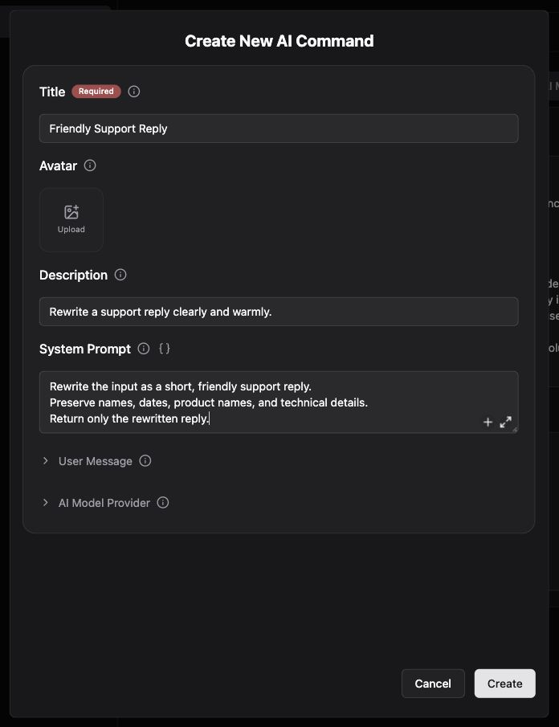

import { YouTubePlayer } from '/snippets/youtube-player.mdx';

Ein KI-Befehl bündelt einen Prompt, den du wiederholst, mit seinem Modell und seinen Einstellungen, sodass du ihn mit einem Klick auf beliebigen Text ausführen kannst. Nutze einen für eine klar umrissene Aufgabe wie das Umformulieren einer Support-Antwort. Für umfangreichere Arbeit mit Tools nutze einen [Agenten](/de/ai/agents); für eine Abfolge von Schritten einen [Workflow](/de/workflows/introduction).

<Frame caption="Beispiel für den nicht gespeicherten KI-Befehl „Freundliche Support-Antwort“.">
  
</Frame>

Das Video-Tutorial unten erstellt in 2 Minuten einen Befehl, der die Aufgaben aus Besprechungsnotizen herauszieht: beschreiben, an eigenem Text ausprobieren, mit eigenen Worten ändern, zur PopBar hinzufügen, ein Tastenkürzel vergeben und in einer anderen App ausführen.

<YouTubePlayer videoId="zRD7Yg_Grjw" title="How to Make Your Own AI Command in Enconvo | Step-by-Step Tutorial" />

## Einen Befehl erstellen

1. Öffne **Einstellungen → KI-Befehle** oder führe **KI-Befehl erstellen** in der SmartBar aus und klicke auf **Neuer KI-Befehl**.
2. Beschreibe mit eigenen Worten, was der Befehl tun soll, und klicke dann auf **Entwerfen**. Enconvo schreibt Titel, Symbol und Anweisungen und führt sie sofort an einem Beispiel aus.
3. Füge etwas von deinem eigenen Text in das Beispiel ein und klicke auf **Erneut versuchen**, um das Ergebnis an echter Eingabe zu sehen.
4. Um das Verhalten zu ändern, gib die Änderung unter **Etwas ändern?** ein, zum Beispiel „nach Zuständigem gruppieren“, und klicke auf **Neu entwerfen**. Die geänderten Zeilen sind in den Anweisungen markiert, und das Beispielergebnis läuft erneut.
5. Lasse unter **Wo du ihn nutzen kannst** **Zur PopBar hinzufügen** eingeschaltet, um jedes Mal, wenn du Text markierst, eine PopBar-Schaltfläche zu erhalten, oder klicke auf **Tastenkürzel hinzufügen** und drücke die gewünschten Tasten.
6. Klicke auf **Speichern**.

Beispielanweisung:

```text
Rewrite the input as a short, friendly support reply.
Preserve names, dates, product names, and technical details.
Return only the rewritten reply.
```

## Einen Befehl ausführen

- **Über die PopBar:** Markiere Text in einer beliebigen App und klicke auf die Schaltfläche des Befehls. Wenn das Ergebnis bereit ist, klicke auf **Einfügen**, um die Auswahl zu ersetzen.
- **Über ein Tastenkürzel:** Markiere den Text und drücke das Tastenkürzel des Befehls. Das Ergebnis öffnet sich in der SmartBar, wo du es einfügen kannst.
- **Über die SmartBar:** Suche nach dem Titel des Befehls und führe ihn auf der aktuellen Eingabe aus.
- **Über einen Agenten:** Bitte im Chat einen Agenten, einen Befehl für dich auszuführen. Der Agent macht mit deinem Chat weiter, wenn der Befehl fertig ist.

Chats aus KI-Befehlen, ob integrierte wie Übersetzen oder deine eigenen, erscheinen weder im Chatfenster noch im **Verlauf** der Dynamic Island noch in der Chatliste der SmartBar.

## Einen Befehl ändern

Öffne den Befehl in **Einstellungen → KI-Befehle**, um seinen Titel und seine Anweisungen zu bearbeiten. Änderungen werden beim Tippen gespeichert.

| Einstellung | Was sie ändert |
| --- | --- |
| **PopBar** | Legt den Befehl auf die PopBar oder nimmt ihn herunter. |
| **Tastenkürzel** | Tasten, die den Befehl auf dem Text ausführen, den du in einer beliebigen App markiert hast. |
| **Inline-Modus** | Läuft ohne Fenster und fügt das Ergebnis über deine Auswahl ein. |
| **Folgeaktion** | Was der Befehl mit der Antwort macht, wenn er fertig ist, wo angeboten. |
| **KI-Modell** | Zeigt, ob der Befehl dem Modell für alle KI-Befehle folgt oder ein eigens gewähltes nutzt. Klicke auf **Ändern**, um eines zu wählen. |

### Das Modell für alle Befehle wählen

KI-Befehle laufen mit Enconvo Fast, sofern du kein anderes Modell wählst. Um es zu ändern, öffne **Einstellungen → KI-Befehle** und klicke auf **Alle Befehle**. Das Modell unter **KI-Modell** führt auch die Schreibwerkzeuge, die PopBar sowie **Überarbeiten** und **Übersetzen** des Diktats aus. **Empfohlenes verwenden** schaltet zurück auf Enconvo Fast. Befehle, die ein eigenes Modell wählen, behalten es, wenn dieses geändert wird; klicke auf **Ansehen**, um sie zu sehen, oder auf **… für alle verwenden**, um sie auf dieses Modell umzustellen.

Ein integrierter Befehl zeigt stattdessen **Anpassen**: Es erstellt deine eigene Kopie, die du bearbeiten kannst. Deine eigenen Befehle haben ein Menü **⋯** mit **Duplizieren** und **Löschen**. Das Löschen eines Befehls entfernt ihn auch von der PopBar und gibt sein Tastenkürzel frei.

## Wechselnden Kontext nutzen

Wo ein Feld Variablen unterstützt, nutze die Variablenauswahl, um den Eingabetext, den markierten Text, die aktive App oder anderen Kontext einzubinden. Siehe [Variablen](/de/workflows/variables). Prüfe den aufgelösten Kontext, bevor du einen Befehl auf private Dokumente anwendest.

## Fehlerbehebung

| Problem | Was zu tun ist |
| --- | --- |
| Ein Befehl fehlt | Prüfe, ob er gespeichert wurde, und suche dann nach seinem Titel. |
| Die Ausgabe ignoriert den markierten Text | Prüfe die Eingabe- und Kontexteinstellungen des Befehls und die Bedienungshilfen unter [Berechtigungen](/de/configuration/permissions). |

## Verwandte Themen

<CardGroup cols={2}>
  <Card title="PopBar" icon="arrow-pointer" href="/de/features/popbar">Befehle auf markiertem Text ausführen.</Card>
  <Card title="Schreibwerkzeuge" icon="pen-nib" href="/de/features/writing-tools">Vorgefertigte Schreibbefehle.</Card>
  <Card title="Agenten" icon="robot" href="/de/ai/agents">Assistenten mit Tools für umfangreichere Arbeit.</Card>
  <Card title="Workflows" icon="diagram-project" href="/de/workflows/introduction">Mehrere Schritte verketten.</Card>
</CardGroup>
