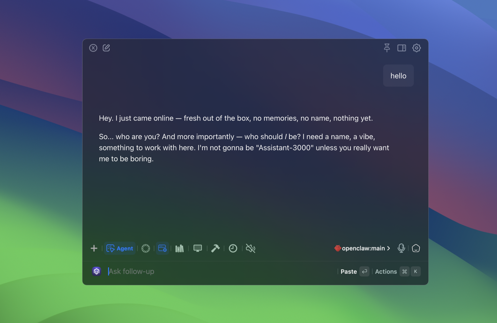
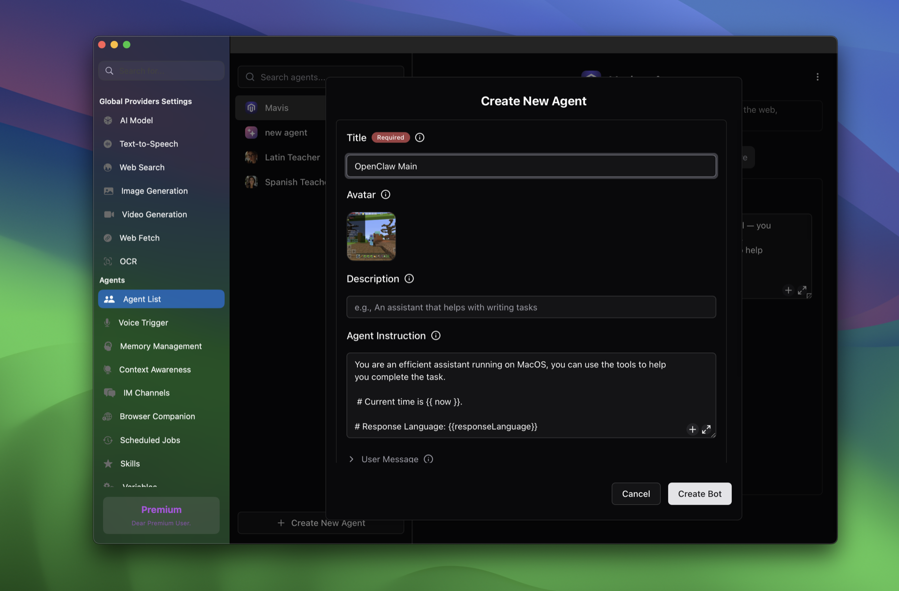

OpenClaw ist eine selbst gehostete KI-Agentenplattform, um Assistenten über Chat, Nachrichtenkanäle, Werkzeuge, Fähigkeiten und Automationen laufen zu lassen.

OpenClaw kann seine Agenten über ein OpenAI-kompatibles Gateway bereitstellen. Nachdem du das Gateway einschaltest, kann Enconvo einen OpenClaw-Agenten wie jedes andere KI-Modell nutzen, auch im Chat, in Enconvo-Agenten und in modellgestützten Funktionen.

Das Gateway von OpenClaw stellt OpenAI-kompatible Endpunkte bereit, etwa `/v1/models`, `/v1/chat/completions` und `/v1/responses`. Der OpenClaw-Anbieter von Enconvo nutzt die Chat-Completions-API (`/v1/chat/completions`).

<Note>
  Enconvo nutzt die OpenClaw-Responses-API für diesen Anbieter nicht. Konfiguriere OpenClaw über sein OpenAI-kompatibles Chat-Completions-Gateway.
</Note>

Neu bei OpenClaw? Beginne mit der [OpenClaw-Anleitung zum Einstieg](https://docs.openclaw.ai/start/getting-started) und komm dann hierher zurück, um es mit Enconvo zu verbinden.

Siehe die [OpenClaw-Gateway-Dokumentation](https://docs.openclaw.ai/gateway#openai-compatible-endpoints) für die vollständige Endpunktreferenz des Gateways.

## Bevor du startest

- OpenClaw auf dem Rechner installiert, der das Gateway ausführt
- Das OpenClaw-Gateway läuft auf einem erreichbaren Host und Port
- Der Chat-Completions-Gateway-Endpunkt ist eingeschaltet
- Das Gateway-Token aus `~/.openclaw/openclaw.json`
- Enconvo mit eingeschaltetem OpenClaw-KI-Modell-Anbieter

## Automatisch einrichten

Öffne **Einstellungen → KI-Modell → OpenClaw**. Die Einrichtungskarte kann das lokale OpenClaw-Gateway für dich starten, stoppen und konfigurieren.

Nutze **Automatische Einrichtung**, wenn OpenClaw auf demselben Mac wie Enconvo installiert ist. Enconvo wird:

<Steps>
  <Step title="OpenClaw finden">
    Prüfen, dass die CLI `openclaw` auf diesem Mac existiert.
  </Step>
  <Step title="Chat Completions einschalten">
    `openclaw config set gateway.http.endpoints.chatCompletions.enabled true` ausführen.
  </Step>
  <Step title="Das Gateway-Token vorbereiten">
    `gateway.auth.token` aus `~/.openclaw/openclaw.json` lesen oder eines anlegen, wenn es fehlt.
  </Step>
  <Step title="Das Gateway starten">
    Den OpenClaw-Gateway-Dienst starten oder neu starten.
  </Step>
  <Step title="Die API prüfen">
    Das Gateway mit `/health` und `/v1/models` abfragen.
  </Step>
  <Step title="Zugangsdaten speichern">
    Basis-URL und Gateway-Token in den OpenClaw-Zugangsdaten von Enconvo speichern.
  </Step>
</Steps>

Die Einrichtungskarte zeigt ein Laufzeitabzeichen wie **Läuft** oder **Gestoppt**. Solange die Karte sichtbar ist, aktualisiert Enconvo diesen Status regelmäßig und hört auf, wenn die Karte nicht mehr sichtbar ist.

## Das OpenClaw-Gateway einschalten

Du kannst OpenClaw bitten, die Gateway-Details für dich vorzubereiten:

```text
enable openai-compatible api and give me the token and baseurl
```

Nutze die zurückgegebene Basis-URL und das Token in den OpenClaw-Zugangsdaten von Enconvo.

<Steps>
  <Step title="Chat Completions einschalten">
    Schalte den OpenAI-kompatiblen Chat-Completions-Endpunkt einmal ein:

    ```bash
    openclaw config set gateway.http.endpoints.chatCompletions.enabled true
    ```
  </Step>
  <Step title="Den Bind-Modus wählen">
    Behalte für rein lokalen Zugriff den Standard-Loopback-Bind. Damit ein anderes Gerät in deinem LAN das Gateway erreicht, binde an das LAN:

    ```bash
    openclaw config set gateway.bind lan
    ```
  </Step>
  <Step title="Das Gateway neu starten">
    Wende die Konfigurationsänderung an:

    ```bash
    openclaw gateway restart
    ```
  </Step>
  <Step title="Den Gateway-Status prüfen">
    Bestätige, dass das Gateway läuft:

    ```bash
    openclaw gateway status
    ```
  </Step>
</Steps>

## OpenClaw von Hand verbinden

Öffne **Einstellungen → KI-Modell → OpenClaw** und konfiguriere dann den Zugangsdaten-Anbieter.


| Einstellung | Wert |
|---------|-------|
| **OpenClaw Base URL** | `http://<gateway-host>:<port>/v1` |
| **Gateway Token** | `gateway.auth.token` aus `~/.openclaw/openclaw.json` |

Enconvo nutzt die Chat-Completions-API für OpenClaw automatisch.

Nutze die Basis-URL, die auf `/v1` endet, nicht den vollen Endpunkt `/v1/chat/completions`. Ist dein Endpunkt zum Beispiel `http://192.168.1.18:18789/v1/chat/completions`, gib `http://192.168.1.18:18789/v1` ein.

Um das Gateway-Token aus der Standard-OpenClaw-Konfigurationsdatei zu lesen:

```bash
jq -r '.gateway.auth.token' ~/.openclaw/openclaw.json
```

Enconvo sendet diesen Wert als:

```http
Authorization: Bearer <gateway-token>
```

Klicke auf **Prüfen**, nachdem du Basis-URL und Token eingegeben hast.

## Wie Anfragen und Anhänge funktionieren

Enconvo sendet OpenClaw-Anfragen über OpenAI-kompatible Chat Completions:

```http
POST /v1/chat/completions
```

Nutze `openclaw:main` oder einen anderen Modellnamen, den deine OpenClaw-Agentenliste anbietet.

<Warning>
  Bildanhänge werden von Enconvo nicht an OpenClaw gesendet. Behandle den OpenClaw-Anbieter in Enconvo als Text-/Chat-Anbieter. Für Bildabläufe nutze einen Anbieter mit einem sehfähigen Modell oder führe OCR oder Bildanalyse aus, bevor du Text an OpenClaw sendest.
</Warning>

## OpenClaw als KI-Modell nutzen

Ist es konfiguriert, erscheint OpenClaw in der Modellauswahl. Wähle **OpenClaw** und das vom Agenten gestützte Modell, etwa `openclaw:main`.



Nutze diesen Modus, wenn ein Enconvo-Gespräch, ein Befehl oder eine Funktion über einen OpenClaw-Agenten laufen soll und die normale Enconvo-Oberfläche bleibt.

<Steps>
  <Step title="Die Modellauswahl öffnen">
    Klicke im Chat oder in einer anderen modellgestützten Enconvo-Funktion auf den aktuellen Modellnamen.
  </Step>
  <Step title="OpenClaw wählen">
    Wähle **OpenClaw** in der Anbieterliste.

    
  </Step>
  <Step title="Ein OpenClaw-Agentenmodell wählen">
    Wähle `openclaw:main` oder einen anderen OpenClaw-Agenten aus der Modellliste.
  </Step>
  <Step title="Die Funktion normal ausführen">
    Stelle deine Frage oder führe die Enconvo-Funktion aus. Der gewählte OpenClaw-Agent übernimmt den Modellaufruf im Hintergrund.
  </Step>
</Steps>

Enconvo lädt OpenClaw-Modelle aus `openclaw agents list`. Ist die OpenClaw-CLI lokal nicht verfügbar, fällt Enconvo auf `openclaw:main` zurück.

## Einen Agenten für OpenClaw anlegen

Du kannst auch einen Enconvo-Agenten anlegen, der einen OpenClaw-Agenten koordiniert. Das ist nützlich, wenn du einen Enconvo-Ablauf, einen Werkzeugsatz oder einen Prompt um einen bestimmten OpenClaw-Agenten willst.

<Steps>
  <Step title="Agent erstellen öffnen">
    Öffne die SmartBar und suche nach **Agent erstellen**.

    
  </Step>
  <Step title="Den Agenten benennen">
    Lege einen klaren Titel an, etwa `OpenClaw Main`.

    
  </Step>
  <Step title="Anweisungen für den Koordinator schreiben">
    Gib dem Enconvo-Agenten Anweisungen, die erklären, wie er mit OpenClaw arbeiten soll.

    ```markdown
    You coordinate the OpenClaw Main agent for the user.

    Use OpenClaw for agentic work, automation, and tasks that should run through the user's OpenClaw setup.
    Summarize what OpenClaw did, surface any blockers, and ask before destructive or irreversible actions.
    ```
  </Step>
  <Step title="Das OpenClaw-Modell wählen">
    Wähle in den Modelleinstellungen des Agenten **OpenClaw** und `openclaw:main`.
  </Step>
  <Step title="Den Agenten speichern und nutzen">
    Starte ein Gespräch mit dem neuen Enconvo-Agenten. Er nutzt das gewählte OpenClaw-Agentenmodell und behält die Enconvo-Agentenoberfläche und die Werkzeuge, die du konfiguriert hast.
  </Step>
</Steps>

## Fehlerbehebung

<AccordionGroup>
  <Accordion title="OpenClaw erscheint nicht in der Modellauswahl">
    Stelle sicher, dass der OpenClaw-Anbieter unter **Einstellungen → KI-Modell** eingeschaltet ist. Ist die Modellliste leer, prüfe, dass `openclaw agents list` lokal funktioniert, oder nutze den Standard `openclaw:main`.
  </Accordion>
  <Accordion title="Die Prüfung scheitert mit unauthorized">
    Prüfe das Gateway-Token erneut. Enconvo erwartet den Wert aus `gateway.auth.token` und sendet ihn als Bearer-Token.
  </Accordion>
  <Accordion title="Die Verbindung scheitert">
    Bestätige mit `openclaw gateway status`, dass das Gateway läuft. Ist Enconvo auf einem anderen Gerät, setze `gateway.bind` auf `lan`, starte das Gateway neu und nutze die LAN-IP des Hosts in der Basis-URL.
  </Accordion>
  <Accordion title="Der Start gelingt, aber Enconvo sagt kurz, es brauche Aufmerksamkeit">
    OpenClaw kann melden, dass der LaunchAgent neu gestartet hat, bevor das HTTP-Gateway bereit ist. Warte ein paar Sekunden und prüfe das Laufzeitabzeichen der Einrichtungskarte erneut. Du kannst auch direkt mit `openclaw gateway status` und `curl http://127.0.0.1:18789/health` prüfen.
  </Accordion>
  <Accordion title="Das Gateway läuft, aber `/v1/models` scheitert">
    Stelle sicher, dass Enconvo dasselbe Token nutzt wie `gateway.auth.token` in `~/.openclaw/openclaw.json`. Der Einrichtungsstatus kann ein laufendes Gateway über `/health` trotzdem erkennen, aber die Modellprüfung braucht das Bearer-Token.
  </Accordion>
  <Accordion title="Bildanhänge werden ignoriert">
    Der OpenClaw-Anbieter in Enconvo ist derzeit nur Text. Enconvo sendet keine Bildanhänge an OpenClaw; wähle einen sehfähigen Anbieter für direkte Bildeingabe.
  </Accordion>
  <Accordion title="Falsche Basis-URL">
    Gib `http://<gateway-host>:<port>/v1` ein. Nimm `/chat/completions` nicht ins Basis-URL-Feld von Enconvo auf.
  </Accordion>
</AccordionGroup>

## Verwandt

<CardGroup cols={2}>
  <Card title="Hermes Agent" icon="server" href="/de/providers/hermes">Verbinde ein anderes Agenten-Gateway auf dieselbe Weise.</Card>
  <Card title="Agenten" icon="robot" href="/de/ai/agents">Gib einem Agenten Anweisungen und Werkzeuge.</Card>
</CardGroup>
