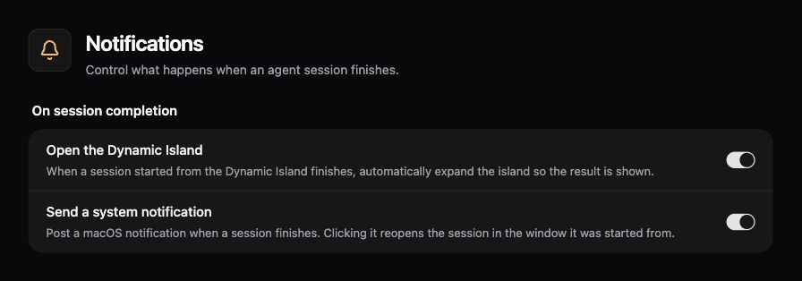

Enconvo puede avisarte de que una sesión de Agent ha terminado abriendo la Dynamic Island, mostrando una notificación de macOS, o ambas cosas. Lo configuras en **Ajustes → Notificaciones**, junto con las horas de silencio para los momentos en que no quieres que te interrumpan.

<Frame caption="Ajustes de finalización del Agent para la expansión de la Dynamic Island y las notificaciones del sistema.">
  
</Frame>

## Configura los avisos de finalización

1. Abre **Ajustes → Notificaciones**.
2. Si la página dice **Las notificaciones de Enconvo están desactivadas**, haz clic en **Activar**, o permite Enconvo en **Ajustes del Sistema → Notificaciones**.
3. En **Al finalizar la sesión**, activa o desactiva cada interruptor. Funcionan de forma independiente.
4. Inicia una solicitud corta a un Agent y espera a que termine.

| Ajuste | Qué hace |
| --- | --- |
| **Abrir la Isla Dinámica** | Cuando termina una sesión que iniciaste desde la Dynamic Island, la isla se expande para mostrar el resultado. |
| **Enviar una notificación del sistema** | Muestra una notificación de macOS con el comienzo de la respuesta cuando termina una sesión. Haz clic en la notificación para reabrir la sesión en la ventana desde la que se inició. |

El modo de concentración de macOS y los ajustes de notificaciones pueden ocultar los avisos aunque estos interruptores estén activados.

## Horas de silencio

Las horas de silencio retienen las preguntas de los Agents, las Alertas de correo y las tareas terminadas hasta que termina el periodo de silencio, en este Mac y en tu iPhone emparejado. No se aprueba nada por ti mientras esperan.

1. En **Ajustes → Notificaciones**, busca **Novedades**.
2. Activa **Horas de silencio** y luego establece **Empieza** y **Termina**.
3. Elige qué sigue llegando:

| Ajuste | Qué hace |
| --- | --- |
| **Avisar de las aprobaciones** | Las solicitudes de aprobación te siguen llegando durante las horas de silencio. |
| **Avisar de las preguntas** | Las preguntas de los Agents te siguen llegando durante las horas de silencio. |

El menú de Enconvo en la barra de menús también tiene **Horas de silencio**, y **Pausar novedades 1 hora** para un descanso corto.

Las Alertas de correo están desactivadas hasta que las actives en **Tareas programadas → Correo importante**. Las Alertas de correo que ya activaste o configuraste siguen funcionando. Su interruptor **Teléfono** envía las alertas a un iPhone o a un teléfono Android emparejado.

## Resultados programados

Una notificación del sistema es distinta de enviar el resultado de una tarea programada a Telegram u otro chat de mensajería instantánea. El envío de resultados se configura en el editor de la [tarea programada](/es/workflows/scheduled-jobs).

Una tarea programada también puede mostrar su propia notificación en el Mac cuando se ejecuta (**Avisarme cuando se ejecute**). Esa notificación también sigue a **Enviar una notificación del sistema**. El historial de ejecuciones de la tarea muestra si cada ejecución funcionó y si su resultado se entregó.

## Solución de problemas

| Problema | Qué hacer |
| --- | --- |
| No aparece ningún aviso cuando termina una sesión | Comprueba que **Enviar una notificación del sistema** está activado, que macOS permite las notificaciones de Enconvo y que el modo de concentración no las oculta. |
| La Dynamic Island no se abrió | **Abrir la Isla Dinámica** solo se aplica a las sesiones que iniciaste desde la Dynamic Island. |
| Una pregunta o una tarea terminada llegó tarde | Puede que las horas de silencio la retuvieran. Activa **Avisar de las preguntas**, o cambia **Empieza** y **Termina**. |

## Relacionado

<CardGroup cols={2}>
  <Card title="Dynamic Island" icon="bolt" href="/es/features/dynamic-island">Inicia sesiones y consulta sus resultados en la parte superior de la pantalla.</Card>
  <Card title="Tareas programadas" icon="clock" href="/es/workflows/scheduled-jobs">Ejecuta un Agent más tarde y entrega su resultado.</Card>
  <Card title="App de iPhone" icon="mobile" href="/es/integrations/iphone-app">Recibe un aviso en tu teléfono cuando termina un chat.</Card>
  <Card title="Permisos de macOS" icon="shield" href="/es/configuration/permissions">El permiso de Notificaciones y los demás que usa Enconvo.</Card>
</CardGroup>
