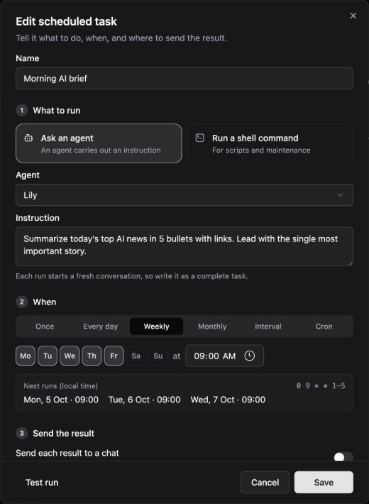

import { YouTubePlayer } from '/snippets/youtube-player.mdx';

Una tarea programada hace un trabajo por ti sin que tengas que iniciarla cada vez: le pide algo a un Agente, ejecuta uno de tus flujos de trabajo guardados o ejecuta un comando de shell. Se ejecuta según una programación (una vez, o una y otra vez), cuando ocurre algo como un correo nuevo o un archivo en una carpeta, o cuando la inicias a mano. Úsala para un resumen matutino de noticias, un plan semanal o una comprobación de precios.

Cada ejecución inicia su propia conversación, y el resultado aparece en la tarea programada. También puedes hacer que Enconvo te avise en tu Mac, envíe el resultado a un chat de mensajería instantánea, responda en GitHub o añada lo que oyó al tablero de Ideas de un Proyecto.

Cada tarea programada se lee en tres partes, y puedes cambiar cada una en el sitio o con tus propias palabras:

| Parte | Qué contiene |
| --- | --- |
| **Cuándo (qué la inicia)** | Una programación, un evento o tú a mano |
| **Pasos** | El Agente y la instrucción, el flujo de trabajo o el comando de shell que ejecuta |
| **Después (tras una ejecución)** | Adónde va el resultado y cómo te enteras |

Sus ejecuciones aparecen como barras debajo, así puedes ver de un vistazo qué se ejecutó y qué falló.

Este vídeo cubre las Tareas programadas, después los Flujos de trabajo, las Variables y cómo te enteras de los resultados con las Notificaciones y las Horas de silencio.

<YouTubePlayer videoId="XLbDK5J3fjE" title="How to Use Automations and Workflows in Enconvo | Step-by-Step Tutorial" />

<Frame caption="La vista Programadas: las tareas a la izquierda, los detalles de una tarea a la derecha.">
  
</Frame>

## Configura una tarea programada conversando

<Steps>
  <Step title="Abre Tareas programadas">
    En la barra lateral de la **Ventana de chat**, selecciona **Tareas programadas** y después **Nueva tarea programada**.
  </Step>
  <Step title="Di qué hacer y cuándo">
    Describe la tarea y su momento en el cuadro de redacción, por ejemplo "Cada día laborable a las 8:00, ponme al día con las noticias de IA más importantes en cinco viñetas con enlaces." O elige uno de los modelos de inicio, que rellena el cuadro de redacción para que lo ajustes antes de enviar.

    Si tienes flujos de trabajo guardados, algunos aparecen bajo **Ejecutar un flujo de trabajo según una programación**. Elige uno para rellenar una petición que ejecute ese flujo todos los días a las 9:00, y después cambia la hora o añade valores de entrada antes de enviar.
  </Step>
  <Step title="Revisa el borrador">
    Enconvo configura la tarea, la muestra como una tarjeta en el chat y responde con cuándo se ejecutará, en palabras sencillas y en tu hora local. Si omites la hora, elige una razonable y lo dice. Solo hace una pregunta cuando la tarea no puede funcionar sin la respuesta, como qué producto vigilar.
  </Step>
  <Step title="Actívala">
    Una tarea programada nueva empieza desactivada, marcada como **Borrador** junto al chat. Revísala y selecciona **Activar**; no se ejecuta nada hasta que lo hagas. La tarea aparece en **Configurar en este chat**, sobre la conversación, y en la lista de tareas. Sigue conversando para cambiarla, pausarla o reanudarla.
  </Step>
</Steps>

<Frame caption="Una tarea nueva empieza con una frase o con un modelo de inicio.">
  
</Frame>

Escribe la tarea como una instrucción completa. Cada ejecución inicia una conversación nueva que no ve el chat en el que la configuraste, así que "Resume las noticias de IA de hoy en cinco viñetas con enlaces" funciona mejor que "Haz eso otra vez mañana."

## Mira lo que viene y lo que se ejecutó

**Hoy**, en la parte superior de Tareas programadas, muestra lo que se ejecuta a continuación y todo lo que ya se ejecutó, con el resultado de cada ejecución. Selecciona una ejecución para leerla, o para darle otra oportunidad a una que falló.

La última ejecución de cada tarea programada también aparece bajo **Chats** en la barra lateral con una marca de reloj en cuanto empieza. Sus ejecuciones anteriores están a un clic en el chat de esa ejecución.

### Vuelve a un chat de programación

Los chats de programación se conservan, pero no aparecen bajo **Chats** en la barra lateral. Para volver a uno, como un chat en el que Enconvo espera tu respuesta, selecciona el nombre del chat sobre la conversación y elígelo bajo **Chats de programación**. Ahí también puedes eliminar un chat; las tareas configuradas en él siguen ejecutándose.

### Pide desde cualquier chat

También puedes pedirlo en cualquier chat, como "Recuérdame mañana a las 9 que envíe la factura" o "Cada lunes por la mañana, enumera las fechas límite de mi semana." El Agente configura el mismo tipo de tarea, muestra su tarjeta y confirma cuándo se ejecutará. Selecciona **Abrir** en la tarjeta para verla en **Tareas programadas**. La tarjeta de un chat más antiguo indica si la tarea se pausó, terminó o eliminó desde entonces.

## Inicia con un evento o a mano

En lugar de una hora, una tarea programada puede iniciarse cuando ocurre algo. Describe qué debe iniciarla en el chat de Tareas programadas, y Enconvo configura el disparador.

| Qué la inicia | Cuándo se ejecuta |
| --- | --- |
| Una programación | A las horas que definas |
| Tú, a mano | Cuando seleccionas **Ejecutar**, con el texto sobre el que trabajar si escribes alguno. Activa **Mostrar en PopBar** para ejecutarla sobre el texto que selecciones, o **Mostrar en el inicio de la Dynamic Island** para tener un botón en la Dynamic Island. |
| Cambios en una carpeta | Por cada archivo añadido, cambiado o eliminado en una carpeta |
| Apps | Cuando una app se abre, se cierra, pasa a primer plano o permanece en primer plano un tiempo |
| Mensajes de Discord o Telegram | Por cada mensaje que el bot conectado puede leer |
| Correo nuevo | Por cada correo nuevo en los buzones del plugin [Email](/es/integrations/email) que permiten que los agentes los lean (se comprueba cada minuto), en Apple Mail (cada dos minutos mientras Mail está abierto) o en Gmail mediante el Conector de Gmail (aproximadamente cada cinco minutos) |
| GitHub | Cuando se abre una incidencia o una pull request, se etiqueta una incidencia, un comentario te menciona, falla la CI o se publica una versión en un repositorio que conectas. Consulta [Disparadores de GitHub](#disparadores-de-github). |
| Eventos de MCP | Por cada evento que informa un servidor MCP conectado |
| Grabaciones transcritas | Por cada grabación que Enconvo termina de transcribir |
| Páginas web y feeds | Por cada elemento nuevo de un feed, o cada vez que cambia el texto de una página |
| Copias | Por cada cosa que copias, en las apps que el Historial del portapapeles no ignora |
| Eventos del Mac | Cuando el Mac se activa, se desbloquea, se conecta o se desconecta de la corriente, o cuando te alejas de él o vuelves |
| Eventos del calendario | Antes de que empiece un evento del calendario, o cuando termina |
| Reuniones | Cuando empieza una reunión en Zoom, Teams, FaceTime o una llamada de WeChat |
| Inicio de sesión | Una vez cada vez que Enconvo se inicia después de que inicias sesión |
| Solicitudes de webhook | Cada vez que una solicitud llega a la dirección propia de la tarea programada, que se muestra en su página con un botón Copiar |

Enconvo vigila los eventos de tu Mac mientras está en ejecución. La fila del disparador en la tarea indica qué ocurre con los eventos de cuando Enconvo estaba cerrado.

### Disparadores de GitHub

<Steps>
  <Step title="Conecta GitHub">
    Bajo **Cuándo**, elige GitHub y selecciona **Conectar GitHub**. Debes haber iniciado sesión en tu cuenta de Enconvo.
  </Step>
  <Step title="Elige el repositorio y el evento">
    Elige un **Repositorio** (u **Otro repositorio…** para escribir uno) y un **Evento**. Para una incidencia etiquetada, elige la **Etiqueta** o **Cualquier etiqueta**. Vigilar un repositorio requiere acceso de administrador a él.
  </Step>
  <Step title="Elige quién puede iniciarla">
    Elige **Solo yo**, **Cualquiera**, o añade los nombres de usuario de GitHub de las personas cuyos eventos deben iniciarla.
  </Step>
</Steps>

Los eventos de GitHub llegan a tu Mac a través de Enconvo Cloud y permanecen sellados para este Mac hasta que permitas aquí los disparadores externos: selecciona **Permitir en este Mac** cuando te lo pida. **Detener los disparadores externos en este Mac** los detiene de nuevo; los eventos esperan entonces en Enconvo Cloud.

Un disparador de evento también puede tener una condición con tus propias palabras. La IA comprueba cada evento contra ella antes de la ejecución; los eventos que no coinciden se omiten, y aun así puedes seleccionar **Ejecutar igualmente** en uno. Cada comprobación es una llamada de IA de pago. Selecciona **Probar con eventos recientes** para ver para qué eventos recientes se habría ejecutado, sin ejecutar nada.

## Gestiona una tarea programada

Selecciona una tarea programada en la lista para ver si está activa, en pausa o requiere atención, y después sus partes **Cuándo**, **Pasos** y **Después** y sus ejecuciones.

Cuando la última ejecución falló o no se envió su resultado, una nota bajo el nombre dice por qué y ofrece una solución:

- **Corregir con el chat** (una tarea de Agente o de flujo de trabajo) abre el chat de la tarea con una petición de corregirla que nombra el error, y **Ejecutar de nuevo** la ejecuta una vez más.
- **Enviar de nuevo** reintenta el envío del resultado, y **Cambiar dónde van los resultados** abre el selector de resultados. Elegir **Solo Enconvo** ahí también borra una nota sobre un resultado que no se envió.
- Una tarea que se inicia por sí sola se pausa tras 5 ejecuciones fallidas seguidas. Selecciona **Activar** cuando la hayas corregido.

| Control | Qué hace |
| --- | --- |
| **Ejecutar ahora** | Ejecuta la tarea una vez de inmediato. Se ejecuta de verdad, así que el Agente puede usar herramientas o puntos. Una tarea que inicias a mano tiene **Ejecutar** en su lugar. |
| **Cambiar con el chat** | En una tarea de Agente, reabre el chat en el que se configuró la tarea (o inicia uno nuevo si no hay) para que describas un cambio, como "pásala a las 7:30" o "añade el tiempo." |
| **Nombre de la tarea** | Selecciona el nombre para renombrar la tarea. Pulsa Return para guardar o Esc para cancelar. |
| **Programar** | Muestra cuándo se ejecuta la tarea y su próxima ejecución. Las programaciones se leen en palabras sencillas, como **Todos los días a las 09:00 y a las 18:00** o **Cada año el 1 de ene a las 03:00**, igual en la lista, en Ajustes y en la tarjeta del chat. Selecciónala para cambiar la hora en el sitio: elige **Una vez**, **Todos los días**, **Semanal**, **Mensual**, **Intervalo** o **Cron**, comprueba las próximas ejecuciones y selecciona **Guardar**. El interruptor de al lado pausa las ejecuciones futuras sin eliminar la tarea. |
| **Instrucción** → **Editar** | Cambia en el sitio lo que se le pide al Agente (o el comando, en una tarea de comando de shell). Pulsa **⌘↩** o selecciona **Guardar**; Esc cancela. |
| **Resultados** | Muestra adónde va el resultado de cada ejecución. Selecciónalo y elige un chat en el que hayas hablado con un Agente mediante un canal de mensajería instantánea, o **Solo Enconvo** para conservar los resultados en la conversación de cada ejecución; el cambio se guarda de inmediato. **Otro chat…** abre el editor para introducir un ID de chat. |
| **Avisarme cuando se ejecute** | Publica una notificación del Mac cuando termina una ejecución, con la primera línea del resultado. Haz clic en ella para abrir la tarea. |
| **…** → **Editar detalles** | Abre el editor de formulario con todos los campos a la vez, incluidos el Agente, la descripción y un número máximo de ejecuciones. |
| **…** → **Duplicar** | Hace una copia y la abre como borrador, para que puedas cambiarla antes de activarla. |
| **…** → **Todas las ejecuciones** | Abre el historial completo de ejecuciones con filtros. |
| **…** → **Eliminar** | Elimina la tarea programada y su historial de ejecuciones. Eliminar una que se está ejecutando también detiene su ejecución. |

Selecciona una barra de ejecución para leer el resultado o el error de esa ejecución, continuar desde ella en su conversación, copiarla o volver a enviar su resultado cuando no se envió.

### Ajustes avanzados

Abre **Ajustes avanzados** en una tarea programada para definir hasta dónde puede llegar:

| Ajuste | Qué hace |
| --- | --- |
| **Límite de ejecuciones** | Cuántas veces se ejecuta en total. A una tarea programada terminada se le pueden dar más ejecuciones aquí. |
| **Límite de tiempo** | Cuánto puede durar una ejecución, de 15 minutos a 8 horas. Cuando una ejecución alcanza su límite, la ejecución ofrece un límite mayor (**Permitir … y ejecutar de nuevo**) para darle más tiempo y volver a ejecutarla con un clic. |

### Busca una tarea programada

Busca en la lista por nombre, instrucción, comando o flujo de trabajo. La lista agrupa las tareas programadas como **Requiere atención** (la última ejecución falló o no se envió su resultado), próximas, **En pausa** y **Terminado** (una tarea programada de una sola vez que ya se ejecutó). Cuando tus tareas programadas se inician de más de una forma, unos botones sobre la lista las filtran según lo que las inicia, con **Todos** para volver a mostrarlas todas.

Para actuar sobre una tarea sin abrirla, apunta a ella en la lista y selecciona **…**, o haz clic con Control sobre ella, y después elige **Ejecutar ahora**, **Pausar** o **Reanudar**, **Editar detalles** o **Eliminar**. Pulsa ↓ en **Buscar tareas** para ir a la primera tarea, y después ↑ y ↓ para moverte entre tareas.

## Usa el editor de formulario

Selecciona **Configurar una tarea con el formulario** en la pantalla de tarea nueva, o **Editar detalles** en una tarea, para rellenar tú mismo todos los campos.

<Frame caption="El editor de tareas con una instrucción de Agente y una programación de días laborables.">
  
</Frame>

1. Pon un nombre a la tarea y elige qué hace: **Preguntar a un agente** con un Agente y una instrucción, **Ejecutar un flujo de trabajo** para ejecutar uno de tus [flujos de trabajo](/es/workflows/introduction) guardados, o **Ejecutar un comando de shell** para un script en tu Mac. Para un flujo de trabajo, rellena las entradas que deba recibir; las entradas que dejes vacías usan los valores predeterminados del flujo.
2. Bajo **Cuándo**, elige **Una vez**, **Todos los días**, **Semanal**, **Mensual**, **Intervalo** o **Cron**, y comprueba la vista previa de **Próximas ejecuciones (hora local)**. En **Cron**, la línea bajo la expresión dice qué significa a medida que escribes, como `0 9-17 * * 1-5`, que se lee **Cada hora de 09:00 a 17:00 en días laborables**.
3. Bajo **Enviar el resultado**, activa **Enviar cada resultado a un chat** para entregar los resultados a un chat de mensajería instantánea. Puede que antes tengas que hablar con el Agente en ese chat para que aparezca en el selector.
4. **Más opciones** añade una descripción y un número máximo de ejecuciones.
5. Selecciona **Guardar** (o **Crear tarea**). **Ejecución de prueba** guarda la tarea y la ejecuta de inmediato.

Las tareas de comando de shell, y el envío de resultados a un chat por su ID, se configuran solo en este editor; el chat de programación se encarga de las tareas de Agente y de flujo de trabajo. En una tarea que se inicia con un evento, el formulario no cambia el disparador: cambia lo que la inicia en el chat de Tareas programadas.

Una tarea de comando de shell te avisa solo cuando falla una ejecución (**Avisarme si falla**), ya que esas tareas suelen ejecutarse cada pocos minutos.

## Programa un flujo de trabajo

Una tarea de flujo de trabajo ejecuta un flujo guardado a las horas que elijas, igual que seleccionar **Ejecutar** en el editor de flujos de trabajo. Elige **Ejecutar un flujo de trabajo** en el editor, o pregúntaselo al chat de programación, por ejemplo "Ejecuta mi Content Pipeline cada día laborable a las 9 con el tema noticias de IA". Encuentra el flujo por su nombre, rellena las entradas que mencionas y deja el resto con sus valores predeterminados.

El resultado de cada ejecución es la salida del último paso del flujo, así que puede enviarse a un chat o mostrarse en una notificación como cualquier otro resultado. Si falla un paso, la ejecución se marca como fallida con el error de ese paso.

- Los detalles de la tarea muestran el flujo y sus entradas. Selecciona **Abrir** para ver el flujo, o **Cambiar** para elegir otro flujo o cambiar las entradas.
- Bajo una ejecución expandida, selecciona **Abrir ejecución** para ver cada paso de esa ejecución en **Flujos de trabajo**. Cuando la última ejecución falló, la nota bajo el nombre de la tarea ofrece **Abrir la ejecución fallida**.
- Una ejecución se detiene en el **Límite de tiempo** de la tarea programada (consulta [Ajustes avanzados](#ajustes-avanzados)). El tiempo que pasa esperando tu respuesta a un paso de aprobación no cuenta.
- Si se elimina el flujo, la tarea se pausa y lo indica. Selecciona **Elegir un flujo de trabajo** para darle otro, o **Eliminar** para quitar la tarea.

## Gestiona muchas tareas en Ajustes

**Ajustes → Tareas programadas** enumera todas las tareas en una tabla, incluidas las tareas de comando de shell. Filtra por **Activo**, **En pausa** o **Requiere atención**, busca y selecciona varias tareas para pausarlas, reanudarlas o eliminarlas a la vez. El historial de una tarea muestra el estado de cada ejecución:

| Estado | Qué comprobar |
| --- | --- |
| Con error | La instrucción, las herramientas del Agente, el estado de salida del shell o los detalles del error |
| Correcto / No entregado | La tarea se ejecutó, pero su canal o chat de mensajería instantánea requiere atención |
| Hecho · sin más ejecuciones | Una tarea de una sola vez ha terminado |
| En pausa | Vuelve a activarla si quieres ejecuciones futuras |

En el historial, **Abrir conversación** abre una ejecución de Agente, **Copiar resultado** copia su salida y **Enviar de nuevo** vuelve a enviar el resultado al chat configurado, como un mensaje real.

## Después de una ejecución

Además de enviar el resultado a un chat y avisarte, **Después (tras una ejecución)** tiene dos opciones más:

- **Responder en GitHub**: en una tarea programada que inicia un evento de GitHub, Enconvo te pregunta antes de publicar su respuesta como comentario en la incidencia o la pull request que inició la ejecución. Una respuesta que nadie aprueba en un día no se publica.
- **Añadir a Ideas**: cada incidencia de GitHub, mensaje de Discord o Telegram, correo o solicitud de webhook que oye la tarea programada se convierte en una idea en el tablero de Ideas de un Proyecto. El líder del Proyecto puede reproducir un error y planificar la corrección, o investigar una petición y cerrarla con un motivo o planificarla, y te pregunta antes de que cambie nada. Consulta [Proyectos](/es/ai/projects).

## Entérate de los resultados

- Un flujo de trabajo encadena pasos y Agentes en un trabajo que puedes volver a ejecutar. Elige uno en [Programa un flujo de trabajo](#programa-un-flujo-de-trabajo), o crea uno en [Flujos de trabajo](/es/workflows/introduction).
- Las [Variables](/es/workflows/variables) ponen en los prompts y las instrucciones valores que cambian cada vez, como la fecha de hoy o el texto que seleccionaste.
- **Ajustes → Notificaciones** elige cómo te enteras de que terminó una ejecución. Activa **Horas de silencio** para retener las preguntas del Agente y las tareas terminadas hasta la mañana, y **Avisar de las aprobaciones** si las solicitudes de aprobación deben seguir llegándote. Consulta [Notificaciones](/es/configuration/notifications).

## Conviene saber

- Las tareas programadas se ejecutan en tu Mac, así que Enconvo debe estar en ejecución y tu Mac activo. Un Mac en reposo o sin conexión no las ejecuta; no cuentes con él como un programador siempre activo.
- Las horas están en la zona horaria local de tu Mac. Comprueba las horas de la próxima ejecución después de viajar o de un cambio de zona horaria.
- Una tarea de una sola vez necesita una hora futura y pasa a **Terminado** después de ejecutarse.
- Cuando le pides a un agente que envíe un mensaje de Apple más tarde, configura una tarea programada de una sola vez, así puedes ver el mensaje programado en Tareas programadas o cancelarlo ahí.
- Las tareas mensuales del 29 al 31 omiten los meses que no tienen esa fecha.
- Las notificaciones del Mac también siguen **Enviar una notificación del sistema** en [Notificaciones](/es/configuration/notifications) y el modo de concentración de macOS. Una notificación se omite cuando ya estás mirando esa ejecución.
- El historial de ejecuciones conserva las últimas 100 ejecuciones de cada tarea; las más antiguas y sus conversaciones se eliminan. Copia lo importante antes de eliminar una tarea.

## Relacionado

<CardGroup cols={2}>
  <Card title="Flujos de trabajo" icon="diagram-project" href="/es/workflows/introduction">Crea los pasos que una tarea programada puede ejecutar.</Card>
  <Card title="Agentes" icon="robot" href="/es/ai/agents">Elige y configura el Agente que hace el trabajo.</Card>
  <Card title="Canales de mensajería instantánea" icon="comments" href="/es/integrations/messaging">Envía cada resultado a un chat de Telegram, Discord u otro.</Card>
  <Card title="Notificaciones" icon="bell" href="/es/configuration/notifications">Controla las notificaciones del Mac de las ejecuciones terminadas.</Card>
</CardGroup>
