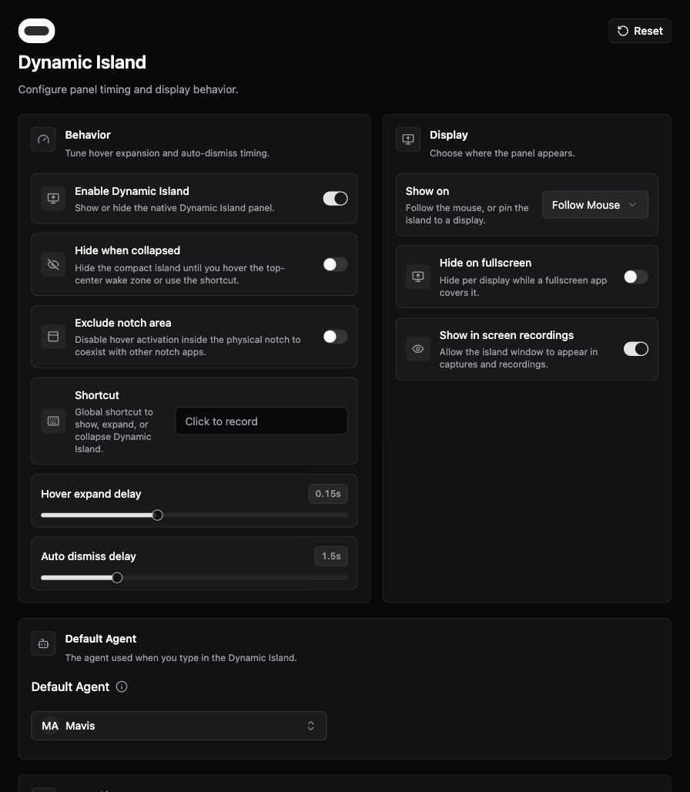

La Dynamic Island se trouve en haut au centre de l’écran. Pointez-la pour ouvrir l’Accueil, où vous pouvez taper ou dicter une demande, joindre du contexte, lancer un raccourci ou revenir à une tâche en cours. Utilisez-la pour les demandes rapides et pour suivre ce que font vos agents sans ouvrir de fenêtre.

Pour d’autres tâches, utilisez la [SmartBar](/fr/features/smartbar) pour une question ou une commande rapide depuis un raccourci, la [fenêtre de chat](/fr/ai/chat) pour les longues conversations et les fichiers, la [barre latérale d’app](/fr/features/app-sidebar) pour travailler à côté d’une app, la [PopBar](/fr/features/popbar) pour agir sur le texte sélectionné, ou le [compagnon de bureau](/fr/features/pet) pour un personnage sur le bureau. [Gestion des fenêtres](/fr/features/window-management) les compare toutes.

<Frame caption="Réglages de comportement, d’affichage et d’agent par défaut de la Dynamic Island.">
  
</Frame>

## Démarrer une demande

1. Ouvrez **Réglages → Dynamic Island** et activez **Activer Dynamic Island**.
2. Pointez le haut au centre de l’écran pour ouvrir l’Accueil. Pour l’ouvrir au clavier, définissez d’abord un **Raccourci** dans l’onglet **Ouverture et affichage**.
3. Tapez une demande, ou cliquez sur l’un des **Raccourcis de l’Accueil**.
4. Vérifiez le contexte joint avant d’envoyer. Les [Appshots](/fr/features/appshots) et le [croquis d’écran](/fr/features/screen-doodle) aident à poser une question sur d’autres apps.
5. Suivez l’avancement, et ouvrez le résultat lorsque la tâche se termine. Pour arrêter une réponse, cliquez sur **Arrêter** ou appuyez sur Esc.

Un message que vous tapez pendant qu’une tâche tourne s’affiche tout de suite. Pour passer à la fenêtre de chat, cliquez sur **Ouvrir dans la fenêtre de chat** dans la barre supérieure de l’île ; avant qu’un chat commence, cela ouvre un nouveau chat là-bas et emporte ce que vous avez tapé.

En mode agent, la puce **Autorisations** définit quand l’agent demande avant d’agir, et son interrupteur **Bac à sable** limite les commandes de l’agent au dossier de travail. Voir [Bac à sable de l’agent](/fr/configuration/sandbox).

## Calculer sur l’Accueil

Tapez une somme, une conversion ou une heure sur l’Accueil, et la réponse apparaît dans une carte sous l’île. Appuyez sur Retour pour la copier, ou sur **⌘Retour** pour demander à votre agent à la place.

La calculatrice gère les maths, les unités, les devises, les dates et les fuseaux horaires. Pour aussi chercher la météo, les vols et l’heure n’importe où, activez **Météo et vols** dans **Réglages → Dynamic Island → Accueil**. Seuls le nom du lieu ou le numéro de vol sont envoyés, à Open-Meteo, adsbdb et adsb.lol. L’interrupteur est partagé avec la [SmartBar](/fr/features/smartbar).

## Suivre vos tâches

La liste des tâches montre les chats en cours, ceux qui attendent votre approbation, ceux qui ont échoué, ou ceux dont le résultat est prêt. Lorsque deux tâches ou plus tournent, elles se replient dans une seule puce **Tâches**.

1. Cliquez sur la puce de tâche sur l’Accueil ou dans l’encoche. La liste s’ouvre à la place de la saisie.
2. Autorisez ou refusez une approbation directement dans sa ligne.
3. Cliquez sur un autre chat pour l’ouvrir dans la fenêtre où il a commencé.

Pour trouver un chat que vous n’avez pas lu, ouvrez **Historique** et filtrez par **Non lus**. **Tout marquer comme lu** les efface tous, avec **Annuler** si vous changez d’avis. La liste des chats a aussi **Archiver le chat** et **Supprimer le chat**.

## Réglages

Ouvrez **Réglages → Dynamic Island**. Ses réglages sont sur trois onglets.

### Accueil

| Réglage | Ce qu’il change |
| --- | --- |
| **Raccourcis de l’Accueil** | La grille de raccourcis à côté de la saisie sur l’Accueil. Faites glisser un raccourci pour le réordonner ou le déplacer vers une autre page, pointez-le et cliquez sur **×** pour le retirer, ou cliquez sur **Ajouter des raccourcis** pour en ajouter. |
| Pages météo et widgets | **Ajouter la page météo** ou **Ajouter une page de widgets** après vos raccourcis. |
| **Calculatrice** | Répond aux maths, unités, devises, dates et fuseaux horaires pendant que vous tapez sur l’Accueil. |
| **Météo et vols** | Cherche aussi la météo, les vols et l’heure n’importe où. Partagé avec la SmartBar. |
| **Agent par défaut** | L’agent qui répond à ce que vous tapez sur l’Accueil. L’Accueil vide lance toujours l’agent par défaut que son bouton affiche. Vous pouvez changer d’agent dans la saisie à tout moment. |

**Réinitialiser l’Accueil** rétablit la disposition par défaut de l’Accueil. Chaque onglet a son propre bouton de réinitialisation.

### Ouverture et affichage

| Réglage | Ce qu’il change |
| --- | --- |
| **Ouvrir quand vous la pointez** | Combien de temps vous pointez avant qu’elle s’ouvre : **Aussitôt**, **Courte pause** ou **Longue pause**. |
| **Replier quand vous vous éloignez** | Combien de temps elle reste ouverte après que le pointeur la quitte : **Rapidement** (une demi-seconde), **Normal** ou **Lentement**. |
| **Raccourci** | Affiche, ouvre ou replie l’île depuis n’importe quelle app. |
| **Masquer jusqu’à ce que vous la pointiez** | Garde l’île repliée hors de vue jusqu’à ce que vous pointiez le haut au centre de l’écran ou appuyiez sur le raccourci. |
| **Laisser l’encoche aux autres apps** | Pointer l’encoche elle-même n’ouvre pas l’île, pour que d’autres apps d’encoche puissent l’utiliser. |
| **Rebond** | À quel point l’île rebondit en s’ouvrant et en se repliant. |
| **Afficher sur** | **Tous les écrans**, **Suivre la souris**, ou un écran que vous choisissez. |
| **Masquer en plein écran** | Masque la pastille au repos de l’île sur un écran tant qu’une app y est en plein écran, pour ne pas couvrir le haut de l’app. Activé par défaut. Seule une fenêtre que l’app signale comme plein écran compte ; une fenêtre agrandie ne compte pas. Pointer l’île ou lui parler la fait quand même apparaître. |
| **Afficher dans les captures et enregistrements** | Désactivez-le pour garder l’île hors de ce que vous capturez ou partagez. |

### Personnage

| Réglage | Ce qu’il change |
| --- | --- |
| **Afficher un personnage sur l’île** | Votre compagnon de bureau ou l’Avatar de l’agent par défaut apparaît dans l’île repliée et mime ce que font vos agents. |
| **Personnage** | **Avatar** ou **Animal de compagnie**. |
| **Motion** | **Toujours**, **Pendant le travail** ou **Jamais**. |
| **L’utiliser comme icône de l’agent** | Affiche le personnage comme icône de l’agent par défaut dans la fenêtre de chat. |

## Voix et tâches terminées

La saisie vocale transforme ce que vous dites en invite. Pour une conversation parlée, utilisez la [Conversation en direct](/fr/features/live-voice) ; un appel de Conversation en direct que vous démarrez depuis la SmartBar passe à la Dynamic Island.

Pour que l’île s’ouvre d’elle-même lorsqu’une tâche que vous y avez démarrée se termine, activez **Ouvrir la Dynamic Island** dans [Notifications](/fr/configuration/notifications). Ce réglage est distinct des notifications macOS.

## Dépannage

| Problème | Que faire |
| --- | --- |
| Elle apparaît sur un autre écran | Vérifiez **Afficher sur**. |
| Elle disparaît lorsqu’une app est en plein écran | C’est le comportement par défaut. Pointez le haut de l’écran pour l’ouvrir, ou désactivez **Masquer en plein écran**. |
| Elle ne s’ouvre pas tant que la barre de menus se masque | Cliquez en haut au centre de l’écran. |
| Un calcul ou une recherche n’affiche rien sur l’Accueil | Vérifiez **Calculatrice** et **Météo et vols** dans l’onglet **Accueil**. |
| Elle manque d’une capture ou d’un enregistrement | Activez **Afficher dans les captures et enregistrements** avant de changer des autorisations. |
| Elle ne s’ouvre pas lorsque vous la pointez | Appuyez sur son raccourci. Si le raccourci l’ouvre, vérifiez **Ouvrir quand vous la pointez** et **Laisser l’encoche aux autres apps**. Si rien ne l’ouvre, vérifiez **Activer Dynamic Island**. |

## Voir aussi

<CardGroup cols={2}>
  <Card title="SmartBar" icon="bolt" href="/fr/features/smartbar">Posez une question rapide depuis n’importe quelle app avec un raccourci.</Card>
  <Card title="Conversation en direct" icon="microphone" href="/fr/features/live-voice">Parlez à un agent à voix haute.</Card>
  <Card title="Notifications" icon="bell" href="/fr/configuration/notifications">Choisissez ce qui se passe lorsqu’une tâche se termine.</Card>
  <Card title="Compagnon de bureau" icon="paw" href="/fr/features/pet">Un personnage qui montre l’activité des agents sur le bureau.</Card>
</CardGroup>
