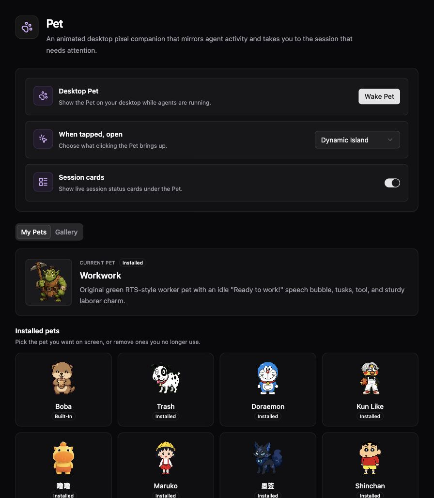

La Mascotte de bureau est un petit personnage animé sur votre bureau. Elle reflète ce que font vos Agents, peut afficher des cartes de session en direct et vous conduit à la session qui demande de l’attention. Cliquez dessus pour poser une question ou ouvrir Enconvo. Elle est distincte d’un [Avatar](/fr/features/avatar), qui donne à un Agent un personnage et une voix pour les conversations.

Pour d’autres usages, [SmartBar](/fr/features/smartbar) convient à une question ou une commande rapide, la [Fenêtre de chat](/fr/ai/chat) aux longues conversations et aux fichiers, la [Barre latérale de l’app](/fr/features/app-sidebar) permet de travailler à côté d’une app, [PopBar](/fr/features/popbar) agit sur le texte sélectionné, et la [Dynamic Island](/fr/features/dynamic-island) offre une saisie compacte en haut de l’écran. [Gestion des fenêtres](/fr/features/window-management) les compare tous.

<Frame caption="Commandes de la Mascotte de bureau pour la destination du toucher et les cartes de session.">
  
</Frame>

## Choisir un animal

1. Ouvrez **Réglages → Animal de compagnie**.
2. Choisissez un personnage dans **Mes animaux**, ou trouvez-en un dans **Galerie**.
3. Cliquez sur **Réveiller l’animal** pour l’afficher sur votre bureau.
4. Réglez **Ouvrir au toucher** sur ce que le clic sur l’animal doit afficher.
5. Activez ou désactivez **Afficher les cartes de session**, et ajustez **Taille de l’animal**.
6. Revenez au bureau et cliquez sur l’animal. Ce que vous avez choisi à l’étape 4 s’ouvre.

## Réglages

| Réglage | Ce qu’il modifie |
| --- | --- |
| **Réveiller l’animal** / **Ranger l’animal** | Affiche ou masque l’animal sur votre bureau. |
| **Ouvrir au toucher** | Ce que le clic sur l’animal affiche : **Zone de question** (par défaut), **Dynamic Island**, **Fenêtre de chat** ou **SmartBar**. |
| **Répondre avec** | L’Agent qui répond à ce que vous demandez à l’animal. Vous pouvez aussi le changer dans la Zone de question. |
| **Cartes de session** | Des cartes d’état de session en direct sous l’animal. |
| **Taille de l’animal** | La taille de l’animal. |

## Animaux personnalisés

**Animaux de compagnie personnalisés**, dans l’onglet **Mes animaux**, indique le dossier qui contient vos paquets d’animaux. Cliquez sur **Ouvrir le dossier**, ajoutez un paquet d’animal au format pris en charge, puis sélectionnez l’animal dans **Mes animaux**. Une simple image de personnage n’est pas un paquet d’animal animé.

Pour supprimer un animal, cliquez sur **Supprimer** sur sa carte. Cela supprime le paquet de votre bibliothèque ; vous pouvez le réinstaller depuis la Galerie.

## Dépannage

| Problème | Que faire |
| --- | --- |
| L’animal n’est pas sur le bureau | Cliquez sur **Réveiller l’animal**, vérifiez qu’un animal est sélectionné dans **Mes animaux**, et vérifiez **Taille de l’animal**. |
| Cliquer sur l’animal ouvre la mauvaise fenêtre | Modifiez **Ouvrir au toucher**. |
| Vous voulez des conversations vocales ou un personnage pour un seul Agent | Utilisez plutôt un [Avatar](/fr/features/avatar). |

## À lire aussi

<CardGroup cols={2}>
  <Card title="Avatar" icon="user" href="/fr/features/avatar">Donnez à un Agent un personnage et une voix.</Card>
  <Card title="Dynamic Island" icon="window-maximize" href="/fr/features/dynamic-island">Affichez votre animal sur l’île en haut de l’écran.</Card>
  <Card title="Gestion des fenêtres" icon="table-columns" href="/fr/features/window-management">Comparez toutes les façons d’ouvrir Enconvo.</Card>
  <Card title="Fenêtre de chat" icon="comments" href="/fr/ai/chat">Poursuivez une session dans une fenêtre complète.</Card>
</CardGroup>
