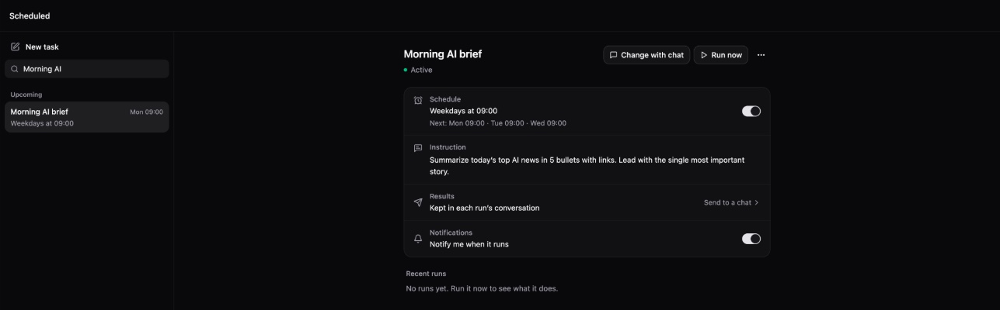

import { YouTubePlayer } from '/snippets/youtube-player.mdx';

Une tâche planifiée fait un travail pour vous sans que vous ayez à la lancer à chaque fois : elle demande quelque chose à un Agent, exécute l'un de vos flux de travail enregistrés ou lance une commande shell. Elle s'exécute selon un planning (une fois, ou de façon répétée), quand quelque chose se produit comme un nouvel e-mail ou un fichier dans un dossier, ou quand vous la lancez à la main. Utilisez-en une pour un récapitulatif d'actualités du matin, un plan hebdomadaire ou une vérification de prix.

Chaque exécution démarre sa propre conversation, et le résultat apparaît dans la tâche planifiée. Vous pouvez aussi demander à Enconvo de vous notifier sur votre Mac, d'envoyer le résultat dans un chat de messagerie instantanée, de répondre sur GitHub ou d'ajouter ce qu'elle a entendu au tableau d'idées d'un Projet.

Chaque tâche planifiée se lit en trois parties, et vous pouvez modifier chacune sur place ou avec vos propres mots :

| Partie | Ce qu'elle contient |
| --- | --- |
| **Quand (ce qui la déclenche)** | Un planning, un événement, ou vous à la main |
| **Étapes** | L'Agent et l'instruction, le flux de travail ou la commande shell qu'elle exécute |
| **Ensuite (après une exécution)** | Où va le résultat et comment vous en êtes informé |

Ses exécutions s'affichent sous forme de barres en dessous, pour voir d'un coup d'œil ce qui s'est exécuté et ce qui a échoué.

Cette vidéo présente les tâches planifiées, puis les flux de travail, les variables, et la façon dont vous êtes informé des résultats avec les notifications et les heures calmes.

<YouTubePlayer videoId="XLbDK5J3fjE" title="How to Use Automations and Workflows in Enconvo | Step-by-Step Tutorial" />

<Frame caption="La vue Planifié : les tâches à gauche, les détails d'une tâche à droite.">
  
</Frame>

## Configurer une tâche planifiée en discutant

<Steps>
  <Step title="Ouvrir Tâches planifiées">
    Dans la barre latérale de la **Fenêtre de chat**, sélectionnez **Tâches planifiées**, puis **Nouvelle tâche planifiée**.
  </Step>
  <Step title="Dire quoi faire et quand">
    Décrivez la tâche et son moment dans la zone de saisie, par exemple « Chaque jour de semaine à 8 h 00, fais-moi un récapitulatif des actualités IA les plus importantes en cinq puces avec des liens. » Ou choisissez l'un des modèles de départ, qui remplit la zone de saisie pour que vous l'ajustiez avant d'envoyer.

    Si vous avez des flux de travail enregistrés, quelques-uns apparaissent sous **Exécuter un workflow selon un planning**. Choisissez-en un pour remplir une demande qui exécute ce flux de travail tous les jours à 9 h 00, puis changez l'heure ou ajoutez des valeurs d'entrée avant d'envoyer.
  </Step>
  <Step title="Vérifier le brouillon">
    Enconvo prépare la tâche, l'affiche sous forme de carte dans le chat, et répond en indiquant quand elle s'exécutera, en langage courant et à votre heure locale. Si vous omettez l'heure, il en choisit une raisonnable et le dit. Il ne pose une question que si la tâche ne peut pas fonctionner sans la réponse, par exemple quel produit surveiller.
  </Step>
  <Step title="L'activer">
    Une nouvelle tâche planifiée démarre désactivée, marquée **Brouillon** à côté du chat. Vérifiez-la et sélectionnez **Activer** ; rien ne s'exécute tant que vous ne l'avez pas fait. La tâche apparaît sous **Configurer dans cette discussion** au-dessus de la conversation et dans la liste des tâches. Continuez à discuter pour la modifier, la mettre en pause ou la reprendre.
  </Step>
</Steps>

<Frame caption="Une nouvelle tâche part d'une phrase ou d'un modèle de départ.">
  
</Frame>

Rédigez la tâche comme une instruction complète. Chaque exécution démarre une nouvelle conversation qui ne voit pas le chat dans lequel vous l'avez configurée : « Résume les cinq principales actualités IA du jour en cinq puces avec des liens » fonctionne donc mieux que « Refais ça demain ».

## Voir ce qui arrive et ce qui s’est exécuté

**Aujourd’hui**, en haut de Tâches planifiées, montre ce qui s'exécute ensuite et tout ce qui s'est déjà exécuté, avec le résultat de chaque exécution. Sélectionnez une exécution pour la lire, ou pour redonner une chance à une exécution qui a échoué.

La dernière exécution de chaque tâche planifiée s'affiche aussi sous **Chats** dans la barre latérale, avec une marque d'horloge dès qu'elle démarre. Ses exécutions précédentes sont à un clic dans le chat de cette exécution.

### Revenir à une discussion de planification

Les discussions de planification sont conservées, mais elles n'apparaissent pas sous **Chats** dans la barre latérale. Pour revenir à l'une d'elles, par exemple un chat où Enconvo attend votre réponse, sélectionnez le nom du chat au-dessus de la conversation et choisissez-le sous **Discussions de planification**. Vous pouvez aussi y supprimer un chat ; les tâches configurées dedans continuent de s'exécuter.

### Demander depuis n’importe quel chat

Vous pouvez aussi demander dans n'importe quel chat, par exemple « Rappelle-moi demain à 9 h d'envoyer la facture » ou « Chaque lundi matin, liste les échéances de ma semaine ». L'Agent configure le même type de tâche, affiche sa carte et confirme quand elle s'exécutera. Sélectionnez **Ouvrir** sur la carte pour la voir dans **Tâches planifiées**. Une carte dans un ancien chat indique si la tâche a été mise en pause, terminée ou supprimée depuis.

## Démarrer sur un événement ou à la main

À la place d'une heure, une tâche planifiée peut démarrer quand quelque chose se produit. Décrivez ce qui doit la déclencher dans le chat de Tâches planifiées, et Enconvo configure le déclencheur.

| Ce qui la déclenche | Quand elle s'exécute |
| --- | --- |
| Un planning | Aux heures que vous définissez |
| Vous, à la main | Quand vous sélectionnez **Exécuter**, avec du texte à traiter si vous en saisissez. Activez **Afficher dans PopBar** pour l'exécuter sur le texte que vous sélectionnez, ou **Afficher sur l'accueil de la Dynamic Island** pour un bouton sur la Dynamic Island. |
| Modifications d'un dossier | Pour chaque fichier ajouté, modifié ou supprimé dans un dossier |
| Apps | Quand une app s'ouvre, se ferme, passe au premier plan ou y reste un moment |
| Messages Discord ou Telegram | Pour chaque message que le bot connecté peut lire |
| Nouvel e-mail | Pour chaque nouvel e-mail dans les boîtes mail du plugin [E-mail](/fr/integrations/email) qui permettent aux agents de les lire (vérifié chaque minute), dans Apple Mail (toutes les deux minutes tant que Mail est ouvert), ou dans Gmail via le Connecteur Gmail (environ toutes les cinq minutes) |
| GitHub | Quand une issue ou une pull request est ouverte, qu'une issue reçoit une étiquette, qu'un commentaire vous mentionne, que la CI échoue ou qu'une version est publiée dans un dépôt que vous connectez. Voir [Déclencheurs GitHub](#déclencheurs-github). |
| Événements MCP | Pour chaque événement que signale un serveur MCP connecté |
| Enregistrements transcrits | Pour chaque enregistrement qu'Enconvo termine de transcrire |
| Pages web et flux | Pour chaque nouvel élément d'un flux, ou chaque fois que le texte d'une page change |
| Copies | Pour chaque chose que vous copiez, dans les apps que l'Historique du presse-papiers n'ignore pas |
| Événements du Mac | Quand le Mac se réveille, est déverrouillé, est branché ou débranché, ou quand vous vous en éloignez ou y revenez |
| Événements du calendrier | Avant le début d'un événement du calendrier, ou à sa fin |
| Réunions | Quand une réunion démarre dans Zoom, Teams, FaceTime ou un appel WeChat |
| Ouverture de session | Une fois à chaque démarrage d'Enconvo après votre ouverture de session |
| Requêtes webhook | Chaque fois qu'une requête atteint l'adresse propre à la tâche planifiée, affichée sur sa page avec un bouton Copier |

Enconvo surveille les événements sur votre Mac pendant qu'il est en cours d'exécution. La ligne du déclencheur sur la tâche indique ce qu'il advient des événements survenus pendant qu'Enconvo était fermé.

### Déclencheurs GitHub

<Steps>
  <Step title="Connecter GitHub">
    Sous **Quand**, choisissez GitHub et sélectionnez **Connecter GitHub**. Vous devez être connecté à votre compte Enconvo.
  </Step>
  <Step title="Choisir le dépôt et l'événement">
    Choisissez un **Dépôt** (ou **Autre dépôt…** pour en saisir un) et un **Événement**. Pour une issue étiquetée, choisissez le **Libellé** ou **N’importe quelle étiquette**. Surveiller un dépôt nécessite un accès administrateur à celui-ci.
  </Step>
  <Step title="Choisir qui peut la déclencher">
    Choisissez **Moi seulement**, **N’importe qui**, ou ajoutez les noms d'utilisateur GitHub des personnes dont les événements doivent la déclencher.
  </Step>
</Steps>

Les événements GitHub parviennent à votre Mac via Enconvo Cloud et restent scellés pour ce Mac tant que vous n'autorisez pas ici les déclencheurs externes : sélectionnez **Autoriser sur ce Mac** quand il le demande. **Arrêter les déclencheurs externes sur ce Mac** les arrête de nouveau ; les événements attendent alors sur Enconvo Cloud.

Un déclencheur d'événement peut aussi avoir une condition formulée avec vos propres mots. L'IA vérifie chaque événement par rapport à elle avant l'exécution ; les événements qui ne correspondent pas sont ignorés, et vous pouvez toujours sélectionner **Exécuter quand même** sur l'un d'eux. Chaque vérification est un appel IA payant. Sélectionnez **Essayer sur les événements récents** pour voir pour quels événements récents elle se serait exécutée, sans rien exécuter.

## Gérer une tâche planifiée

Sélectionnez une tâche planifiée dans la liste pour voir si elle est active, en pause ou si elle demande votre attention, puis ses parties **Quand**, **Étapes** et **Ensuite** et ses exécutions.

Quand la dernière exécution a échoué ou que son résultat n'a pas été envoyé, une note sous le nom en explique la raison et propose une solution :

- **Corriger dans le chat** (tâche d'Agent ou de flux de travail) ouvre le chat de la tâche avec une demande de correction qui nomme l'erreur, et **Exécuter à nouveau** l'exécute une fois de plus.
- **Renvoyer** réessaie d'envoyer le résultat, et **Modifier la destination des résultats** ouvre le sélecteur de résultats. Choisir **Enconvo uniquement** y efface aussi une note concernant un résultat qui n'a pas été envoyé.
- Une tâche qui démarre toute seule se met en pause après 5 exécutions échouées d'affilée. Sélectionnez **Activer** une fois le problème corrigé.

| Commande | Ce qu'elle fait |
| --- | --- |
| **Exécuter maintenant** | Exécute la tâche une fois immédiatement. Elle s'exécute vraiment : l'Agent peut donc utiliser des outils ou des points. Une tâche que vous lancez à la main a **Exécuter** à la place. |
| **Modifier via le chat** | Pour une tâche d'Agent, rouvre le chat dans lequel la tâche a été configurée (ou en démarre un nouveau s'il n'y en a pas) pour que vous décriviez une modification, comme « décale à 7 h 30 » ou « ajoute la météo ». |
| **Nom de la tâche** | Sélectionnez le nom pour renommer la tâche. Appuyez sur Entrée pour enregistrer ou sur Échap pour annuler. |
| **Planifier** | Indique quand la tâche s'exécute et sa prochaine exécution. Les plannings se lisent en langage courant, comme **Tous les jours à 09:00 et 18:00** ou **Chaque année le 1er janv. à 03:00**, de la même façon dans la liste, les Réglages et la carte du chat. Sélectionnez-le pour changer l'heure sur place : choisissez **Une fois**, **Tous les jours**, **Hebdomadaire**, **Mensuel**, **Intervalle** ou **Cron**, vérifiez les prochaines exécutions et sélectionnez **Enregistrer**. L'interrupteur à côté met en pause les exécutions futures sans supprimer la tâche. |
| **Instruction** → **Modifier** | Modifie sur place ce qu'on demande à l'Agent (ou la commande, pour une tâche de commande shell). Appuyez sur **⌘↩** ou sélectionnez **Enregistrer** ; Échap annule. |
| **Résultats** | Indique où va le résultat de chaque exécution. Sélectionnez-le et choisissez un chat dans lequel vous avez parlé à un Agent via un canal de messagerie instantanée, ou **Enconvo uniquement** pour garder les résultats dans la conversation de chaque exécution ; la modification est enregistrée aussitôt. **Autre conversation…** ouvre l'éditeur pour saisir un identifiant de chat. |
| **M’avertir lors de l’exécution** | Affiche une notification du Mac à la fin d'une exécution, avec la première ligne du résultat. Cliquez dessus pour ouvrir la tâche. |
| **…** → **Modifier les détails** | Ouvre l'éditeur à formulaire pour tous les champs à la fois, y compris l'Agent, la description et un nombre maximal d'exécutions. |
| **…** → **Dupliquer** | Crée une copie et l'ouvre comme brouillon, pour que vous puissiez la modifier avant de l'activer. |
| **…** → **Toutes les exécutions** | Ouvre l'historique complet des exécutions avec des filtres. |
| **…** → **Supprimer** | Supprime la tâche planifiée et son historique d'exécutions. Supprimer une tâche en cours d'exécution arrête aussi son exécution. |

Sélectionnez une barre d'exécution pour lire le résultat ou l'erreur de cette exécution, la poursuivre dans sa conversation, la copier, ou renvoyer son résultat quand il n'a pas été envoyé.

### Réglages avancés

Ouvrez **Réglages avancés** sur une tâche planifiée pour définir jusqu'où elle peut aller :

| Réglage | Ce qu'il fait |
| --- | --- |
| **Limite d’exécutions** | Combien de fois elle s'exécute au total. Une tâche planifiée terminée peut recevoir ici de nouvelles exécutions. |
| **Limite de temps** | Combien de temps peut durer une exécution, de 15 minutes à 8 heures. Quand une exécution atteint sa limite, elle propose une limite plus longue (**Autoriser … et exécuter à nouveau**) pour lui donner plus de temps et la relancer en un clic. |

### Trouver une tâche planifiée

Recherchez dans la liste par nom, instruction, commande ou flux de travail. La liste regroupe les tâches planifiées en **Action requise** (la dernière exécution a échoué ou son résultat n'a pas été envoyé), à venir, **En pause** et **Terminé** (une tâche planifiée unique qui s'est exécutée). Quand vos tâches planifiées démarrent de plusieurs façons, des boutons au-dessus de la liste les filtrent selon ce qui les déclenche, avec **Tous** pour toutes les afficher de nouveau.

Pour agir sur une tâche sans l'ouvrir, pointez-la dans la liste et sélectionnez **…**, ou faites un Contrôle-clic dessus, puis choisissez **Exécuter maintenant**, **Mettre en pause** ou **Reprendre**, **Modifier les détails** ou **Supprimer**. Appuyez sur ↓ dans **Rechercher des tâches** pour aller à la première tâche, puis sur ↑ et ↓ pour passer d'une tâche à l'autre.

## Utiliser l’éditeur à formulaire

Sélectionnez **Configurer plutôt une tâche avec le formulaire** sur l'écran de nouvelle tâche, ou **Modifier les détails** sur une tâche, pour renseigner vous-même tous les champs.

<Frame caption="L'éditeur de tâche avec une instruction d'Agent et un planning en semaine.">
  
</Frame>

1. Nommez la tâche et choisissez ce qu'elle fait : **Demander à un agent** avec un Agent et une instruction, **Exécuter un workflow** pour lancer l'un de vos [flux de travail](/fr/workflows/introduction) enregistrés, ou **Exécuter une commande shell** pour un script sur votre Mac. Pour un flux de travail, renseignez les entrées qu'il doit recevoir ; les entrées laissées vides utilisent les valeurs par défaut du flux de travail.
2. Sous **Quand**, choisissez **Une fois**, **Tous les jours**, **Hebdomadaire**, **Mensuel**, **Intervalle** ou **Cron**, et vérifiez l'aperçu **Prochaines exécutions (heure locale)**. Dans **Cron**, la ligne sous l'expression indique ce qu'elle signifie au fur et à mesure que vous tapez, par exemple `0 9-17 * * 1-5` se lisant **Toutes les heures de 09:00 à 17:00 en semaine**.
3. Sous **Envoyer le résultat**, activez **Envoyer chaque résultat vers un chat** pour remettre les résultats dans un chat de messagerie instantanée. Vous devrez peut-être d'abord parler à l'Agent dans ce chat pour qu'il apparaisse dans le sélecteur.
4. **Plus d’options** ajoute une description et un nombre maximal d'exécutions.
5. Sélectionnez **Enregistrer** (ou **Créer la tâche**). **Exécution de test** enregistre la tâche et l'exécute immédiatement.

Les tâches de commande shell, et l'envoi des résultats vers un chat par son identifiant, ne se configurent que dans cet éditeur ; le chat de planification gère les tâches d'Agent et de flux de travail. Pour une tâche qui démarre sur un événement, le formulaire ne modifie pas le déclencheur : changez ce qui la déclenche dans le chat de Tâches planifiées.

Une tâche de commande shell ne vous avertit que lorsqu'une exécution échoue (**M’avertir en cas d’échec**), car de telles tâches s'exécutent souvent toutes les quelques minutes.

## Planifier un flux de travail

Une tâche de flux de travail exécute un flux de travail enregistré aux heures de votre choix, comme lorsque vous sélectionnez **Exécuter** dans l'éditeur de flux de travail. Choisissez **Exécuter un workflow** dans l'éditeur, ou demandez au chat de planification, par exemple « Exécute mon Content Pipeline chaque jour de semaine à 9 h avec le sujet actualités IA ». Il trouve le flux de travail par son nom, renseigne les entrées que vous mentionnez et laisse les autres à leurs valeurs par défaut.

Le résultat de chaque exécution est la sortie de la dernière étape du flux de travail : il peut donc être envoyé dans un chat ou affiché dans une notification comme n'importe quel autre résultat. Si une étape échoue, l'exécution est marquée comme échouée avec l'erreur de cette étape.

- Les détails de la tâche montrent le flux de travail et ses entrées. Sélectionnez **Ouvrir** pour voir le flux de travail, ou **Modifier** pour en choisir un autre ou changer les entrées.
- Sous une exécution développée, sélectionnez **Ouvrir l’exécution** pour voir chaque étape de cette exécution dans **Flux de travail**. Quand la dernière exécution a échoué, la note sous le nom de la tâche propose **Ouvrir l’exécution échouée**.
- Une exécution s'arrête à la **Limite de temps** de la tâche planifiée (voir [Réglages avancés](#réglages-avancés)). Le temps passé à attendre votre réponse à une étape d'approbation n'est pas compté.
- Si le flux de travail est supprimé, la tâche se met en pause et le signale. Sélectionnez **Choisir un workflow** pour lui en donner un autre, ou **Supprimer** pour retirer la tâche.

## Gérer de nombreuses tâches dans les Réglages

**Réglages → Tâches planifiées** liste chaque tâche dans un tableau, y compris les tâches de commande shell. Filtrez par **Actif**, **En pause** ou **Action requise**, recherchez, et sélectionnez plusieurs tâches pour les mettre en pause, les reprendre ou les supprimer ensemble. L'historique d'une tâche affiche l'état de chaque exécution :

| État | Que vérifier |
| --- | --- |
| Échec | L'instruction, les outils de l'Agent, le code de sortie du shell ou les détails de l'erreur |
| Réussi / Non remis | La tâche s'est exécutée, mais son canal de messagerie instantanée ou son chat demande votre attention |
| Terminé · plus d'exécutions | Une tâche unique est terminée |
| En pause | Réactivez-la si vous voulez des exécutions futures |

Dans l'historique, **Ouvrir la conversation** ouvre une exécution d'Agent, **Copier le résultat** copie sa sortie, et **Renvoyer** envoie de nouveau le résultat au chat configuré, comme un vrai message.

## Après une exécution

En plus d'envoyer le résultat dans un chat et de vous notifier, **Ensuite (après une exécution)** propose deux autres options :

- **Répondre sur GitHub** : pour une tâche planifiée déclenchée par un événement GitHub, Enconvo vous demande votre accord avant de publier sa réponse en commentaire sur l'issue ou la pull request qui a déclenché l'exécution. Une réponse que personne n'approuve en un jour n'est pas publiée.
- **Ajouter à Ideas** : chaque issue GitHub, message Discord ou Telegram, e-mail ou requête webhook que la tâche planifiée reçoit devient une idée sur le tableau d'idées d'un Projet. Le responsable du Projet peut reproduire un bug et planifier la correction, ou étudier une demande et la clore avec un motif ou la planifier, et vous demande votre accord avant tout changement. Voir [Projets](/fr/ai/projects).

## Être informé des résultats

- Un flux de travail enchaîne des étapes et des Agents en une tâche que vous pouvez relancer. Choisissez-en un dans [Planifier un flux de travail](#planifier-un-flux-de-travail), ou créez-en un dans [Flux de travail](/fr/workflows/introduction).
- Les [Variables](/fr/workflows/variables) insèrent dans les prompts et les instructions des valeurs qui changent à chaque fois, comme la date du jour ou votre texte sélectionné.
- **Réglages → Notifications** choisit comment vous apprenez qu'une exécution est terminée. Activez **Heures calmes** pour retenir les questions des Agents et les tâches terminées jusqu'au matin, et **Toujours signaler les approbations** si les demandes d'approbation doivent quand même vous parvenir. Voir [Notifications](/fr/configuration/notifications).

## Bon à savoir

- Les tâches planifiées s'exécutent sur votre Mac : Enconvo doit donc être en cours d'exécution et votre Mac éveillé. Un Mac en veille ou hors ligne ne les exécute pas ; ne comptez pas dessus comme planificateur toujours actif.
- Les heures sont dans le fuseau horaire local de votre Mac. Vérifiez les heures de prochaine exécution après un voyage ou un changement de fuseau horaire.
- Une tâche unique nécessite une heure future et passe dans **Terminé** après son exécution.
- Quand vous demandez à un agent d'envoyer un message Apple plus tard, il configure une tâche planifiée unique : vous pouvez donc voir le message planifié dans Tâches planifiées ou l'y annuler.
- Les tâches mensuelles les 29, 30 et 31 sautent les mois qui n'ont pas cette date.
- Les notifications du Mac suivent aussi **Envoyer une notification système** dans [Notifications](/fr/configuration/notifications) et le mode Concentration de macOS. Une notification est ignorée quand vous regardez déjà cette exécution.
- L'historique conserve les 100 dernières exécutions de chaque tâche ; les exécutions plus anciennes et leurs conversations sont supprimées. Copiez tout ce qui est important avant de supprimer une tâche.

## Voir aussi

<CardGroup cols={2}>
  <Card title="Flux de travail" icon="diagram-project" href="/fr/workflows/introduction">Créez les étapes qu'une tâche planifiée peut exécuter.</Card>
  <Card title="Agents" icon="robot" href="/fr/ai/agents">Choisissez et configurez l'Agent qui fait le travail.</Card>
  <Card title="Canaux de messagerie instantanée" icon="comments" href="/fr/integrations/messaging">Envoyez chaque résultat vers un chat Telegram, Discord ou autre.</Card>
  <Card title="Notifications" icon="bell" href="/fr/configuration/notifications">Contrôlez les notifications du Mac pour les exécutions terminées.</Card>
</CardGroup>
