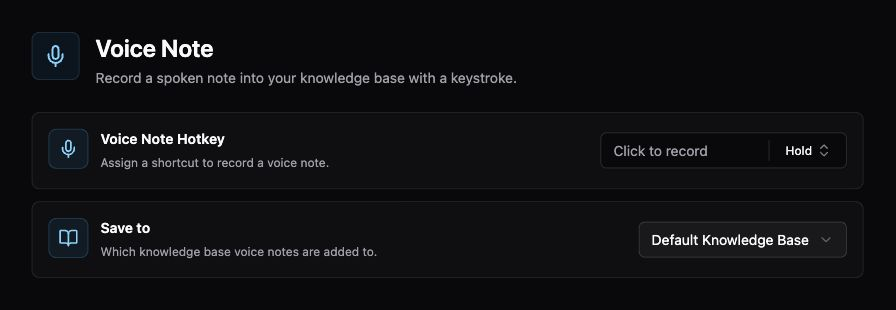

Nota vocale registra un’idea detta in una base di conoscenza, così puoi ritrovarla dopo. Usa la [Dettatura](/it/features/dictation) quando vuoi invece che il testo venga scritto in un’altra app.

<Frame caption="Scorciatoia di Nota vocale e base di conoscenza di destinazione.">
  
</Frame>

## Prima di iniziare

Crea o scegli una [Base di conoscenza](/it/ai/knowledge-base) per le note. Nota vocale non ha una scorciatoia finché non ne imposti una.

## Imposta la scorciatoia

1. Apri **Impostazioni → Nota vocale**.
2. Fai clic su **Scorciatoia per le note vocali** e premi la combinazione che vuoi. Scegli se tenerla premuta o premerla.
3. Imposta **Salva in** sulla base di conoscenza in cui vanno le note. All’inizio è **Base di conoscenza predefinita**.

## Registra una nota

1. Premi la **Scorciatoia per le note vocali** e di’ una nota breve. In modalità tieni premuto, tieni la scorciatoia mentre parli.
2. Rilascia la scorciatoia, o usa i controlli di registrazione, per terminare. La nota viene salvata.
3. Apri la base di conoscenza di destinazione e rivedi l’elemento salvato e la sua trascrizione.

## Rendi le note più facili da trovare

Di’ nell’audio l’argomento e i nomi utili, per esempio: «Project Atlas: chiedi al designer le icone di onboarding aggiornate». Controlla nomi, numeri e date importanti nella trascrizione prima di farci affidamento.

## Risoluzione dei problemi

| Problema | Cosa fare |
| --- | --- |
| La scorciatoia non fa nulla | Imposta una **Scorciatoia per le note vocali** e verifica che **Attiva l’acquisizione rapida** sia attivo in **Impostazioni → Acquisizione rapida**. Quell’interruttore attiva sia la scorciatoia di Acquisizione rapida sia quella di Nota vocale. |
| Nessun audio | Controlla il permesso del microfono e il dispositivo di input selezionato. |
| La nota non è dove te l’aspettavi | Controlla **Salva in** in **Impostazioni → Nota vocale**. |
| La trascrizione fallisce | Leggi l’errore e controlla il fornitore vocale configurato prima di registrare di nuovo la stessa nota. |

## Correlati

<CardGroup cols={2}>
  <Card title="Base di conoscenza" icon="database" href="/it/ai/knowledge-base">Trova e usa le note salvate.</Card>
  <Card title="Acquisizione rapida" icon="bolt" href="/it/features/quick-capture">Salva ciò che è sullo schermo nell’app corrente.</Card>
  <Card title="Dettatura e Comando vocale" icon="microphone" href="/it/features/dictation">Scrivi con la voce in qualsiasi app.</Card>
  <Card title="Dizionario e parlanti" icon="book" href="/it/configuration/speech-assets">Insegna alle funzioni vocali parole e nomi.</Card>
</CardGroup>
