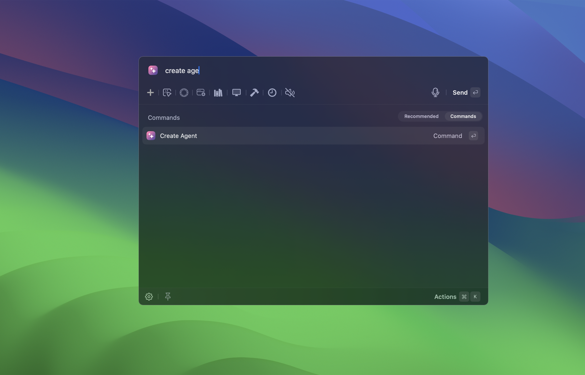

OpenClaw è una piattaforma di agenti IA self-hosted per eseguire assistenti tra chat, canali di messaggistica, strumenti, competenze e automazioni.

OpenClaw può esporre i suoi agenti tramite un Gateway compatibile con OpenAI. Dopo aver attivato il Gateway, Enconvo può usare un agente OpenClaw come qualsiasi altro modello di IA, anche dentro la chat, gli agenti Enconvo e le funzioni basate su un modello.

Il Gateway di OpenClaw espone endpoint compatibili con OpenAI come `/v1/models`, `/v1/chat/completions` e `/v1/responses`. Il fornitore OpenClaw di Enconvo usa l’API Chat Completions (`/v1/chat/completions`).

<Note>
  Enconvo non usa l’API Responses di OpenClaw per questo fornitore. Configura OpenClaw tramite il suo Gateway Chat Completions compatibile con OpenAI.
</Note>

Nuovo a OpenClaw? Inizia con la [guida per iniziare di OpenClaw](https://docs.openclaw.ai/start/getting-started), poi torna qui per collegarlo a Enconvo.

Vedi la [documentazione del Gateway OpenClaw](https://docs.openclaw.ai/gateway#openai-compatible-endpoints) per il riferimento completo degli endpoint del Gateway.

## Prima di iniziare

- OpenClaw installato sulla macchina che eseguirà il Gateway
- Il Gateway OpenClaw in esecuzione su un host e una porta raggiungibili
- L’endpoint Chat Completions del Gateway attivato
- Il token del Gateway da `~/.openclaw/openclaw.json`
- Enconvo con il fornitore di modelli IA OpenClaw attivato

## Configura in automatico

Apri **Impostazioni → Modello di IA → OpenClaw**. La scheda di configurazione può avviare, fermare e configurare per te il Gateway OpenClaw locale.

Usa **Configurazione automatica** quando OpenClaw è installato sullo stesso Mac di Enconvo. Enconvo:

<Steps>
  <Step title="Trova OpenClaw">
    Verifica che la CLI `openclaw` esista su questo Mac.
  </Step>
  <Step title="Attiva Chat Completions">
    Esegue `openclaw config set gateway.http.endpoints.chatCompletions.enabled true`.
  </Step>
  <Step title="Prepara il token del Gateway">
    Legge `gateway.auth.token` da `~/.openclaw/openclaw.json`, oppure ne crea uno se manca.
  </Step>
  <Step title="Avvia il Gateway">
    Avvia o riavvia il servizio Gateway di OpenClaw.
  </Step>
  <Step title="Verifica l’API">
    Sonda il Gateway con `/health` e `/v1/models`.
  </Step>
  <Step title="Salva le credenziali">
    Salva l’URL di base e il token del Gateway nelle credenziali OpenClaw di Enconvo.
  </Step>
</Steps>

La scheda di configurazione mostra un badge di runtime come **In esecuzione** o **Fermato**. Mentre la scheda è visibile, Enconvo aggiorna questo stato periodicamente e smette di aggiornarlo quando la scheda non è più visibile.

## Attiva il gateway OpenClaw

Puoi chiedere a OpenClaw di preparare i dettagli del Gateway per te:

```text
enable openai-compatible api and give me the token and baseurl
```

Usa l’URL di base e il token restituiti nelle impostazioni delle credenziali OpenClaw di Enconvo.

<Steps>
  <Step title="Attiva Chat Completions">
    Attiva una volta l’endpoint chat completions compatibile con OpenAI:

    ```bash
    openclaw config set gateway.http.endpoints.chatCompletions.enabled true
    ```
  </Step>
  <Step title="Scegli la modalità di bind">
    Per l’accesso solo locale, tieni il bind loopback predefinito. Perché un altro dispositivo sulla LAN raggiunga il Gateway, fai il bind sulla LAN:

    ```bash
    openclaw config set gateway.bind lan
    ```
  </Step>
  <Step title="Riavvia il Gateway">
    Applica la modifica della configurazione:

    ```bash
    openclaw gateway restart
    ```
  </Step>
  <Step title="Controlla lo stato del Gateway">
    Conferma che il Gateway sia in esecuzione:

    ```bash
    openclaw gateway status
    ```
  </Step>
</Steps>

## Collega OpenClaw a mano

Apri **Impostazioni → Modello di IA → OpenClaw**, poi configura il fornitore di credenziali.


| Impostazione | Valore |
|---------|-------|
| **URL di base OpenClaw** | `http://<gateway-host>:<port>/v1` |
| **Token del Gateway** | `gateway.auth.token` da `~/.openclaw/openclaw.json` |

Enconvo usa in automatico l’API Chat Completions per OpenClaw.

Usa l’URL di base che finisce con `/v1`, non l’endpoint completo `/v1/chat/completions`. Per esempio, se l’endpoint è `http://192.168.1.18:18789/v1/chat/completions`, inserisci `http://192.168.1.18:18789/v1`.

Per leggere il token del Gateway dal file di configurazione predefinito di OpenClaw:

```bash
jq -r '.gateway.auth.token' ~/.openclaw/openclaw.json
```

Enconvo invia questo valore come:

```http
Authorization: Bearer <gateway-token>
```

Fai clic su **Convalida** dopo aver inserito l’URL di base e il token.

## Come funzionano richieste e allegati

Enconvo invia le richieste OpenClaw tramite Chat Completions compatibili con OpenAI:

```http
POST /v1/chat/completions
```

Usa `openclaw:main` o un altro nome di modello annunciato dall’elenco agenti OpenClaw.

<Warning>
  Enconvo non invia allegati immagine a OpenClaw. Tratta il fornitore OpenClaw come un fornitore di testo e chat in Enconvo. Per i flussi con immagini, usa un fornitore di modelli con visione, oppure esegui OCR o analisi dell’immagine prima di inviare il testo a OpenClaw.
</Warning>

## Usa OpenClaw come modello di IA

Una volta configurato, OpenClaw compare nel selettore dei modelli. Scegli **OpenClaw** e seleziona il modello basato su un agente, come `openclaw:main`.


Usa questa modalità quando vuoi che una conversazione, un comando o una funzione di Enconvo passino da un agente OpenClaw, tenendo l’interfaccia normale di Enconvo.

<Steps>
  <Step title="Apri il selettore dei modelli">
    Nella chat o in un’altra funzione Enconvo basata su un modello, fai clic sul nome del modello attuale.
  </Step>
  <Step title="Scegli OpenClaw">
    Seleziona **OpenClaw** nell’elenco dei fornitori.

    
  </Step>
  <Step title="Seleziona un modello agente OpenClaw">
    Scegli `openclaw:main` o un altro agente OpenClaw dall’elenco dei modelli.
  </Step>
  <Step title="Esegui la funzione normalmente">
    Fai la domanda o esegui la funzione Enconvo. L’agente OpenClaw selezionato gestisce la chiamata al modello dietro le quinte.
  </Step>
</Steps>

Enconvo carica i modelli OpenClaw da `openclaw agents list`. Se la CLI OpenClaw non è disponibile in locale, Enconvo torna a `openclaw:main`.

## Crea un Agente per OpenClaw

Puoi anche creare un agente Enconvo che coordina un agente OpenClaw. È utile quando vuoi un flusso, un insieme di strumenti o un prompt rivolto a Enconvo intorno a un agente OpenClaw preciso.

<Steps>
  <Step title="Apri Crea agente">
    Apri SmartBar e cerca **Crea agente**.

    
  </Step>
  <Step title="Dai un nome all’agente">
    Crea un titolo chiaro, come `OpenClaw Main`.

    
  </Step>
  <Step title="Scrivi le istruzioni del coordinatore">
    Dai all’agente Enconvo istruzioni che spieghino come deve lavorare con OpenClaw.

    ```markdown
    You coordinate the OpenClaw Main agent for the user.

    Use OpenClaw for agentic work, automation, and tasks that should run through the user's OpenClaw setup.
    Summarize what OpenClaw did, surface any blockers, and ask before destructive or irreversible actions.
    ```
  </Step>
  <Step title="Scegli il modello OpenClaw">
    Nelle impostazioni del modello dell’agente, seleziona **OpenClaw** e scegli `openclaw:main`.
  </Step>
  <Step title="Salva e usa l’agente">
    Inizia una conversazione con il nuovo agente Enconvo. Userà il modello agente OpenClaw selezionato, tenendo l’interfaccia e gli strumenti dell’agente Enconvo che hai configurato.
  </Step>
</Steps>

## Risoluzione dei problemi

<AccordionGroup>
  <Accordion title="OpenClaw non compare nel selettore dei modelli">
    Verifica che il fornitore OpenClaw sia attivo in **Impostazioni → Modello di IA**. Se l’elenco dei modelli è vuoto, verifica che `openclaw agents list` funzioni in locale, oppure usa il predefinito `openclaw:main`.
  </Accordion>
  <Accordion title="La convalida fallisce con non autorizzato">
    Ricontrolla il token del Gateway. Enconvo si aspetta il valore di `gateway.auth.token` e lo invia come token Bearer.
  </Accordion>
  <Accordion title="La connessione fallisce">
    Conferma che il Gateway sia in esecuzione con `openclaw gateway status`. Se Enconvo è su un altro dispositivo, imposta `gateway.bind` su `lan`, riavvia il Gateway e usa l’IP LAN dell’host nell’URL di base.
  </Accordion>
  <Accordion title="L’avvio riesce ma Enconvo dice per un attimo che serve attenzione">
    OpenClaw può segnalare che il LaunchAgent si è riavviato prima che il Gateway HTTP sia pronto. Attendi qualche secondo e controlla di nuovo il badge di runtime della scheda di configurazione. Puoi anche verificare direttamente con `openclaw gateway status` e `curl http://127.0.0.1:18789/health`.
  </Accordion>
  <Accordion title="Il Gateway è in esecuzione ma `/v1/models` fallisce">
    Verifica che Enconvo usi lo stesso token di `gateway.auth.token` in `~/.openclaw/openclaw.json`. Lo stato della configurazione può comunque rilevare un Gateway in esecuzione tramite `/health`, ma la convalida dei modelli richiede il token bearer.
  </Accordion>
  <Accordion title="Gli allegati immagine vengono ignorati">
    Il fornitore OpenClaw in Enconvo è per ora solo testo. Enconvo non invierà allegati immagine a OpenClaw; scegli un fornitore con visione per l’input diretto di immagini.
  </Accordion>
  <Accordion title="URL di base sbagliato">
    Inserisci `http://<gateway-host>:<port>/v1`. Non includere `/chat/completions` nel campo URL di base di Enconvo.
  </Accordion>
</AccordionGroup>

## Correlati

<CardGroup cols={2}>
  <Card title="Hermes Agent" icon="server" href="/it/providers/hermes">Collega allo stesso modo un altro gateway di agenti.</Card>
  <Card title="Agenti" icon="robot" href="/it/ai/agents">Dai a un Agente istruzioni e strumenti.</Card>
</CardGroup>
