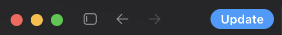

Enconvo はバックグラウンドで新しいバージョンを確認し、設定中の更新チャンネルに新しいビルドがある場合は **更新** ボタンを表示します。通常は「本番環境」を使い、一般公開前の新機能を試したい場合は「ベータ版」に切り替えてください。

## 更新チャンネル

| チャンネル | おすすめのユーザー | 配信内容 |
|---------|----------|------------------|
| **本番環境** | ほとんどのユーザー | ベータテストを経た安定版リリース |
| **ベータ版** | 早期テスター | 本番環境への昇格前の新しいビルド |
| **開発** | 開発テスト向け | ベータ版とは別に頻繁に配信される開発ビルド |

<Tip>
新機能を早期にテストしたい場合を除き、通常は **本番環境** をお使いください。リリースのテストに協力する場合や、安定版公開前に修正を取り込みたい場合は **ベータ版** をご利用ください。
</Tip>

## 更新チャンネルを変更する

<Steps>
  <Step title="設定を開く">
    アプリメニューから Enconvo の設定を開くか、**⌘,** を押します。
  </Step>
  <Step title="一般へ移動する">
    設定サイドバーで **一般** を開きます。
  </Step>
  <Step title="アップデートを探す">
    **アップデート** セクションまでスクロールします。
  </Step>
  <Step title="チャンネルを選択する">
    **更新チャンネル** を **本番環境**、**ベータ版**、または **開発** に設定します。
  </Step>
</Steps>

新規の開発版インストールは「開発」チャンネルから始まり、すでに選んだチャンネルがある場合はそのまま維持されます。チャンネルを切り替えても、すでにインストールされている新しいビルドが必ずしもダウングレードされるわけではありません。

## アップデートをインストールする

ご利用のチャンネルに新しいバージョンがあると、次の場所に **更新** ボタンが表示されます。

- **チャットウィンドウ** のタイトルバー
- **SmartBar** のタイトルバー
- **Dynamic Island**

**更新** をクリックすると新しいバージョンが表示され、ダウンロード、インストール、再起動の手順が案内されます。

Enconvo はチャットウィンドウ、SmartBar、または Dynamic Island を開いたときに更新を確認します。不要な通信を繰り返さないため、10 分以内に再確認することはありません。

<Note>
アップデートの自動ダウンロードはデフォルトでオフになっています。Enconvo はまず更新があることを知らせてボタンを表示し、いきなりダウンロードすることはしません。
</Note>

## 今すぐ確認する

1. **設定 → 一般** を開いて **アップデート** までスクロールします。現在使用中のバージョンが表示されます。
2. **アップデートを確認** をクリックします。結果がその場に表示されます。
3. お使いのチャンネルに新しいバージョンがある場合は、画面の案内に従って更新してください。

メニューバーの Enconvo アイコンから **アップデートを確認** を選ぶこともできます。更新ウィンドウが開かない場合は、お使いのチャンネルにおける最新バージョンがすでに適用されている可能性があります。**設定 → このアプリについて** ではバージョン、ビルド番号、およびベータ版・開発チャンネル利用時は **ベータ版** や **開発** の表示を確認できます。

## 新機能を見る

**設定 → チュートリアル** では、Enconvo 内でアップデート動画やステップごとの解説を再生でき、未視聴の項目には **New** の印が付きます。チャットウィンドウの設定メニューにある **新機能** からも同じ画面を開けます。アップデート後に初めて Enconvo を使うときは、チャットウィンドウのサイドバーに表示されるカードからもそのバージョンのアップデート動画を見られます。

## トラブルシューティング

| 問題 | 対処方法 |
| --- | --- |
| ベータ版にしているのにベータの更新が出ない | **設定 → 一般 → アップデート → 更新チャンネル** が **ベータ版** になっているか確認し、チャットウィンドウまたは SmartBar を開き直してください。バックグラウンド確認は 10 分間隔で行われるため、直前に確認した場合は数分待ってから試してください。 |
| 本番環境に戻したら最新ビルドが表示されなくなった | 本番環境には安定版チャンネルに公開されたビルドのみが表示されます。ベータ限定のままのビルドは、本番環境へ昇格したあとに表示されます。 |
| **更新** ボタンが消えた | すでに更新がインストールされたか非表示になった、あるいは現在のチャンネルと一致しなくなった可能性があります。**設定 → 一般 → アップデート** で **アップデートを確認** をクリックして確認してください。 |
| 更新画面が開かない | Enconvo をいったん終了して開き直し、もう一度 **アップデートを確認** を実行してください。Enconvo のリリースサーバーへネットワーク接続できるかも確認してください。 |

## 関連項目

<CardGroup cols={2}>
  <Card title="設定リファレンス" icon="sliders" href="/ja/configuration/settings-reference">
    アプリのすべての設定を一覧で確認できます。
  </Card>
  <Card title="変更履歴" icon="newspaper" href="/changelog">
    各リリースの変更内容を確認できます。
  </Card>
</CardGroup>
