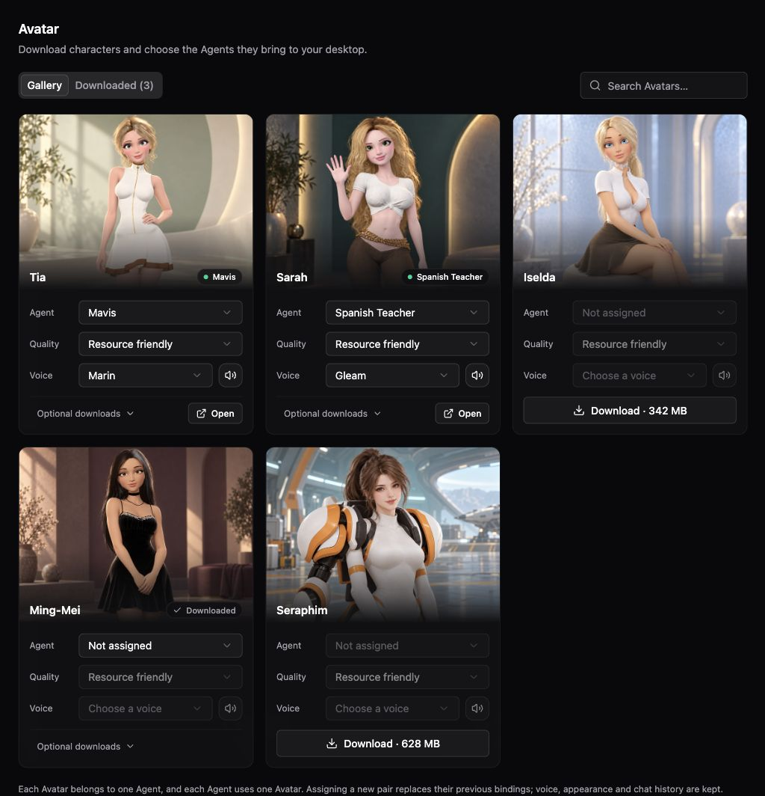

import { YouTubePlayer } from '/snippets/youtube-player.mdx';

アバターは、いずれかのエージェントを代表するデスクトップキャラクターです。音声通話では声に合わせてアニメーションしながら話し、エージェント自体は通常の指示やツールをそのまま維持します。

この動画では最初にアバターを、続いて IM チャネルと認証情報管理を紹介しています。

<YouTubePlayer videoId="O5rNJwqlisg" title="How to Use Avatars, IM Channels and Credentials in Enconvo | Step-by-Step Tutorial" />

<Frame caption="エージェントの割り当て、描画品質、音声、任意のダウンロードを表示するアバターギャラリー。">
  
</Frame>

## キャラクターを設定する

1. **設定 → アバター**を開きます。
2. **ギャラリー**からキャラクターを見つけ、**ダウンロード**をクリックして基本パッケージを取得します。
3. ダウンロードが終わったら、対応させるエージェントを選び、**アバターを連携**をクリックします。1 つのエージェントにつきアバターは 1 つ、1 つのアバターは 1 つのエージェントに紐づきます。
4. キャラクターの**品質**を選びます。
5. **開く**をクリックして、エージェントのアバターをデスクトップに表示します。

アバターとの通話では**設定 → Live Talk → 話す**で設定した音声が使われ、音声の変更は次の通話から反映されます。

**任意のダウンロード**には、利用可能な場合、そのキャラクター用の高解像度テクスチャやモーションなどの追加パッケージが表示されます。まずは基本パッケージから始め、お使いの Mac に合った品質を選んでください。

オリジナルのキャラクターを作るには、**キャラクターを作成**をクリックして顔・毛並み・名前を選ぶか、**ファイルをインポート…**から OpenAvatar のキャラクターファイルを追加します。写真から作成する方法は、[Live Photo キャラクターを作成する](#live-photo-キャラクターを作成する)をご覧ください。

## Live Photo キャラクターを作成する

Live Photo キャラクターを使うと、1 枚のポートレート写真からデスクトップ上で息づいて動き、通話中にライブ映像として現れるアバターを作れます。

1. **設定 → アバター**を開き、**Live Photo** タブを開きます。
2. **Live Photo を作成**をクリックします。
3. 写真から始める場合は**写真を選ぶ…**をクリックし、通話で映したい顔が写った 10 MB までの JPG、PNG、または WebP 写真を 1 枚選びます。架空のキャラクターを作りたい場合は**説明して作る**を選び、特徴を文章で入力すると、Enconvo が候補となるポートレートを生成します。
4. **ポートレートの構図を決める**で顔の位置を合わせます。**背景**では、元の写真の背景を丸い枠の中に残すか、**削除**を選んで人物だけを切り抜くかを選べます。
5. 写真があなた本人であること、または被写体本人の使用許可を得ていることを確認します。
6. **音声**ステップで声のタイプを選び（下記参照）、キャラクターを作成します。生成には数分かかりますが、その間にウィンドウを閉じても構いません。
7. 通常のアバターと同様に、キャラクターをエージェントに連携して**開く**をクリックします。

写真と通話音声は映像を描画するために米国にある外部サービス Atmee へ送信されます。写真キャラクターは最大 3 体まで保持でき、新しく作る場合は 1 体削除してください。

### 声を選ぶ

**音声**ステップでは次の方法が選べます：

- **声をクローン**：その場で本人の声を録音するか、**代わりにアップロード**をクリックして音声・動画ファイルを使います。**クローン元**は、月間上限がある Enconvo Cloud 上の ElevenLabs か、ご自身の ElevenLabs API キーを選べます。
- **声を選択**：ElevenLabs の声、またはクローンした声から選びます。
- **通話の音声に合わせる**：**設定 → Live Talk → 話す**で設定されている音声を使います。

あとから変更するには、キャラクターカードの**音声を変更**をクリックします。

### 自分の Atmee アカウントを使う

デフォルトでは、Live Photo キャラクターは Enconvo の Atmee アカウントで動作し、1 日あたりの利用時間と 3 体までのキャラクター上限が適用されます。**自分の Atmee アカウントを使用**を選び、Atmee Studio（**API keys**）から取得した API キーを貼り付けると、それらの上限なしにあなたのアカウント内で新しいキャラクターを作成でき、すでに Atmee アカウントにあるアバターも取り込めます。キーは[認証情報管理](/ja/configuration/credentials)に保存されます。

### Live Photo キャラクターとの通話

通話中、キャラクターは声に合わせて唇が動くライブ映像として表示されます。1 分間誰も話さないと、再び話し始めるまでライブ映像は待機状態になります。1 分半後には「まだいらっしゃいますか？」と尋ね、さらに 1 分経つと通話が終了し、再開用の**続ける**ボタンが表示されます。

ライブ配信に出演させる方法は、[Live Photo キャラクターを配信する](/ja/features/avatar-live-stream)をご覧ください。

## 会話と操作

[Live Talk](/ja/features/live-voice) を設定したうえで、アバターの会話コントロールを使って話し始めます。キャラクターを右クリックすると、音声、履歴、設定、キャラクター操作メニューが開きます。吹き出しには会話テキストと音声の動作状況が表示されます。

キャラクターはドラッグで移動でき、スクロールで回転、Control キーを押しながらスクロールまたはピンチ操作で拡大・縮小できます。周囲の透明部分をクリックすると背後のデスクトップに操作が抜けます。

## キャラクターを切り替える

デスクトップ上の**キャラクター**メニューからはエージェントの再割り当ては行われません。別のエージェントに割り当てられているキャラクターを選ぶと、そのエージェントのアバターが開きます。どのエージェントにも割り当てられていないキャラクターは、メインのエージェントを通じて表示されます。キャラクターの担当エージェントを変更するには、**設定 → アバター**を使ってください。

メニューバーや Dynamic Island にあるアバターのスイッチは、割り当て済みのキャラクターとともにメインのエージェントを開きます。

## 設定

**設定 → アバター**にあるダウンロード済みキャラクターのカードには、次の操作項目があります：

| 設定 | 変更される内容 |
| --- | --- |
| **エージェント** | そのキャラクターが担当するエージェント。新しいペアを割り当てると以前の紐づけが置き換わりますが、音声・見た目・チャット履歴は保持されます。 |
| **品質** | 描画品質。デフォルトの**最小**は GPU・CPU・バッテリーの消費を最も抑えます。**バランス**と**最高画質**はライティング、シェーディング、高解像度テクスチャを追加し、GPU をより多く使います。 |
| **任意のダウンロード** | キャラクター用の追加パッケージやパッケージのアップデート。 |

ギャラリーの上にある**自然なリップシンク**をオンにすると、話す声に合わせてすべてのアバターの唇を動かすオンデバイスモデルがダウンロードされます。Apple シリコン搭載 Mac が必要です。

その下にある**ライブデスクトップ**は、ウィンドウの背後にボードを表示し、エージェント・コーディングセッション・オートメーションの動作状況を表示するとともに、あなたの対応が必要なときや問題が起きたときにキャラクターが反応して知らせます。

## トラブルシューティング

| 問題 | 対処方法 |
| --- | --- |
| **品質**を変更できない | 先にキャラクターをダウンロードし、エージェントに割り当ててください。 |
| **Live Photo を作成**が選べない | 写真キャラクターがすでに 3 体あります。1 体削除するか、ご自身の Atmee アカウントをお使いください。 |
| **説明して作る**が動かない | AI モデルが必要です。**設定 → AI モデル**でモデルを選んでからやり直してください。 |
| ダウンロードに失敗する | カード上のエラー内容を確認し、ネットワーク接続とディスクの空き容量を確かめてから**再試行**をクリックしてください。 |
| 拡大するとキャラクターがぼやける | より高い**品質**を選び、**任意のダウンロード**にテクスチャがないか確認してください。 |
| 通話が始まらない | [Live Talk](/ja/features/live-voice) の設定と macOS のマイクアクセス権限を確認してください。 |
| 別のエージェントが応答する | **設定 → アバター**でキャラクターに割り当てられている**エージェント**を確認してください。 |

## 手順を動画で見る

<video controls playsInline preload="none" poster="/images/guides/avatar-gallery.jpg" aria-label="アバターギャラリーを見る" style={{width: "100%", maxHeight: "640px"}}>
  <source src="/videos/guides/avatar-gallery.mp4" type="video/mp4" />
  [ウォークスルーをダウンロード](/videos/guides/avatar-gallery.mp4)。
</video>

「ダウンロード済み」に切り替え、「Tia」を検索し、「任意のダウンロード」を確認したあと「ギャラリー」に戻ります。パッケージのダウンロードや割り当ての変更は行われません。この無音のウォークスルーでは実際の画面キャプチャに読むための間を設けており、上の手順書でも同じ操作を案内しています。

## 関連項目

<CardGroup cols={2}>
  <Card title="Live Talk" icon="phone" href="/ja/features/live-voice">エージェントと音声通話を始めます。</Card>
  <Card title="エージェント" icon="robot" href="/ja/ai/agents">アバターが担当するエージェントを設定します。</Card>
  <Card title="ペット" icon="paw" href="/ja/features/pet">独自の操作を持つ別のデスクトップコンパニオン。</Card>
  <Card title="Live Photo キャラクターを配信する" icon="tower-broadcast" href="/ja/features/avatar-live-stream">OBS に載せてライブチャットに返答させます。</Card>
</CardGroup>
