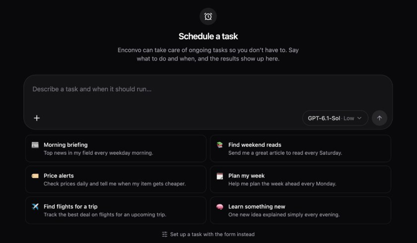

import { YouTubePlayer } from '/snippets/youtube-player.mdx';

オートメーションは、毎回自分で開始しなくてもタスクを自動で実行する機能です。エージェントに作業を依頼したり、保存済みのワークフローを実行したり、シェルコマンドを実行したりできます。設定したスケジュール（1 回限り、または繰り返し）での実行や、新しいメールの受信・フォルダへのファイル追加といったイベント発生時の実行のほか、手動での実行にも対応しています。朝のニュースまとめ、週次計画の作成、価格チェックなどに便利です。

各実行では独立した会話が開始され、結果はオートメーション内に表示されます。また、Mac での通知、IM チャットへの結果送信、GitHub での返信、プロジェクトの Ideas ボードへの追加なども設定できます。

オートメーションは次の 3 つのパートで構成されており、各パートはその場で直接変更したり、チャットで指示して変更したりできます。

| パート | 内容 |
| --- | --- |
| **When（実行のきっかけ）** | スケジュール、イベント、または手動実行 |
| **Steps（処理内容）** | 実行するエージェントと指示、ワークフロー、またはシェルコマンド |
| **Then（実行後の処理）** | 結果の送信先と通知方法 |

過去の実行結果はバーとして下部に表示されるため、何が実行され、何が失敗したかを一目で確認できます。

以下の動画では、オートメーションに続いてワークフロー、変数、および通知とおやすみ時間を使った結果の受け取り方を紹介しています。

<YouTubePlayer videoId="XLbDK5J3fjE" title="How to Use Automations and Workflows in Enconvo | Step-by-Step Tutorial" />

<Frame caption="予約タスクの画面：左側にタスク一覧、右側にタスクの詳細が表示されます。">
  
</Frame>

## チャットでオートメーションを設定する

<Steps>
  <Step title="予約タスクを開く">
    **チャットウィンドウ**のサイドバーで **予約タスク** を選択し、**新しい予約タスク** をクリックします。
  </Step>
  <Step title="実行内容とタイミングを伝える">
    入力欄にタスクとタイミングを記述します（例：「平日の 8:00 ごとに、最も重要な AI ニュースをリンク付きの 5 つの箇条書きでまとめて」）。またはスターターのいずれかを選ぶと入力欄にテンプレートが入力されるため、送信前に調整できます。

    保存済みのワークフローがある場合は、**ワークフローをスケジュールで実行** の下にいくつか表示されます。いずれかを選ぶと「毎日 9:00 にそのワークフローを実行する」リクエストが入力されるので、送信前に時刻を変更したり入力値を追加したりできます。
  </Step>
  <Step title="下書きを確認する">
    Enconvo がタスクを設定し、チャット内にカードとして表示したうえで、実行タイミングをわかりやすい言葉と現地時間で返信します。時刻を指定しなかった場合は適切な時刻を自動で選び、その旨を伝えます。監視する製品など、回答なしではタスクを組めない場合のみ質問を返します。
  </Step>
  <Step title="オンにする">
    新しいオートメーションは、チャット横に **下書き** としてオフの状態で作成されます。内容を確認して **オンにする** を選択するまで、実行は開始されません。作成したタスクは会話上部の **このチャットで設定** とタスク一覧に表示されます。そのままチャットを続けて、変更、一時停止、再開を行えます。
  </Step>
</Steps>

<Frame caption="ひとこと入力するかスターターを選ぶだけで、新しいタスクを作成できます。">
  
</Frame>

タスクは完結した指示として記述してください。各実行では設定時のチャットを引き継がない新しい会話が開始されるため、「明日も同じことをして」ではなく「今日のトップ AI ニュースをリンク付きの 5 つの箇条書きで要約して」のように書く方が適切に動作します。

## 予定と実行結果を確認する

予約タスクの上部にある **今日** には、次に実行されるタスクとすでに実行されたすべてのタスク、および各実行の結果が表示されます。実行項目を選択すると、詳細の確認や失敗した実行の再試行を行えます。

各オートメーションの最新の実行は、開始されるとすぐにサイドバーの **チャット** の下に時計マーク付きで表示されます。過去の実行もそのチャットからワンクリックで開けます。

### スケジュール設定のチャットに戻る

スケジュール設定のチャットは保存されますが、サイドバーの **チャット** には表示されません。Enconvo が回答を待っているチャットなどに再び開くには、会話上部のチャット名を選択し、**スケジュール設定のチャット** から選びます。そこからチャットを削除することもでき、削除しても設定済みのタスクは実行され続けます。

### どのチャットからでも依頼する

通常のチャットでも「明日の 9 時に請求書を送るようリマインドして」や「毎週月曜日の朝に今週の締め切りを一覧にして」のように依頼できます。エージェントが同様のタスクを設定してカードを表示し、実行時刻を確認します。カード上の **開く** を選択すると **予約タスク** で確認できます。過去のチャット内のカードには、その後タスクが一時停止、完了、または削除されたかどうかも表示されます。

## イベントまたは手動で開始する

時刻ではなく、何かの出来事をきっかけにオートメーションを開始することもできます。予約タスクのチャットで開始条件を説明すると、Enconvo がトリガーを設定します。

| 開始のきっかけ | 実行タイミング |
| --- | --- |
| スケジュール | 設定した時刻になったとき |
| 手動実行 | **実行** を選択したとき（テキストを入力していればそれを対象に処理します）。**PopBar に表示** をオンにすると選択したテキストに対して実行でき、**Dynamic Island のホームに表示** をオンにすると Dynamic Island にボタンが表示されます。 |
| フォルダの変更 | フォルダ内のファイルが追加、変更、または削除されたとき |
| アプリ | アプリが開いたとき、終了したとき、最前面に来たとき、または一定時間最前面にとどまったとき |
| Discord または Telegram のメッセージ | 接続されたボットが読み取れるメッセージを受信したとき |
| 新しいメール | [メール](/ja/integrations/email)プラグインでエージェントの読み取りを許可したメールボックス（1 分ごとに確認）、Apple Mail（Mail が開いている間 2 分ごとに確認）、または Gmail コネクタ経由の Gmail（約 5 分ごとに確認）に新しいメールが届いたとき |
| GitHub | 接続したリポジトリで Issue やプルリクエストが開かれたとき、Issue にラベルが付いたとき、コメントでメンションされたとき、CI が失敗したとき、リリースが公開されたとき。[GitHub トリガー](#github-トリガー)を参照してください。 |
| MCP イベント | 接続された MCP サーバーがイベントを報告したとき |
| 文字起こし済みの録音 | Enconvo が録音の文字起こしを完了したとき |
| ウェブページとフィード | 新しいフィード項目が追加されたとき、またはページのテキストが変更されたとき |
| コピー | クリップボード履歴で除外されていないアプリでコピーを行ったとき |
| Mac のイベント | Mac がスリープ解除されたとき、ロック解除されたとき、電源に接続・解除されたとき、または席を離れたり戻ったりしたとき |
| カレンダーのイベント | カレンダーのイベントが始まる前、または終了したとき |
| 会議 | Zoom、Teams、FaceTime、または WeChat 通話で会議が始まったとき |
| ログイン | ログイン後に Enconvo が起動したとき（毎回 1 回） |
| Webhook リクエスト | ページに表示される専用アドレス（コピーボタン付き）にリクエストが届いたとき |

Enconvo は起動中、Mac 上のイベントを監視します。Enconvo を閉じていた間に発生したイベントがどう扱われるかは、タスクのトリガー行に表示されます。

### GitHub トリガー

<Steps>
  <Step title="GitHub を接続する">
    **When** の下で GitHub を選び、**GitHub を接続** を選択します。Enconvo アカウントにサインインしている必要があります。
  </Step>
  <Step title="リポジトリとイベントを選ぶ">
    **リポジトリ**（または手入力する場合は **別のリポジトリ…**）と **イベント** を選択します。ラベル付き Issue の場合は、対象の **ラベル** または **すべてのラベル** を選びます。リポジトリを監視するには管理者権限が必要です。
  </Step>
  <Step title="開始を許可する相手を選ぶ">
    **自分のみ**、**誰でも**、または開始を許可する相手の GitHub ユーザー名を選択します。
  </Step>
</Steps>

GitHub イベントは Enconvo Cloud 経由で Mac に届き、この Mac で外部トリガーを許可するまでは保留されます。確認が表示されたら **この Mac で許可** を選択してください。**この Mac で外部トリガーを停止** を選ぶと再び停止し、イベントは Enconvo Cloud で待機します。

イベントトリガーには、自分の言葉で条件を追加することもできます。実行前に AI が各イベントを条件と照合し、一致しないイベントはスキップされます（スキップされたイベントでも **それでも実行** を選べます）。照合ごとに AI 呼び出し料金が発生します。**最近のイベントで試す** を選択すると、実際に実行せずに直近のどのイベントで発火するかを確認できます。

## オートメーションを管理する

一覧からオートメーションを選択すると、有効・一時停止・要対応の状態、**When**、**Steps**、**Then** の各パート、および実行履歴を確認できます。

前回の実行が失敗したか結果を送信できなかった場合は、タスク名の下に理由と修正方法が表示されます。

- **チャットで修正**（エージェントまたはワークフローのタスク）は、エラー内容を添えて設定用チャットを開きます。**もう一度実行** は再度 1 回実行します。
- **再送信** は結果の送信をやり直します。**結果の保存先を変更** は送信先ピッカーを開きます。そこで **Enconvo のみ** を選ぶと、未送信に関する警告も消えます。
- 自動開始のタスクは 5 回連続で失敗すると一時停止します。修正後に **オンにする** を選択してください。

| 操作 | 説明 |
| --- | --- |
| **今すぐ実行** | タスクをただちに 1 回実行します。実際に動作するため、エージェントがツールやポイントを使用する場合があります。手動開始タスクでは **実行** になります。 |
| **チャットに合わせて変更** | エージェントタスクの場合、設定時のチャットを再度開いて（ない場合は新規作成して）「7:30 に変更して」「天気を追加して」のように変更を指示できます。 |
| **タスク名** | 名前を選択してタスク名を変更します。Return で保存、Esc でキャンセルします。 |
| **スケジュール** | 実行タイミングと次回実行時刻が表示されます。スケジュールは **毎日 09:00 と 18:00** や **毎年 1月1日 03:00** のように自然な言葉で表記され、一覧・設定・チャットカードで共通です。選択するとその場で時刻を変更でき、**1 回**、**毎日**、**毎週**、**毎月**、**間隔**、**Cron** から選んで次回実行を確認し、**保存** を選択します。横のスイッチでタスクを削除せずに今後の実行を一時停止できます。 |
| **指示** → **編集** | エージェントへの指示（シェルコマンドタスクの場合はコマンド）をその場で変更します。**⌘↩** または **保存** で確定し、Esc でキャンセルします。 |
| **結果** | 各実行の結果の送信先を表示します。選択して、メッセージングチャネル経由でエージェントと会話したことがあるチャットを選ぶか、**Enconvo のみ** を選んで各実行の会話内に留めます（変更は即座に保存されます）。**別のチャット…** を選ぶとチャット ID を入力するエディタが開きます。 |
| **実行時に通知する** | 実行が完了したときに、結果の 1 行目を添えた Mac 通知を表示します。通知をクリックするとタスクが開きます。 |
| **…** → **詳細を編集** | エージェント、説明、最大実行回数など、すべての項目をまとめて編集するフォームを開きます。 |
| **…** → **複製** | コピーを作成して下書きとして開くため、オンにする前に内容を調整できます。 |
| **…** → **すべての実行履歴** | 絞り込み機能付きの完全な実行履歴を開きます。 |
| **…** → **削除** | オートメーションとその実行履歴を削除します。実行中のものを削除すると実行も停止します。 |

実行バーを選択すると、その実行の結果やエラーの確認、その会話からの続行、結果のコピー、未送信結果の再送信を行えます。

### 詳細設定

オートメーションの **詳細設定** を開くと、実行範囲の上限を設定できます。

| 設定 | 説明 |
| --- | --- |
| **実行回数の上限** | 合計の実行回数です。完了したオートメーションでも、ここで回数を増やせば再び実行できます。 |
| **時間制限** | 1 回の実行にかけられる最大時間です（15 分〜8 時間）。上限に達した場合、その実行画面に時間を延ばしてワンクリックでやり直せる **… に延ばして再実行** ボタンが表示されます。 |

### オートメーションを探す

一覧は名前、指示、コマンド、ワークフローで検索できます。一覧では **要対応**（前回の実行が失敗したか結果が未送信のもの）、今後の予定、**一時停止**、**完了**（実行済みの 1 回限りのオートメーション）にグループ分けされます。開始方法が複数ある場合は、一覧上部のボタンでトリガー別に絞り込め、**すべて** で全件表示に戻せます。

タスクを開かずに操作するには、一覧の項目にポインタを合わせて **…** を選択するか、Control キーを押しながらクリックし、**今すぐ実行**、**一時停止** または **再開**、**詳細を編集**、**削除** のいずれかを選びます。**タスクを検索** で ↓ を押すと最初のタスクへ移動し、↑ と ↓ でタスク間を移動できます。

## フォームエディタを使う

新規タスク画面で **代わりにフォームでタスクを設定** を選択するか、既存タスクで **詳細を編集** を選択すると、すべての項目を自分で入力できます。

<Frame caption="エージェントへの指示と平日スケジュールを設定したタスクエディタ。">
  
</Frame>

1. タスク名を入力し、処理内容を選択します。エージェントと指示を指定する **エージェントに質問**、保存済みの[ワークフロー](/ja/workflows/introduction)を実行する **ワークフローを実行**、Mac 上のスクリプトを実行する **シェルコマンドを実行** のいずれかを選びます。ワークフローの場合は必要な入力値を入力します（空欄のままの入力にはワークフローのデフォルト値が使われます）。
2. **When** で **1 回**、**毎日**、**毎週**、**毎月**、**間隔**、**Cron** のいずれかを選び、**次回の実行（現地時間）** のプレビューを確認します。**Cron** では入力に合わせて下の行に意味が表示され、たとえば `0 9-17 * * 1-5` なら「平日の 09:00 から 17:00 まで毎時」のように読めます。
3. **結果を送信** で **各結果をチャットに送信** をオンにすると、IM チャットに結果が届きます。ピッカーに表示させるには、あらかじめそのチャットでエージェントと会話しておく必要がある場合があります。
4. **その他のオプション** では説明や最大実行回数を追加できます。
5. **保存**（または **タスクを作成**）を選択します。**テスト実行** を選ぶと、タスクを保存してただちに実行します。

シェルコマンドタスク、およびチャット ID を指定した結果送信は、このエディタでのみ設定できます（スケジュール設定のチャットはエージェントとワークフローのタスクに対応しています）。イベントで開始するタスクについては、フォームではトリガーを変更できません。開始条件を変更するにはオートメーションのチャットを使用してください。

シェルコマンドタスクは数分おきに実行されることが多いため、実行が失敗したときのみ通知されます（**失敗時に通知する**）。

## ワークフローをスケジュール実行する

ワークフロータスクは、ワークフローエディタで **実行** を選ぶのと同じように、指定した時刻に保存済みワークフローを実行します。エディタで **ワークフローを実行** を選ぶか、スケジュール設定のチャットで「Content Pipeline を平日 9 時にトピック AI news で実行して」のように依頼してください。名前でワークフローを検索し、指定された入力値を埋め、残りはデフォルトのまま設定します。

各実行の結果はワークフローの最後のステップの出力となるため、他の結果と同じようにチャットへ送信したり通知で表示したりできます。途中のステップが失敗すると、そのステップのエラーとともに実行は失敗として記録されます。

- タスクの詳細にはワークフローとその入力値が表示されます。**開く** でワークフローを確認し、**変更** で別のワークフローの選択や入力値の変更を行えます。
- 展開した実行項目にある **実行を開く** を選択すると、**ワークフロー** でその実行の各ステップを確認できます。前回の実行が失敗したときは、タスク名の下のメッセージに **失敗した実行を開く** が表示されます。
- 実行はオートメーションの **時間制限** で停止します（[詳細設定](#詳細設定)を参照）。承認ステップでユーザーの応答を待っている時間は計測に含まれません。
- ワークフローが削除されるとタスクは一時停止し、その旨が表示されます。**ワークフローを選択** で別のワークフローを指定するか、**削除** でタスクを削除してください。

## 設定で多数のタスクを管理する

**設定 → 予約タスク** では、シェルコマンドタスクを含めすべてのタスクが一覧表で表示されます。**有効**、**一時停止**、**要対応** で絞り込んだり検索したりでき、複数選択してまとめて一時停止、再開、削除を行えます。タスクの履歴には各実行のステータスが表示されます。

| ステータス | 確認すべき点 |
| --- | --- |
| 失敗 | 指示内容、エージェントのツール、シェルの終了ステータス、またはエラー詳細 |
| 成功 / 未配信 | タスクは実行されましたが、送信先のメッセージングチャネルまたはチャットに問題があります |
| 完了・今後の予定なし | 1 回限りのタスクが完了しました |
| 一時停止 | 今後も実行したい場合は再度オンにしてください |

履歴画面では、**会話を開く** でエージェントの実行結果を開き、**結果をコピー** で出力をコピーし、**再送信** で設定済みのチャットへ実際のメッセージとして再送できます。

## 実行後のアクション

結果をチャットに送信したり通知を出したりするほかに、**Then（実行後の処理）** には次の 2 つの選択肢があります。

- **GitHub で返信**：GitHub イベントで開始されたオートメーションでは、実行のきっかけとなった Issue やプルリクエストへのコメントとして返信を投稿する前に確認を求めます。1 日以内に承認されない返信は投稿されません。
- **Ideas に追加**：オートメーションが受信した各 GitHub Issue、Discord または Telegram のメッセージ、メール、Webhook リクエストを、プロジェクトの Ideas ボードにアイデアとして追加します。プロジェクトのリードがバグを再現して修正を計画したり、リクエストを調査して理由付きでクローズまたは計画したりでき、何かを変更する前には必ず確認を求めます。[プロジェクト](/ja/ai/projects)を参照してください。

## 結果の受け取り方と関連機能

- ワークフローは複数のステップとエージェントを連結し、繰り返し実行できるジョブにまとめます。[ワークフローをスケジュール実行する](#ワークフローをスケジュール実行する)で選択するか、[ワークフロー](/ja/workflows/introduction)で作成してください。
- [変数](/ja/workflows/variables)を使うと、今日の日付や選択中のテキストなど、毎回変わる値をプロンプトや指示に組み込めます。
- **設定 → 通知** で実行完了時の通知方法を選べます。**おやすみ時間** をオンにするとエージェントからの質問や完了したタスクの通知を翌朝まで保留でき、承認リクエストだけは受け取りたい場合は **承認リクエストは通知する** をオンにします。[通知](/ja/configuration/notifications)を参照してください。

## 知っておきたいポイント

- オートメーションは Mac 上で動作するため、Enconvo が起動しており、Mac がスリープしていない必要があります。スリープ中やオフラインの Mac では実行されないため、常時稼働のスケジューラとしては使用しないでください。
- 時刻は Mac の現地タイムゾーン基準です。移動やタイムゾーン変更の後は次回実行時刻を確認してください。
- 1 回限りのタスクには未来の時刻を指定する必要があり、実行後は **完了** に移動します。
- エージェントに Apple メッセージを後で送信するよう依頼すると、1 回限りのオートメーションが設定されます。予約タスクで送信予定のメッセージを確認したりキャンセルしたりできます。
- 29 日〜31 日に指定した毎月のタスクは、その日付がない月をスキップします。
- Mac 通知は[通知](/ja/configuration/notifications)の **システム通知を送信** および macOS の集中モードにも従います。その実行をすでに画面で開いている場合は通知がスキップされます。
- 実行履歴には各タスクの最新 100 回分が保存され、それより古い実行とその会話は削除されます。重要な内容はタスクを削除する前にコピーしておいてください。

## 操作手順の動画

<video controls playsInline preload="none" poster="/images/guides/scheduled-tasks-walkthrough.jpg" aria-label="Schedule a task" style={{width: "100%", maxHeight: "640px"}}>
  <source src="/videos/guides/scheduled-tasks.mp4" type="video/mp4" />
  [ウォークスルーをダウンロード](/videos/guides/scheduled-tasks.mp4)。
</video>

予約タスクを開き、「朝のブリーフィング」スターターを選択してタスクの詳細と「詳細を編集」を開く様子です。スターターの下書きは送信されておらず、何も実行されず、例のタスクは録画後に削除されています。この無音のウォークスルーでは実際の画面キャプチャに読みやすいよう一時停止を入れています。上の手順にも同じ内容が書かれています。

## 関連項目

<CardGroup cols={2}>
  <Card title="ワークフロー" icon="diagram-project" href="/ja/workflows/introduction">オートメーションで実行するステップを作成します。</Card>
  <Card title="エージェント" icon="robot" href="/ja/ai/agents">作業を担当するエージェントを選択して設定します。</Card>
  <Card title="メッセージングチャネル" icon="comments" href="/ja/integrations/messaging">実行結果を Telegram や Discord などのチャットに送信します。</Card>
  <Card title="通知" icon="bell" href="/ja/configuration/notifications">実行完了時の Mac 通知を設定します。</Card>
</CardGroup>
