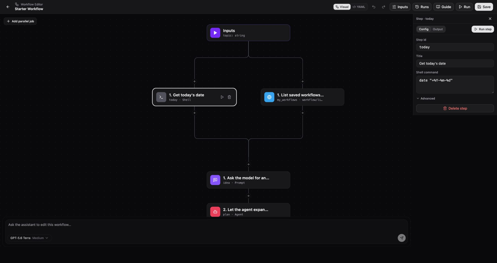

이 워크스루들은 실제 Enconvo 인터페이스를 보여 줍니다. 읽기 쉽도록 단계마다 잠시 멈추며, 연결된 가이드에는 동일한 안내가 텍스트로 담겨 있습니다. 예제 초안은 촬영 후 삭제되었습니다.

## iPhone 페어링하기

음성 해설 튜토리얼: iPhone 앱에서 로그인하고 Mac에 페어링 코드를 띄워 스캔한 뒤, 휴대폰에서 Mac의 채팅을 이어갑니다.

[가이드 읽기 및 동영상 보기](/ko/integrations/iphone-app).

<Frame>
  
</Frame>

## 첫 워크플로 만들기

음성 해설 튜토리얼: 시작 템플릿으로 워크플로를 만들고, 단계를 직접 추가한 다음 워크플로 어시스턴트로 단계를 하나 더 추가한 뒤, 실행하여 각 단계의 출력을 확인합니다.

[가이드 읽기 및 동영상 보기](/ko/workflows/build-your-first-workflow).

<Frame>
  
</Frame>

## 작업 예약하기

예약 작업을 열고 시작용 작업을 선택한 뒤 작업 세부 정보를 살펴보고 편집기를 엽니다. 시작용 초안은 전송되지 않았으며 예제 작업은 촬영 후 삭제되었습니다.

[가이드 읽기 및 동영상 보기](/ko/workflows/scheduled-jobs).

<Frame>
  
</Frame>

## 아바타 갤러리 둘러보기

다운로드됨으로 전환하고 Tia를 검색한 뒤 선택적 다운로드를 확인하고 갤러리로 돌아갑니다. 패키지는 다운로드되지 않았으며 할당 상태도 변경되지 않았습니다.

[가이드 읽기 및 동영상 보기](/ko/features/avatar).

<Frame>
  
</Frame>

## 사전 항목 준비하기

용어와 설명을 입력하고 일괄 추가로 전환한 뒤 세 줄의 예제를 입력합니다. 초안은 폐기되었으며 사전 항목은 저장되지 않았습니다.

[가이드 읽기 및 동영상 보기](/ko/configuration/speech-assets).

<Frame>
  
</Frame>

## 워크플로 편집기 살펴보기

시각화와 YAML 사이를 전환하고 실행 입력을 확인한 뒤 단계 검사기를 엽니다. 워크플로는 변경되거나 실행되지 않았습니다.

[가이드 읽기 및 동영상 보기](/ko/workflows/creating-workflows).

<Frame>
  
</Frame>
