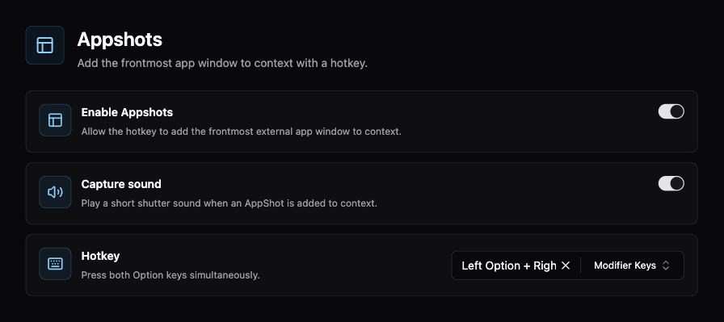

Appshots acrescenta a janela do app à frente ao seu chat como contexto. Use quando quiser perguntar sobre algo no ecrã sem o guardar numa base de conhecimento.

## Capturar uma janela de app

1. Traga para a frente o app sobre o qual quer perguntar.
2. Pressione o atalho de Appshots. Appshots não tem atalho até você definir um em **Atalho** em **Definições → Appshots**.
3. A janela vai para a Smart Bar, a Janela de chat ou a Barra lateral da aplicação se uma delas estiver aberta à frente. Caso contrário, vai para a Dynamic Island. Toca um som curto de obturador.
4. Confira a janela anexada e faça uma pergunta específica, como “Explique o erro nesta janela.”

<Frame caption="Definições de Appshots no app atual.">
  
</Frame>

## Definições

Abra **Definições → Appshots**.

| Ajuste | O que faz |
| --- | --- |
| **Ativar Appshots** | Deixa o atalho acrescentar a janela do app à frente. Ligado por predefinição. |
| **Som de captura** | Toca um som curto de obturador quando um Appshot é acrescentado. O som confirma a captura; ainda confira o anexo antes de enviar. |
| **Atalho** | O atalho que acrescenta a janela. Nenhum por predefinição. Pode ser um conjunto de teclas modificadoras, como as duas teclas **Option** juntas, ou um atalho comum. |

## Escolher a ferramenta de captura certa

| Objetivo | Use |
| --- | --- |
| Perguntar sobre a janela do app atual | Appshots |
| Chamar a atenção para uma região antes de perguntar | [Desenho no ecrã](/pt-br/features/screen-doodle) |
| Guardar o conteúdo do app atual para pesquisar depois | [Captura rápida](/pt-br/features/quick-capture) |
| Extrair texto de uma imagem | [OCR](/pt-br/ai/ocr) |

O conteúdo capturado pode ser enviado ao modelo que você usa no pedido. Veja [Compreensão do contexto](/pt-br/features/context-awareness) para outras formas de acrescentar contexto.

## Solução de problemas

| Problema | O que fazer |
| --- | --- |
| Não aparece contexto | Confira **Definições → Permissões**, sobretudo Gravação de ecrã e Acessibilidade. |
| A janela errada é capturada | Traga o app de destino para a frente de novo. Appshots captura a janela de outro app, não as janelas do próprio Enconvo, como Definições. |
| O atalho não faz nada | Confirme que **Ativar Appshots** está ligado e que um **Atalho** está definido. |
| O atalho faz outra coisa | Outro app usa as mesmas teclas. Mude o **Atalho** em **Definições → Appshots**. |

## Relacionados

<CardGroup cols={2}>
  <Card title="Compreensão do contexto" icon="eye" href="/pt-br/features/context-awareness">
    Escolha o que a Smart Bar apanha e acrescente mais com #.
  </Card>
  <Card title="Desenho no ecrã" icon="pen" href="/pt-br/features/screen-doodle">
    Marque uma região antes de perguntar.
  </Card>
  <Card title="Captura rápida" icon="bookmark" href="/pt-br/features/quick-capture">
    Guarde o app à frente numa base de conhecimento.
  </Card>
  <Card title="Dynamic Island" icon="circle-dot" href="/pt-br/features/dynamic-island">
    Para onde um Appshot vai quando nenhum chat está aberto.
  </Card>
</CardGroup>
