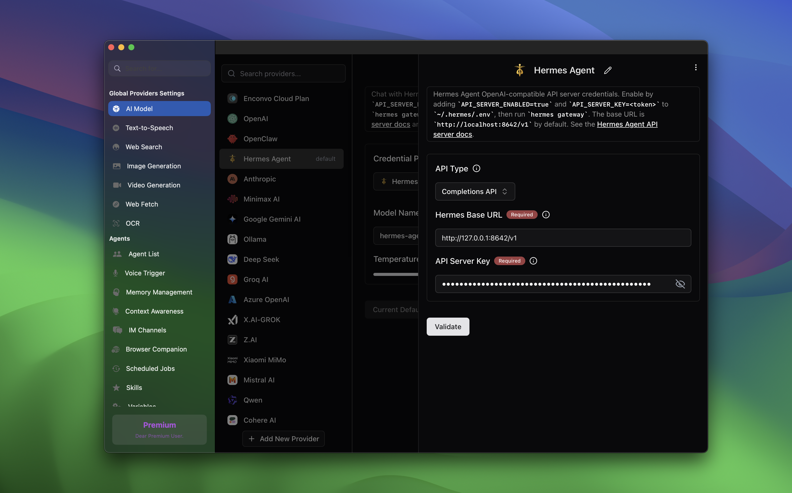

O Hermes Agent é um agente de IA de código aberto da Nous Research. Corre como um runtime de agente local ou num servidor, com ferramentas, memória, skills, acesso ao terminal e integrações de mensagens.

No Enconvo, o Hermes Agent é usado através do servidor de API compatível com a OpenAI. Depois de o gateway Hermes estar a correr, o Enconvo pode usar o Hermes como qualquer outro modelo de IA no chat, nos agentes Enconvo e nas funções que usam modelos.

<Tip>
  Novo no Hermes? Comece pelo [Hermes Agent Quickstart](https://hermes-agent.nousresearch.com/docs/getting-started/quickstart) e volte aqui para o ligar ao Enconvo.
</Tip>

Referência da API: [documentação do servidor de API do Hermes Agent](https://hermes-agent.nousresearch.com/docs/user-guide/features/api-server). Código: [repositório GitHub do Hermes Agent](https://github.com/NousResearch/hermes-agent).

## Antes de começar

- Hermes Agent já instalado e configurado
- Gateway Hermes a correr com o servidor de API ligado
- O token do servidor de API de `API_SERVER_KEY` em `~/.hermes/.env`
- Enconvo com o fornecedor de modelo de IA Hermes Agent ligado

O Hermes expõe endpoints compatíveis com a OpenAI, como `/v1/models`, `/v1/chat/completions` e `/v1/responses`. O fornecedor Hermes do Enconvo usa a API Chat Completions (`/v1/chat/completions`).

O Enconvo não usa a API Responses do Hermes para este fornecedor. Configure o Hermes como um fornecedor Chat Completions compatível com a OpenAI.

## Configurar automaticamente

Abra **Definições → Modelo de IA → Hermes Agent**. O cartão de configuração pode iniciar, parar e configurar o servidor de API Hermes local por você.

Use **Configuração automática** quando o Hermes está instalado no mesmo Mac que o Enconvo. O Enconvo vai:

<Steps>
  <Step title="Encontrar o Hermes">
    Conferir se a CLI `hermes` existe neste Mac.
  </Step>
  <Step title="Ligar o servidor de API">
    Atualizar `~/.hermes/.env` com `API_SERVER_ENABLED=true` e um `API_SERVER_KEY` se faltar um.
  </Step>
  <Step title="Iniciar o gateway">
    Iniciar o serviço de gateway Hermes.
  </Step>
  <Step title="Verificar a API">
    Sondar o servidor de API local com `/v1/health` e `/v1/models`.
  </Step>
  <Step title="Guardar credenciais">
    Guardar o URL base e a chave do servidor de API nas credenciais Hermes do Enconvo.
  </Step>
</Steps>

O cartão de configuração mostra um distintivo de runtime como **A correr** ou **Parado**. Enquanto o cartão está visível, o Enconvo atualiza este estado de vez em quando e deixa de atualizar quando o cartão já não está visível.

## Obter o URL base e a chave de API

Use este URL base quando o Enconvo corre no mesmo Mac que o Hermes:

```text
http://127.0.0.1:8642/v1
```

Leia o token do servidor de API em `~/.hermes/.env`:

```bash
awk -F= '/^API_SERVER_KEY=/{print $2}' ~/.hermes/.env
```

O Enconvo envia este valor como:

```http
Authorization: Bearer <API_SERVER_KEY>
```

Para testar o endpoint compatível com a OpenAI diretamente:

```bash
curl http://127.0.0.1:8642/v1/chat/completions \
  -H "Authorization: Bearer <API_SERVER_KEY>" \
  -H "Content-Type: application/json" \
  -d '{
    "model": "hermes-agent",
    "messages": [
      { "role": "user", "content": "Hello!" }
    ]
  }'
```

Use o URL base que termina em `/v1`, não o endpoint completo `/v1/chat/completions`.

## Ligar o Hermes à mão

Abra **Definições → Modelo de IA → Hermes Agent** e configure o fornecedor de credenciais.



| Definição | Valor |
|---------|-------|
| **Hermes Base URL** | `http://127.0.0.1:8642/v1` |
| **API Server Key** | `API_SERVER_KEY` de `~/.hermes/.env` |

Clique em **Validar** depois de introduzir o URL base e o token.

## Como funcionam os pedidos e os anexos

O Enconvo envia pedidos ao Hermes através de Chat Completions compatível com a OpenAI:

```http
POST /v1/chat/completions
```

Use `hermes-agent` ou o nome de modelo anunciado pelo endpoint `/v1/models` do Hermes.

O Enconvo não envia anexos de imagem ao Hermes. Trate o fornecedor Hermes como um fornecedor de texto e chat no Enconvo, mesmo que o servidor de API Hermes a montante anuncie suporte a entrada de imagem. Para fluxos de imagem, use um fornecedor de modelo com visão ou corra OCR ou análise de imagem antes de enviar texto ao Hermes.

## Usar o Hermes como modelo de IA

Depois de configurado, o Hermes aparece no seletor de modelos. Escolha **Hermes Agent** e selecione o modelo anunciado, em geral `hermes-agent`.


Use este modo quando quer que uma conversa, um comando ou uma função do Enconvo corra através do Hermes Agent, mantendo a interface normal do Enconvo.

<Steps>
  <Step title="Abrir o seletor de modelos">
    No chat ou noutra função do Enconvo que usa modelos, clique no nome do modelo atual.
  </Step>
  <Step title="Escolher Hermes Agent">
    Selecione **Hermes Agent** na lista de fornecedores.
  </Step>
  <Step title="Selecionar o modelo Hermes">
    Escolha `hermes-agent` ou o nome de modelo anunciado pelo seu servidor de API Hermes.
  </Step>
  <Step title="Correr a função normalmente">
    Faça a pergunta ou execute a função do Enconvo. O Hermes trata a chamada do modelo nos bastidores.
  </Step>
</Steps>

O Enconvo carrega os modelos Hermes a partir do endpoint `/v1/models` do Hermes. Se o Hermes não estiver a correr ou o endpoint não estiver disponível, o Enconvo recorre a `hermes-agent`.

## Criar um Agente para o Hermes

Também pode criar um agente Enconvo que coordena o Hermes Agent. É útil quando quer um fluxo, um conjunto de ferramentas ou um prompt virados para o Enconvo em volta do runtime de agente do Hermes.

<Steps>
  <Step title="Abrir Criar Agente">
    Abra a SmartBar e pesquise **Criar Agente**.
  </Step>
  <Step title="Dar nome ao agente">
    Crie um título claro, como `Hermes Agent`.
  </Step>
  <Step title="Escrever instruções de coordenação">
    Dê ao agente Enconvo instruções que expliquem como deve trabalhar com o Hermes.

    ```markdown
    You coordinate Hermes Agent for the user.

    Use Hermes for agentic work, automation, terminal-backed tasks, and requests that should run through the user's Hermes setup.
    Summarize what Hermes did, surface any blockers, and ask before destructive or irreversible actions.
    ```
  </Step>
  <Step title="Escolher o modelo Hermes">
    Nas definições de modelo do agente, selecione **Hermes Agent** e escolha `hermes-agent`.
  </Step>
  <Step title="Guardar e usar o agente">
    Comece uma conversa com o novo agente Enconvo. Ele usa o Hermes e mantém a interface e as ferramentas de agente Enconvo que você configurou.
  </Step>
</Steps>

## Ligar pela rede

Se o Hermes estiver a correr noutra máquina, use o IP da LAN dessa máquina no Enconvo:

```text
http://<hermes-host-lan-ip>:8642/v1
```

<Warning>
  O acesso pela LAN deve usar um `API_SERVER_KEY` forte. Exponha o servidor de API Hermes só em redes em que confia.
</Warning>

## Solução de problemas

<AccordionGroup>
  <Accordion title="O Hermes Agent não aparece no seletor de modelos">
    Confirme que o fornecedor Hermes está ligado em **Definições → Modelo de IA**. Se a lista de modelos estiver vazia, confirme que o gateway está a correr com `hermes gateway status`.
  </Accordion>
  <Accordion title="A validação falha com não autorizado">
    Volte a conferir `API_SERVER_KEY` em `~/.hermes/.env`. O Enconvo espera este valor e envia-o como token Bearer.
  </Accordion>
  <Accordion title="A ligação falha">
    Confirme que o servidor de API está saudável com `curl http://127.0.0.1:8642/v1/health`. Se o Enconvo corre noutro dispositivo, use o IP da LAN do anfitrião e confirme que o Hermes está ligado para acesso de rede.
  </Accordion>
  <Accordion title="O início tem sucesso mas o estado demora um momento a atualizar">
    Os gestores de serviços podem regressar antes de o servidor de API estar pronto. Espere alguns segundos e confira outra vez o distintivo de runtime do cartão de configuração, ou execute `hermes gateway status` e teste `curl http://127.0.0.1:8642/v1/health`.
  </Accordion>
  <Accordion title="Os anexos de imagem são ignorados">
    O fornecedor Hermes no Enconvo é, por agora, só de texto. O Enconvo não envia anexos de imagem ao Hermes; escolha um fornecedor com visão para entrada direta de imagem.
  </Accordion>
  <Accordion title="URL base errado">
    Introduza `http://<gateway-host>:8642/v1`. Não inclua `/chat/completions` no campo de URL base do Enconvo.
  </Accordion>
  <Accordion title="Precisa dos registos do gateway">
    Leia os registos do gateway Hermes com `tail -f ~/.hermes/logs/gateway.log` e os erros com `tail -f ~/.hermes/logs/gateway.error.log`.
  </Accordion>
</AccordionGroup>

## Relacionados

<CardGroup cols={2}>
  <Card title="OpenClaw" icon="server" href="/pt-br/providers/openclaw">Ligue outro gateway de agente da mesma forma.</Card>
  <Card title="Agentes" icon="robot" href="/pt-br/ai/agents">Dê a um Agente instruções e ferramentas.</Card>
</CardGroup>
