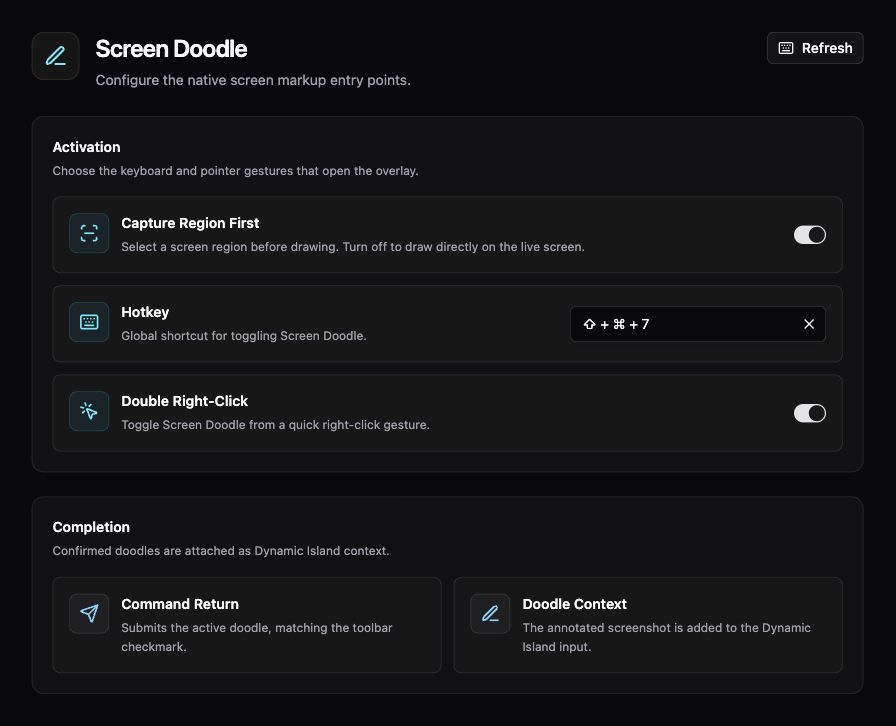

Рисование на экране позволяет пометить часть экрана, прежде чем спрашивать агента. Нарисуйте стрелки, круги, выделения или заметки и отправьте. Помеченный снимок прилагается к чату как изображение, в Dynamic Island, если вы только что не пользовались другим чатом Enconvo, например Окном чата.

<Frame caption="Настройки запуска и завершения рисования на экране.">
  
</Frame>

## Пометить экран

1. Выведите на передний план то, о чём хотите спросить.
2. Дважды щёлкните правой кнопкой, чтобы открыть рисование на экране, или нажмите **Сочетание клавиш**, заданное в **Настройки → Рисование на экране**.
3. Если включено **Сначала выберите область**, перетащите, чтобы выбрать область. Иначе рисуйте прямо по живому экрану.
4. Выберите инструмент на панели и отметьте нужную область.
5. Нажмите **Отправить** (бумажный самолётик) или нажмите **⌘↩**.
6. Проверьте приложенное изображение и напишите запрос, например «Что значит выделенное предупреждение?».

У рисования на экране нет сочетания клавиш, пока вы его не зададите. Двойной правый щелчок работает сразу.

### Добавить голосовую подпись

Удерживайте левую клавишу **Option** и говорите, чтобы описать только что нарисованную фигуру. Слова появляются рядом с ней как текст. Чтобы рисование слушало после каждой фигуры, включите **Говорить после каждой фигуры** на панели и сделайте паузу, чтобы закончить каждую подпись.

## Инструменты

| Инструмент или действие | Клавиша |
| --- | --- |
| Стрелка | **A** |
| Линия | **L** |
| Перо | **P** |
| Маркер | **H** |
| Прямоугольник | **R** |
| Круг | **O** |
| Счётчик (нумерованные метки) | **N** |
| Текст | **T** |
| Выбор | **V** |
| Ластик | **E** |
| Цвет | **C** |
| Толщина линии | **⌘** + прокрутка |
| Доска | **B** |
| Подсветка курсора | **K** |
| Сохранить как… | **⌘S** |
| Отправить | **⌘↩** |

На панели также есть **Отменить**, **Повторить**, **Очистить**, **Копировать в буфер обмена** и **Закрыть**.

## Настройки

Откройте **Настройки → Рисование на экране**.

| Настройка | Что делает |
| --- | --- |
| **Сначала выберите область** | Выберите область перед рисованием. Выключите, чтобы рисовать прямо по живому экрану. Включено по умолчанию. |
| **Сочетание клавиш** | Открывает или закрывает рисование на экране. По умолчанию пусто. |
| **Двойной правый клик** | Открывает или закрывает рисование на экране быстрым двойным правым щелчком. Включено по умолчанию. |

## Устранение неполадок

| Проблема | Что делать |
| --- | --- |
| Наложение не открывается | Проверьте **Сочетание клавиш** и **Двойной правый клик** в **Настройки → Рисование на экране** и проверьте [разрешения macOS](/ru/configuration/permissions). |
| Нужно всё окно приложения | Используйте [Appshots](/ru/features/appshots). |

## См. также

<CardGroup cols={2}>
  <Card title="Dynamic Island" icon="circle-dot" href="/ru/features/dynamic-island">
    Куда по умолчанию уходит пометка.
  </Card>
  <Card title="Appshots" icon="window-maximize" href="/ru/features/appshots">
    Добавьте всё окно приложения одной горячей клавишей.
  </Card>
  <Card title="Контекстная осведомлённость" icon="eye" href="/ru/features/context-awareness">
    Другие способы дать агенту контекст.
  </Card>
</CardGroup>
