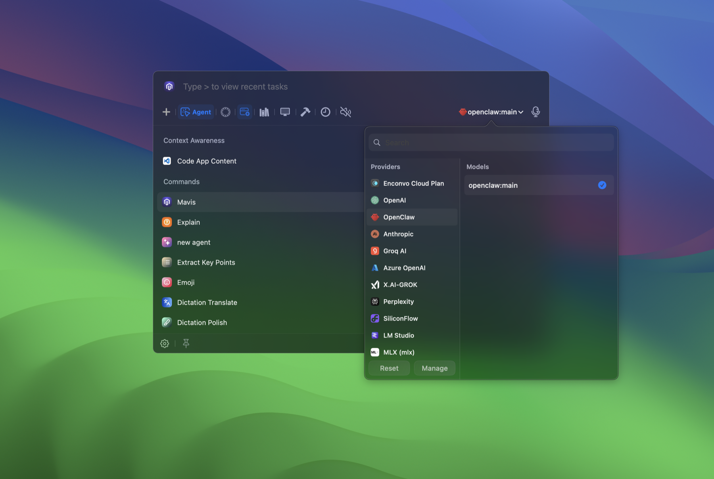

OpenClaw — самостоятельно размещаемая платформа агентов ИИ для помощников в чате, каналах мессенджеров, инструментах, навыках и автоматизациях.

OpenClaw может открывать своих агентов через шлюз, совместимый с OpenAI. После включения шлюза Enconvo может использовать агента OpenClaw как любую другую модель ИИ, в том числе в чате, у агентов Enconvo и в возможностях на моделях.

Шлюз OpenClaw открывает конечные точки, совместимые с OpenAI, такие как `/v1/models`, `/v1/chat/completions` и `/v1/responses`. Провайдер OpenClaw в Enconvo использует Chat Completions API (`/v1/chat/completions`).

<Note>
  Enconvo не использует Responses API OpenClaw для этого провайдера. Настройте OpenClaw через его шлюз Chat Completions, совместимый с OpenAI.
</Note>

Впервые в OpenClaw? Начните с [руководства по началу работы OpenClaw](https://docs.openclaw.ai/start/getting-started), затем вернитесь сюда, чтобы подключить его к Enconvo.

Полный справочник конечных точек шлюза см. в [документации шлюза OpenClaw](https://docs.openclaw.ai/gateway#openai-compatible-endpoints).

## Прежде чем начать

- OpenClaw установлен на машине, где будет работать шлюз
- Шлюз OpenClaw работает на доступном хосте и порту
- Конечная точка шлюза Chat Completions включена
- Токен шлюза из `~/.openclaw/openclaw.json`
- Enconvo с включенным провайдером моделей ИИ OpenClaw

## Настроить автоматически

Откройте **Настройки → AI-модель → OpenClaw**. Карточка настройки может запускать, останавливать и настраивать локальный шлюз OpenClaw за вас.

Используйте **Автонастройка**, когда OpenClaw установлен на том же Mac, что и Enconvo. Enconvo:

<Steps>
  <Step title="Найти OpenClaw">
    Проверьте, что CLI `openclaw` есть на этом Mac.
  </Step>
  <Step title="Включить Chat Completions">
    Run `openclaw config set gateway.http.endpoints.chatCompletions.enabled true`.
  </Step>
  <Step title="Подготовить токен шлюза">
    Прочитайте `gateway.auth.token` из `~/.openclaw/openclaw.json` или создайте его, если его нет.
  </Step>
  <Step title="Запустить шлюз">
    Запустите или перезапустите службу шлюза OpenClaw.
  </Step>
  <Step title="Проверить API">
    Проверьте шлюз через `/health` и `/v1/models`.
  </Step>
  <Step title="Сохранить учетные данные">
    Сохраните базовый URL и токен шлюза в учетные данные OpenClaw в Enconvo.
  </Step>
</Steps>

Карточка настройки показывает значок состояния, например **Запущен** или **Остановлен**. Пока карточка видна, Enconvo периодически обновляет этот статус и перестает обновлять, когда карточка больше не видна.

## Включить шлюз OpenClaw

Можно попросить OpenClaw подготовить данные шлюза за вас:

```text
enable openai-compatible api and give me the token and baseurl
```

Используйте возвращенные базовый URL и токен в настройках учетных данных OpenClaw в Enconvo.

<Steps>
  <Step title="Включить Chat Completions">
    Enable the OpenAI-compatible chat completions endpoint once:

    ```bash
    openclaw config set gateway.http.endpoints.chatCompletions.enabled true
    ```
  </Step>
  <Step title="Выбрать режим привязки">
    For local-only access, keep the default loopback bind. For another device on your LAN to reach the Gateway, bind to LAN:

    ```bash
    openclaw config set gateway.bind lan
    ```
  </Step>
  <Step title="Перезапустить шлюз">
    Apply the configuration change:

    ```bash
    openclaw gateway restart
    ```
  </Step>
  <Step title="Проверить статус шлюза">
    Confirm the Gateway is running:

    ```bash
    openclaw gateway status
    ```
  </Step>
</Steps>

## Подключить OpenClaw вручную

Open **Settings → AI Model → OpenClaw**, then configure the credential provider.


| Setting | Value |
|---------|-------|
| **OpenClaw Base URL** | `http://<gateway-host>:<port>/v1` |
| **Gateway Token** | `gateway.auth.token` from `~/.openclaw/openclaw.json` |

Enconvo uses the Chat Completions API for OpenClaw automatically.

Use the base URL ending in `/v1`, not the full `/v1/chat/completions` endpoint. For example, if your endpoint is `http://192.168.1.18:18789/v1/chat/completions`, enter `http://192.168.1.18:18789/v1`.

To read the Gateway token from the default OpenClaw config file:

```bash
jq -r '.gateway.auth.token' ~/.openclaw/openclaw.json
```

Enconvo sends this value as:

```http
Authorization: Bearer <gateway-token>
```

Click **Validate** after entering the base URL and token.

## How requests and attachments work

Enconvo sends OpenClaw requests through OpenAI-compatible Chat Completions:

```http
POST /v1/chat/completions
```

Use `openclaw:main` or another model name advertised by your OpenClaw agent list.

<Warning>
  Image attachments are not sent to OpenClaw by Enconvo. Treat the OpenClaw provider as a text/chat provider in Enconvo. For image workflows, use a vision-capable model provider or run OCR/image analysis before sending text to OpenClaw.
</Warning>

## Use OpenClaw as an AI model

Once configured, OpenClaw appears in the model selector. Choose **OpenClaw** and select the agent-backed model, such as `openclaw:main`.


Use this mode when you want an Enconvo conversation, command, or feature to run through an OpenClaw agent while keeping the normal Enconvo interface.

<Steps>
  <Step title="Open the model picker">
    In chat or another model-powered Enconvo feature, click the current model name.
  </Step>
  <Step title="Choose OpenClaw">
    Select **OpenClaw** in the provider list.

    
  </Step>
  <Step title="Select an OpenClaw agent model">
    Choose `openclaw:main` or another OpenClaw agent from the model list.
  </Step>
  <Step title="Run the feature normally">
    Ask your question or run the Enconvo feature. The selected OpenClaw agent handles the model call behind the scenes.
  </Step>
</Steps>

Enconvo loads OpenClaw models from `openclaw agents list`. If the OpenClaw CLI is not available locally, Enconvo falls back to `openclaw:main`.

## Create an Agent for OpenClaw

You can also create an Enconvo agent that coordinates an OpenClaw agent. This is useful when you want an Enconvo-facing workflow, tool set, or prompt around a specific OpenClaw agent.

<Steps>
  <Step title="Open Create Agent">
    Open SmartBar and search for **Create Agent**.

    
  </Step>
  <Step title="Name the agent">
    Create a clear title, such as `OpenClaw Main`.

    
  </Step>
  <Step title="Write coordinator instructions">
    Give the Enconvo agent instructions that explain how it should work with OpenClaw.

    ```markdown
    You coordinate the OpenClaw Main agent for the user.

    Use OpenClaw for agentic work, automation, and tasks that should run through the user's OpenClaw setup.
    Summarize what OpenClaw did, surface any blockers, and ask before destructive or irreversible actions.
    ```
  </Step>
  <Step title="Choose the OpenClaw model">
    In the agent's model settings, select **OpenClaw** and choose `openclaw:main`.
  </Step>
  <Step title="Save and use the agent">
    Start a conversation with the new Enconvo agent. It will use the selected OpenClaw agent model while retaining the Enconvo agent interface and tools you configured.
  </Step>
</Steps>

## Устранение неполадок

<AccordionGroup>
  <Accordion title="OpenClaw does not appear in the model picker">
    Make sure the OpenClaw provider is enabled in **Settings → AI Model**. If the model list is empty, verify that `openclaw agents list` works locally or use the default `openclaw:main`.
  </Accordion>
  <Accordion title="Validation fails with unauthorized">
    Recheck the Gateway token. Enconvo expects the value from `gateway.auth.token` and sends it as a Bearer token.
  </Accordion>
  <Accordion title="Connection fails">
    Confirm the Gateway is running with `openclaw gateway status`. If Enconvo is on another device, set `gateway.bind` to `lan`, restart the Gateway, and use the host's LAN IP in the base URL.
  </Accordion>
  <Accordion title="Start succeeds but Enconvo briefly says it needs attention">
    OpenClaw can report that the LaunchAgent restarted before the HTTP Gateway is ready. Wait a few seconds and check the setup card's runtime badge again. You can also verify directly with `openclaw gateway status` and `curl http://127.0.0.1:18789/health`.
  </Accordion>
  <Accordion title="The Gateway is running but `/v1/models` fails">
    Make sure Enconvo is using the same token as `gateway.auth.token` in `~/.openclaw/openclaw.json`. The setup status can still detect a running Gateway through `/health`, but model validation requires the bearer token.
  </Accordion>
  <Accordion title="Image attachments are ignored">
    The OpenClaw provider in Enconvo is currently text-only. Enconvo will not send image attachments to OpenClaw; choose a vision-capable provider for direct image input.
  </Accordion>
  <Accordion title="Wrong base URL">
    Enter `http://<gateway-host>:<port>/v1`. Do not include `/chat/completions` in the Enconvo base URL field.
  </Accordion>
</AccordionGroup>

## См. также

<CardGroup cols={2}>
  <Card title="Hermes Agent" icon="server" href="/ru/providers/hermes">Connect another agent gateway the same way.</Card>
  <Card title="Agents" icon="robot" href="/ru/ai/agents">Give an Agent instructions and tools.</Card>
</CardGroup>
