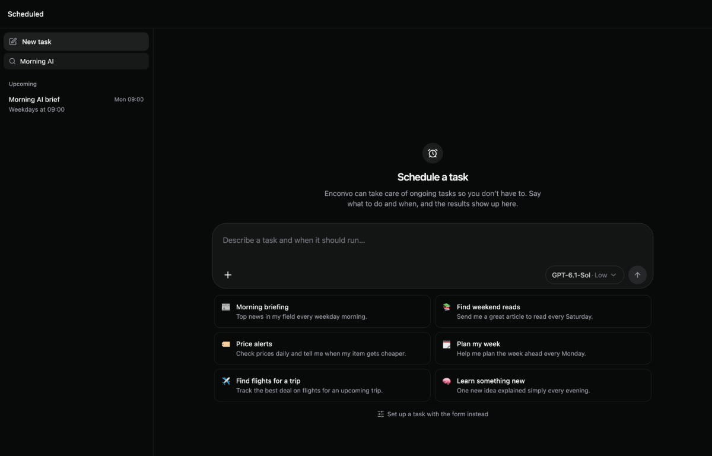

Ці огляди показують справжній інтерфейс Enconvo. Кроки призупинено для зручності читання, а супровідні посібники містять ті самі інструкції текстом. Приклади чернеток відкидають після зйомки.

## Спарити iPhone

Озвучений навчальний ролик: увійдіть у програмі iPhone, покажіть код спарювання на Mac, відскануйте його і продовжуйте чати Mac із телефону.

[Прочитати посібник і переглянути відео](/uk/integrations/iphone-app).

<Frame>
  
</Frame>

## Зібрати перший робочий процес

Озвучений навчальний ролик: створіть робочий процес із стартового шаблону, додайте крок вручну, дайте асистенту робочого процесу додати ще один, потім запустіть його і перегляньте вивід кожного кроку.

[Прочитати посібник і переглянути відео](/uk/workflows/build-your-first-workflow).

<Frame>
  
</Frame>

## Запланувати завдання

Відкрийте Заплановані, виберіть стартове завдання, перегляньте деталі завдання і відкрийте його редактор. Стартову чернетку не надіслано, а приклад завдання видалено після зйомки.

[Прочитати посібник і переглянути відео](/uk/workflows/scheduled-jobs).

<Frame>
  
</Frame>

## Переглянути галерею аватара

Перейдіть до Завантажених, знайдіть Tia, перегляньте необов’язкові завантаження, потім поверніться до Галереї. Жодного пакета не завантажено і жодного призначення не змінено.

[Прочитати посібник і переглянути відео](/uk/features/avatar).

<Frame>
  
</Frame>

## Підготувати записи словника

Введіть термін і опис, перейдіть до пакетного додавання і введіть три приклади рядків. Чернетку відкидають; жоден запис словника не збережено.

[Прочитати посібник і переглянути відео](/uk/configuration/speech-assets).

<Frame>
  
</Frame>

## Дослідити редактор робочих процесів

Перемикайтеся між візуальним виглядом і YAML, перегляньте вхідні дані запуску і відкрийте інспектор кроку. Робочий процес ні змінено, ні виконано.

[Прочитати посібник і переглянути відео](/uk/workflows/creating-workflows).

<Frame>
  
</Frame>
