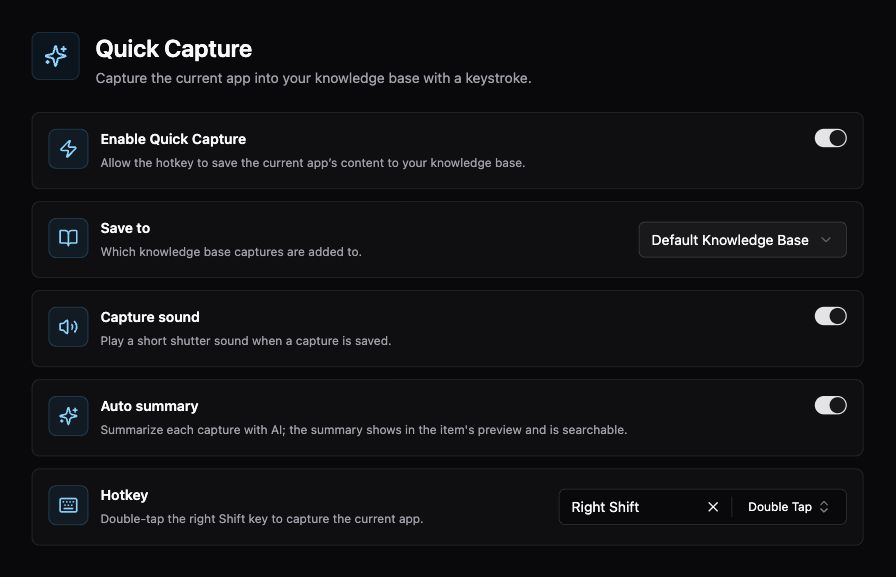

快速擷取會把目前 App 的內容儲存到知識庫，供日後使用。每次擷取都會保留視窗截圖及其文字：瀏覽器會儲存網頁內容，YouTube 影片則儲存字幕。[Appshots](/zh-hant/features/appshots) 是把 App 視窗附加到你正在問的問題中；快速擷取則會建立一個長期保存的知識庫項目。

<Frame caption="快速擷取的儲存位置、音效、自動摘要與快速鍵控制項。">
  
</Frame>

## 擷取值得保存的內容

1. 將包含內容的 App 切換到最上層。
2. 按下快速擷取快速鍵，或開啟[動態島](/zh-hant/features/dynamic-island)並點擊 **快速擷取**。快速擷取預設沒有快速鍵，需先在 **設定 → 快速擷取** 的 **快速鍵** 下設定。
3. 按下快速鍵的瞬間，Enconvo 就會擷取畫面並顯示膠囊提示，接著將擷取內容儲存至 **儲存至** 中設定的知識庫；除非你另外選擇，否則會存入預設知識庫。同時會播放一聲短促的快門聲。
4. 通知會顯示儲存了什麼以及存到哪裡。點擊 **開啟** 可在知識庫中檢視，或點擊 **還原** 收回這次擷取。

如果儲存失敗，通知會提供 **再試一次** 與 **關閉**。[語音筆記](/zh-hant/features/voice-notes)也具有相同的 **還原**、**再試一次** 與 **關閉**。

項目出現後，建立索引與產生摘要可能還要稍等片刻才會完成。

## 設定

開啟 **設定 → 快速擷取**。

| 設定 | 作用 |
| --- | --- |
| **啟用快速擷取** | 允許快速鍵儲存目前的 App。這也會同時開啟或關閉[語音筆記](/zh-hant/features/voice-notes)快速鍵。預設為開啟。 |
| **儲存至** | 擷取內容存入的知識庫。擷取內容無法存入記憶。 |
| **錄製聲音** | 儲存擷取內容時播放一聲短促的快門聲。 |
| **自動摘要** | 使用 AI 為每次擷取產生摘要。摘要會顯示在項目預覽中並可供搜尋。 |
| **快速鍵** | 儲存目前 App 的快捷鍵。預設為無。可以是雙擊某個輔助鍵（例如右側 **Shift** 鍵），或是一般的快捷鍵。 |

**自動摘要** 會將擷取到的文字傳送給你的 AI 模型。如果想控制擷取內容的處理位置，請檢查你的模型與服務供應商設定。

### X 貼文

同一頁面上的 **X** 區塊用於設定 Enconvo [瀏覽器擴充功能](/zh-hant/features/browser-extension)在 x.com 上的行為。

| 設定 | 作用 |
| --- | --- |
| **卡片樣式** | 將已儲存的貼文顯示為 **貼文** 或 **截圖**。切換後，之前儲存的貼文也會隨之改變。 |
| **在 X 上加入書籤時** | X 本身的書籤按鈕的行為：**在 X 上加入書籤**、**加入書籤並儲存到 Enconvo** 或 **僅儲存到 Enconvo**。在你做出選擇之前，Enconvo 會在你第一次加入書籤時詢問。移除書籤仍會將貼文保留在 Enconvo 中。 |
| **「詢問 Enconvo」按鈕** | 在每則貼文標題列的 Grok 旁顯示 Enconvo 按鈕，用來就貼文與回覆提問。 |
| **自動摘要 X 貼文** | 用 AI 摘要每則已儲存的貼文及其討論串。 |
| **自動為已儲存的貼文分類** | 依主題為每則已儲存的貼文加上標籤。需要登入帳號。 |

## 疑難排解

| 問題 | 解決方法 |
| --- | --- |
| 內容遺漏或不完整 | 檢查[權限](/zh-hant/configuration/permissions)，將目標 App 切換到最上層，並用一個簡單、清楚可見的範例試試。 |
| 找不到擷取內容 | 檢查 **儲存至**，然後開啟該知識庫。項目剛出現時，索引與摘要可能尚未完成。 |
| 快速鍵沒有反應 | 確認 **啟用快速擷取** 已開啟，並且已設定 **快速鍵**。 |

## 相關內容

<CardGroup cols={2}>
  <Card title="知識庫" icon="book" href="/zh-hant/ai/knowledge-base">
    瀏覽、搜尋你儲存的內容，並就其提問。
  </Card>
  <Card title="Appshots" icon="window-maximize" href="/zh-hant/features/appshots">
    將 App 視窗加入你正在問的問題中。
  </Card>
  <Card title="語音筆記" icon="microphone" href="/zh-hant/features/voice-notes">
    將口述筆記儲存到知識庫。
  </Card>
</CardGroup>
