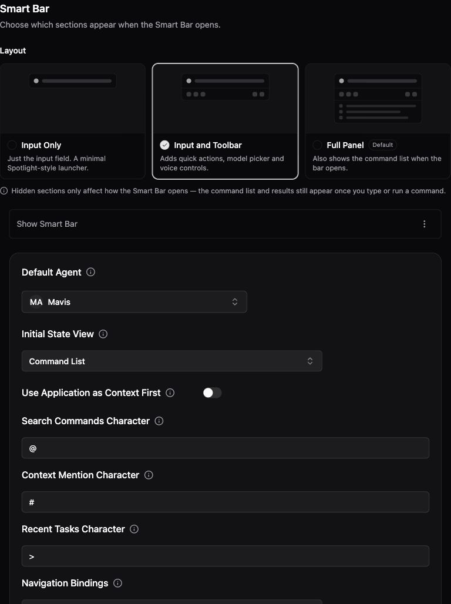

SmartBar 是一個可從任何應用程式開啟的啟動列，讓你快速向代理程式提問或執行指令。按下 **⌥Space**、輸入內容，再按 Return 即可。當你想快速獲得解答並立刻回到手邊工作時，SmartBar 是最佳選擇。

其他需求可分別使用：處理長篇對話與檔案可使用[聊天視窗](/zh-hant/ai/chat)，在單一 App 旁協作可使用 [App 側邊欄](/zh-hant/features/app-sidebar)，處理選取文字可使用 [PopBar](/zh-hant/features/popbar)，需要常駐於螢幕上的精巧入口則可使用[動態島](/zh-hant/features/dynamic-island)與[桌面寵物](/zh-hant/features/pet)。[視窗管理](/zh-hant/features/window-management)比較了所有介面入口。

## 提出問題

1. 按下 **⌥Space**，或你在**設定 → SmartBar** 中自訂的快速鍵。
2. 輸入你的問題。若有需要，可先切換其他代理程式或模型。
3. 附加代理程式需要的上下文資訊。它不會讀取所有已開啟的應用程式；請參閱[加入上下文](#加入上下文)。
4. 按 Return，並查看回覆或工具執行進度。若要中止回覆，請點擊圓形停止按鈕。
5. 複製結果，或輸入追問以接續對話。任務執行期間輸入的訊息會立即顯示。

當你輸入的文字符合某個指令時，按 Return 會執行反白的項目。若要改為將文字傳送給代理程式，請按 **⌘Return** 或點擊**傳送給 AI**。**⌥Return** 則會執行該列的第二個動作。

在代理程式模式下，**權限**標籤決定代理程式在行動前何時詢問你，而**沙盒**開關則將代理程式的指令限制在工作資料夾內。請參閱[代理程式沙盒](/zh-hant/configuration/sandbox)。

## 使用觸發字元搜尋

在 SmartBar 中輸入以下字元，即可搜尋對應類型的項目：

| 輸入 | 用途 |
| --- | --- |
| `@` | 搜尋指令 |
| `#` | 加入上下文 |
| `$` | 使用技能 |
| `>` | 顯示最近任務 |
| `/` | 開啟操作選單，例如模型與推理強度選擇 |

你可以在**設定 → SmartBar** 的**搜尋**底下修改前四個觸發字元。`/` 無法更改。

建議從開啟的列表中直接挑選項目，而不要憑記憶手動輸入名稱：列表只會顯示你目前實際擁有的指令與上下文來源。請參閱[寫作工具組](/zh-hant/features/writing-tools)、[快速連結](/zh-hant/features/quick-links)與[上下文感知](/zh-hant/features/context-awareness)。

部分列表可透過別名開啟：輸入別名並加上空格，即可直接在 SmartBar 內開啟[剪貼簿歷史、書籤搜尋或檔案搜尋](/zh-hant/features/clipboard-history)。

## 加入上下文

SmartBar 開啟時可自動取得選取的文字、Finder 選取項目與目前的瀏覽器網頁。請在**設定 → 上下文感知**中為每一項選擇**自動加入**、**建議**或**關閉**。若要加入其他內容，請輸入 `#` 並挑選來源。

## 選擇版面配置

<Frame caption="SmartBar 的三種開啟版面配置。反白顯示的版面為範例設定。">
  
</Frame>

**設定 → SmartBar** 中的**版面配置**決定 SmartBar 開啟時顯示的畫面：

| 版面配置 | 開啟時顯示 |
| --- | --- |
| **僅輸入框** | 僅顯示輸入欄位 |
| **輸入框和工具列** | 輸入欄位，加上快捷操作、模型選擇器與語音控制 |
| **完整面板** | 以上全部，外加輸入欄位下方的項目列表 |

在**完整面板**模式下，**初始檢視**設定在輸入前列表顯示的內容：**推薦提示詞**或**指令列表**。無論選擇哪種版面配置，一旦開始輸入或執行指令，列表與結果仍會照常顯示。

## 設定

開啟**設定 → SmartBar**。

| 設定 | 變更內容 |
| --- | --- |
| **快速鍵** | 從任何應用程式開啟與關閉 SmartBar。預設為 **⌥Space**。 |
| **預設代理程式** | 負責回答你在輸入框中提問的代理程式。 |
| **自動清除對話** | SmartBar 關閉超過指定時間後再次開啟時自動開始新對話，範圍從**永不**到**每次開啟時**。 |
| **版面配置** | SmartBar 開啟時顯示的畫面（見上文）。 |
| **外觀** | SmartBar 與 App 側邊欄的淺色或深色玻璃質感，或**跟隨應用程式**。 |
| **自動切換輸入法** | 在 SmartBar 中輸入時自動切換為指定輸入法，關閉時切回原本的輸入法。 |
| **導覽快速鍵** | 在列表與文字間移動的 Control 鍵快捷組合：**macOS**（⌃N ⌃P ⌃F ⌃B）或 **Vim**（⌃J ⌃K ⌃L ⌃H）。 |
| **搜尋** | 用於指令、上下文、技能與最近任務的觸發字元。 |
| **計算機** | 在你輸入時即時解答數學運算、單位換算、貨幣匯率、日期與時區。預設為開啟。 |
| **天氣和航班** | 同時查詢任何地點的天氣、航班與當地時間。預設為關閉。 |

更改預設值不會改變既有的對話。[模型選擇指南](/zh-hant/ai/model-selection-guide)說明了每個對話如何各自保留所選的模型與推理強度。

## 語音與計算

點擊麥克風即可透過[聽寫](/zh-hant/features/dictation)口述問題。若想進行語音對談，請啟動 [Live Talk](/zh-hant/features/live-voice)；從 SmartBar 發起的通話會移至動態島顯示。

輸入數學算式（例如 `2+3*4`），SmartBar 會即時顯示計算結果。計算機也支援單位與貨幣換算、日期與時區運算，以及分帳計算（例如 `25% off $60 split by 3`）。複製前請先確認結果與提供的操作項目。

若要查詢天氣、航班或某地時間，請在**設定 → SmartBar** 中開啟**天氣和航班**。接著輸入 `weather in London`、`Tokyo feels like`、航班編號（如 `BA008`），或 `time in Chernivtsi`。系統只會將地點名稱或航班編號傳送給 Open-Meteo、adsbdb 與 adsb.lol。**天氣和航班**設定與[動態島](/zh-hant/features/dynamic-island)首頁的計算機共用。

## 疑難排解

| 問題 | 解決方式 |
| --- | --- |
| SmartBar 無法開啟 | 檢查**設定 → SmartBar** 中的**快速鍵**，並確認是否有其他應用程式佔用同一組快捷鍵。如果你先前曾自訂按鍵，系統會保留你的設定。 |
| 按 Return 執行了指令而不是詢問代理程式 | 按 **⌘Return**，或點擊**傳送給 AI**。 |
| 輸入算式或天氣查詢沒有顯示結果 | 檢查**設定 → SmartBar** 中的**計算機**與**天氣和航班**開關。 |
| 上下文中缺少應用程式內容或選取文字 | 檢查[權限](/zh-hant/configuration/permissions)與**設定 → 上下文感知**。 |
| 請求失敗 | 檢查所選的服務供應商並閱讀錯誤提示。 |
| 找不到本頁提到的某個控制項 | 你的版本可能較本指南舊。請參閱[更新](/zh-hant/configuration/updates)。 |

## 相關文件

<CardGroup cols={2}>
  <Card title="聊天視窗" icon="comments" href="/zh-hant/ai/chat">包含歷史記錄、專案與檔案的長篇對話。</Card>
  <Card title="動態島" icon="window-maximize" href="/zh-hant/features/dynamic-island">螢幕頂端的精巧輸入入口。</Card>
  <Card title="上下文感知" icon="layer-group" href="/zh-hant/features/context-awareness">選擇 Enconvo 自動取得的上下文內容。</Card>
  <Card title="鍵盤快速鍵" icon="keyboard" href="/zh-hant/configuration/keyboard-shortcuts">變更開啟各個視窗的快速鍵。</Card>
</CardGroup>
