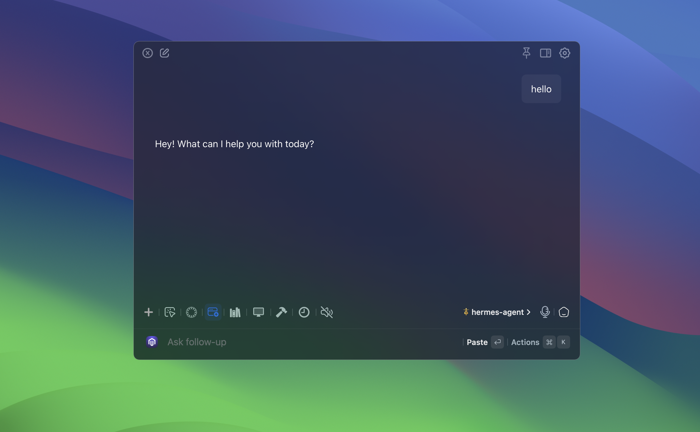

Hermes Agent 是 Nous Research 推出的開源 AI 代理程式。它作為本機或伺服器託管的代理程式執行環境運作，具備工具、記憶、技能、終端機存取與即時通訊整合能力。

在 Enconvo 中，Hermes Agent 是透過其相容 OpenAI 的 API 伺服器來使用。當 Hermes 閘道執行後，Enconvo 就能像使用其他 AI 模型一樣，在聊天、Enconvo 代理程式以及由模型驅動的功能中使用 Hermes。

<Tip>
  剛接觸 Hermes？請先參閱 [Hermes Agent 快速入門](https://hermes-agent.nousresearch.com/docs/getting-started/quickstart)，再回到這裡將它連接至 Enconvo。
</Tip>

API 參考文件：[Hermes Agent API 伺服器文件](https://hermes-agent.nousresearch.com/docs/user-guide/features/api-server)。原始碼：[Hermes Agent GitHub 儲存庫](https://github.com/NousResearch/hermes-agent)。

## 開始之前

- 已安裝並設定好 Hermes Agent
- Hermes 閘道正在執行，且已啟用 API 伺服器
- 已取得 `~/.hermes/.env` 中 `API_SERVER_KEY` 的 API 伺服器 Token
- Enconvo 已啟用 Hermes Agent AI 模型服務供應商

Hermes 提供相容 OpenAI 的端點，例如 `/v1/models`、`/v1/chat/completions` 與 `/v1/responses`。Enconvo 的 Hermes 服務供應商使用的是 Chat Completions API（`/v1/chat/completions`）。

Enconvo 不會為此服務供應商使用 Hermes Responses API。請將 Hermes 設定為相容 OpenAI 的 Chat Completions 服務供應商。

## 自動設定

開啟 **設定 → AI 模型 → Hermes Agent**。設定卡片可為你啟動、停止與設定本機 Hermes API 伺服器。

當 Hermes 與 Enconvo 安裝在同一台 Mac 上時，請使用 **自動設定**。Enconvo 將會：

<Steps>
  <Step title="尋找 Hermes">
    檢查這台 Mac 上是否存在 `hermes` CLI。
  </Step>
  <Step title="啟用 API 伺服器">
    更新 `~/.hermes/.env`，設定 `API_SERVER_ENABLED=true`，若缺少 `API_SERVER_KEY` 則產生一組。
  </Step>
  <Step title="啟動閘道">
    啟動 Hermes 閘道服務。
  </Step>
  <Step title="驗證 API">
    透過 `/v1/health` 與 `/v1/models` 探測本機 API 伺服器。
  </Step>
  <Step title="儲存憑證">
    將基礎 URL 與 API 伺服器金鑰儲存至 Enconvo 的 Hermes 憑證中。
  </Step>
</Steps>

設定卡片會顯示執行狀態徽章，例如 **執行中** 或 **已停止**。當卡片可見時，Enconvo 會定期重新整理此狀態，當卡片不再可見時則停止重新整理。

## 取得基礎 URL 與 API 金鑰

當 Enconvo 與 Hermes 執行在同一台 Mac 上時，請使用此基礎 URL：

```text
http://127.0.0.1:8642/v1
```

從 `~/.hermes/.env` 讀取 API 伺服器 Token：

```bash
awk -F= '/^API_SERVER_KEY=/{print $2}' ~/.hermes/.env
```

Enconvo 會以下列方式傳送此值：

```http
Authorization: Bearer <API_SERVER_KEY>
```

若要直接測試相容 OpenAI 的端點：

```bash
curl http://127.0.0.1:8642/v1/chat/completions \
  -H "Authorization: Bearer <API_SERVER_KEY>" \
  -H "Content-Type: application/json" \
  -d '{
    "model": "hermes-agent",
    "messages": [
      { "role": "user", "content": "Hello!" }
    ]
  }'
```

請使用以 `/v1` 結尾的基礎 URL，而非完整的 `/v1/chat/completions` 端點。

## 手動連接 Hermes

開啟 **設定 → AI 模型 → Hermes Agent**，然後設定憑證服務供應商。


| 設定 | 值 |
|---------|-------|
| **Hermes 基礎 URL** | `http://127.0.0.1:8642/v1` |
| **API 伺服器金鑰** | 來自 `~/.hermes/.env` 的 `API_SERVER_KEY` |

輸入基礎 URL 與 Token 後，點擊 **驗證**。

## 請求與附件的運作方式

Enconvo 會透過相容 OpenAI 的 Chat Completions 傳送 Hermes 請求：

```http
POST /v1/chat/completions
```

請使用 `hermes-agent` 或 Hermes `/v1/models` 端點所宣告的模型名稱。

Enconvo 不會將圖片附件傳送給 Hermes。即使你上游的 Hermes API 伺服器宣告支援圖片輸入，在 Enconvo 中仍請將 Hermes 服務供應商視為純文字/聊天服務供應商。如需處理圖片工作流程，請使用支援視覺的模型服務供應商，或在傳送文字給 Hermes 之前先執行 OCR 或圖像分析。

## 將 Hermes 作為 AI 模型使用

設定完成後，Hermes 會出現在模型選擇器中。選擇 **Hermes Agent** 並選取所宣告的模型，通常為 `hermes-agent`。



當你希望 Enconvo 對話、指令或功能透過 Hermes Agent 執行，同時保留原本的 Enconvo 介面時，請使用此模式。

<Steps>
  <Step title="開啟模型選擇器">
    在聊天或其他由模型驅動的 Enconvo 功能中，點擊目前的模型名稱。
  </Step>
  <Step title="選擇 Hermes Agent">
    在服務供應商清單中選擇 **Hermes Agent**。
  </Step>
  <Step title="選取 Hermes 模型">
    選取 `hermes-agent` 或你的 Hermes API 伺服器所宣告的模型名稱。
  </Step>
  <Step title="正常執行功能">
    提出問題或執行該 Enconvo 功能。Hermes 會在幕後處理模型呼叫。
  </Step>
</Steps>

Enconvo 會從 Hermes 的 `/v1/models` 端點載入 Hermes 模型。若 Hermes 未執行或無法連線該端點，Enconvo 會退回使用 `hermes-agent`。

## 為 Hermes 建立代理程式

你也可以建立一個用來協調 Hermes Agent 的 Enconvo 代理程式。當你想圍繞 Hermes 的代理程式執行環境打造面向 Enconvo 的工作流程、工具組或提示詞時，這會非常實用。

<Steps>
  <Step title="開啟建立代理">
    開啟 SmartBar 並搜尋 **建立代理**。
  </Step>
  <Step title="命名代理程式">
    建立一個清楚的標題，例如 `Hermes Agent`。
  </Step>
  <Step title="撰寫協調指令">
    為這個 Enconvo 代理程式提供說明，解釋它應如何配合 Hermes 工作。

    ```markdown
    You coordinate Hermes Agent for the user.

    Use Hermes for agentic work, automation, terminal-backed tasks, and requests that should run through the user's Hermes setup.
    Summarize what Hermes did, surface any blockers, and ask before destructive or irreversible actions.
    ```
  </Step>
  <Step title="選擇 Hermes 模型">
    在代理程式的模型設定中，選擇 **Hermes Agent** 並選取 `hermes-agent`。
  </Step>
  <Step title="儲存並使用代理程式">
    與新建的 Enconvo 代理程式開始對話。它將使用 Hermes，同時保留你設定的 Enconvo 代理程式介面與工具。
  </Step>
</Steps>

## 透過網路連線

若 Hermes 執行在另一台機器上，請在 Enconvo 中使用該主機的區域網路 IP：

```text
http://<hermes-host-lan-ip>:8642/v1
```

<Warning>
  區域網路存取應使用強度足夠的 `API_SERVER_KEY`。僅在你信任的網路上開放 Hermes API 伺服器。
</Warning>

## 疑難排解

<AccordionGroup>
  <Accordion title="Hermes Agent 未出現在模型選擇器中">
    請確認已在 **設定 → AI 模型** 中啟用 Hermes 服務供應商。如果模型清單為空，請以 `hermes gateway status` 確認閘道正在執行。
  </Accordion>
  <Accordion title="驗證失敗並顯示未授權">
    請重新檢查 `~/.hermes/.env` 中的 `API_SERVER_KEY`。Enconvo 需要此值，並會將其作為 Bearer Token 傳送。
  </Accordion>
  <Accordion title="連線失敗">
    使用 `curl http://127.0.0.1:8642/v1/health` 確認 API 伺服器正常運作。如果 Enconvo 執行在另一台裝置上，請使用主機的區域網路 IP，並確認 Hermes 已繫結為允許網路存取。
  </Accordion>
  <Accordion title="啟動成功但狀態需要片刻才會更新">
    服務管理員可能會在 API 伺服器準備就緒前就先傳回結果。請稍候幾秒後再次檢查設定卡片的執行狀態徽章，或執行 `hermes gateway status` 並測試 `curl http://127.0.0.1:8642/v1/health`。
  </Accordion>
  <Accordion title="圖片附件被忽略">
    Enconvo 中的 Hermes 服務供應商目前僅支援純文字。Enconvo 不會將圖片附件傳送給 Hermes；如需直接輸入圖片，請選擇支援視覺的服務供應商。
  </Accordion>
  <Accordion title="基礎 URL 錯誤">
    請輸入 `http://<gateway-host>:8642/v1`。不要在 Enconvo 的基礎 URL 欄位中加入 `/chat/completions`。
  </Accordion>
  <Accordion title="需要檢視閘道記錄檔">
    使用 `tail -f ~/.hermes/logs/gateway.log` 讀取 Hermes 閘道記錄檔，使用 `tail -f ~/.hermes/logs/gateway.error.log` 讀取錯誤記錄。
  </Accordion>
</AccordionGroup>

## 相關內容

<CardGroup cols={2}>
  <Card title="OpenClaw" icon="server" href="/zh-hant/providers/openclaw">以相同方式連接另一個代理閘道。</Card>
  <Card title="代理程式" icon="robot" href="/zh-hant/ai/agents">為代理程式設定指令與工具。</Card>
</CardGroup>
