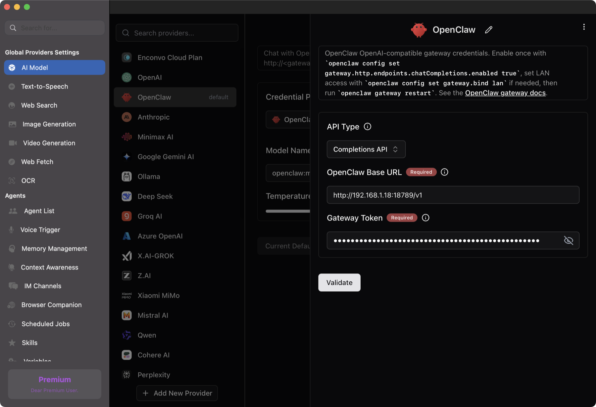

OpenClaw 是一個可自行託管的 AI 代理平台，用於在聊天、即時通訊管道、工具、技能與自動化之間執行助手。

OpenClaw 可以透過相容 OpenAI 的閘道開放其代理程式。啟用閘道後，Enconvo 就能像使用任何其他 AI 模型一樣使用 OpenClaw 代理程式，包含在聊天、Enconvo 代理程式以及由模型驅動的功能中。

OpenClaw 的閘道提供相容 OpenAI 的端點，例如 `/v1/models`、`/v1/chat/completions` 與 `/v1/responses`。Enconvo 的 OpenClaw 服務供應商使用的是 Chat Completions API（`/v1/chat/completions`）。

<Note>
  Enconvo 不會為此服務供應商使用 OpenClaw Responses API。請透過其相容 OpenAI 的 Chat Completions 閘道設定 OpenClaw。
</Note>

剛接觸 OpenClaw？請先參閱 [OpenClaw 入門指南](https://docs.openclaw.ai/start/getting-started)，再回到這裡將它連接至 Enconvo。

完整的閘道端點參考請參閱 [OpenClaw 閘道文件](https://docs.openclaw.ai/gateway#openai-compatible-endpoints)。

## 開始之前

- 在將執行閘道的機器上安裝好 OpenClaw
- OpenClaw 閘道正在可連線的主機與連接埠上執行
- 已啟用 Chat Completions 閘道端點
- 已取得 `~/.openclaw/openclaw.json` 中的閘道 Token
- Enconvo 已啟用 OpenClaw AI 模型服務供應商

## 自動設定

開啟 **設定 → AI 模型 → OpenClaw**。設定卡片可為你啟動、停止與設定本機 OpenClaw 閘道。

當 OpenClaw 與 Enconvo 安裝在同一台 Mac 上時，請使用 **自動設定**。Enconvo 將會：

<Steps>
  <Step title="尋找 OpenClaw">
    檢查這台 Mac 上是否存在 `openclaw` CLI。
  </Step>
  <Step title="啟用 Chat Completions">
    執行 `openclaw config set gateway.http.endpoints.chatCompletions.enabled true`。
  </Step>
  <Step title="準備閘道 Token">
    從 `~/.openclaw/openclaw.json` 讀取 `gateway.auth.token`，若缺少則建立一個。
  </Step>
  <Step title="啟動閘道">
    啟動或重新啟動 OpenClaw 閘道服務。
  </Step>
  <Step title="驗證 API">
    透過 `/health` 與 `/v1/models` 探測閘道。
  </Step>
  <Step title="儲存憑證">
    將基礎 URL 與閘道 Token 儲存至 Enconvo 的 OpenClaw 憑證中。
  </Step>
</Steps>

設定卡片會顯示執行狀態徽章，例如 **執行中** 或 **已停止**。當卡片可見時，Enconvo 會定期重新整理此狀態，當卡片不再可見時則停止重新整理。

## 開啟 OpenClaw 閘道

你可以直接請 OpenClaw 為你準備好閘道資訊：

```text
enable openai-compatible api and give me the token and baseurl
```

在 Enconvo 的 OpenClaw 憑證設定中使用傳回的基礎 URL 與 Token。

<Steps>
  <Step title="啟用 Chat Completions">
    執行一次以啟用相容 OpenAI 的 Chat Completions 端點：

    ```bash
    openclaw config set gateway.http.endpoints.chatCompletions.enabled true
    ```
  </Step>
  <Step title="選擇繫結模式">
    若僅限本機存取，保留預設的 loopback 繫結即可。若要讓區域網路上的其他裝置連線至此閘道，請繫結至區域網路：

    ```bash
    openclaw config set gateway.bind lan
    ```
  </Step>
  <Step title="重新啟動閘道">
    套用設定變更：

    ```bash
    openclaw gateway restart
    ```
  </Step>
  <Step title="檢查閘道狀態">
    確認閘道正在執行：

    ```bash
    openclaw gateway status
    ```
  </Step>
</Steps>

## 手動連接 OpenClaw

開啟 **設定 → AI 模型 → OpenClaw**，然後設定憑證服務供應商。



| 設定 | 值 |
|---------|-------|
| **OpenClaw 基礎 URL** | `http://<gateway-host>:<port>/v1` |
| **閘道 Token** | 來自 `~/.openclaw/openclaw.json` 的 `gateway.auth.token` |

Enconvo 會自動為 OpenClaw 使用 Chat Completions API。

請使用以 `/v1` 結尾的基礎 URL，而非完整的 `/v1/chat/completions` 端點。例如，若你的端點為 `http://192.168.1.18:18789/v1/chat/completions`，請輸入 `http://192.168.1.18:18789/v1`。

從預設 OpenClaw 設定檔讀取閘道 Token：

```bash
jq -r '.gateway.auth.token' ~/.openclaw/openclaw.json
```

Enconvo 會以下列方式傳送此值：

```http
Authorization: Bearer <gateway-token>
```

輸入基礎 URL 與 Token 後，點擊 **驗證**。

## 請求與附件的運作方式

Enconvo 會透過相容 OpenAI 的 Chat Completions 傳送 OpenClaw 請求：

```http
POST /v1/chat/completions
```

請使用 `openclaw:main` 或你的 OpenClaw 代理程式列表所宣告的其他模型名稱。

<Warning>
  Enconvo 不會將圖片附件傳送給 OpenClaw。請在 Enconvo 中將 OpenClaw 服務供應商視為純文字/聊天服務供應商。如需處理圖片工作流程，請使用支援視覺的模型服務供應商，或在傳送文字給 OpenClaw 之前先執行 OCR 或圖像分析。
</Warning>

## 將 OpenClaw 作為 AI 模型使用

設定完成後，OpenClaw 會出現在模型選擇器中。選擇 **OpenClaw** 並選取由代理程式支援的模型，例如 `openclaw:main`。


當你希望 Enconvo 對話、指令或功能透過 OpenClaw 代理程式執行，同時保留原本的 Enconvo 介面時，請使用此模式。

<Steps>
  <Step title="開啟模型選擇器">
    在聊天或其他由模型驅動的 Enconvo 功能中，點擊目前的模型名稱。
  </Step>
  <Step title="選擇 OpenClaw">
    在服務供應商清單中選擇 **OpenClaw**。

    
  </Step>
  <Step title="選取 OpenClaw 代理模型">
    從模型清單中選取 `openclaw:main` 或其他 OpenClaw 代理。
  </Step>
  <Step title="正常執行功能">
    提出問題或執行該 Enconvo 功能。所選的 OpenClaw 代理會在幕後處理模型呼叫。
  </Step>
</Steps>

Enconvo 會從 `openclaw agents list` 載入 OpenClaw 模型。若本機無法使用 OpenClaw CLI，Enconvo 會退回使用 `openclaw:main`。

## 為 OpenClaw 建立代理程式

你也可以建立一個用來協調 OpenClaw 代理程式的 Enconvo 代理程式。當你想圍繞特定 OpenClaw 代理打造面向 Enconvo 的工作流程、工具組或提示詞時，這會非常實用。

<Steps>
  <Step title="開啟建立代理">
    開啟 SmartBar 並搜尋 **建立代理**。

    
  </Step>
  <Step title="命名代理程式">
    設定一個清楚的標題，例如 `OpenClaw Main`。

    
  </Step>
  <Step title="撰寫協調指令">
    為這個 Enconvo 代理程式提供說明，解釋它應如何配合 OpenClaw 工作。

    ```markdown
    You coordinate the OpenClaw Main agent for the user.

    Use OpenClaw for agentic work, automation, and tasks that should run through the user's OpenClaw setup.
    Summarize what OpenClaw did, surface any blockers, and ask before destructive or irreversible actions.
    ```
  </Step>
  <Step title="選擇 OpenClaw 模型">
    在代理程式的模型設定中，選擇 **OpenClaw** 並選取 `openclaw:main`。
  </Step>
  <Step title="儲存並使用代理程式">
    與新建的 Enconvo 代理程式開始對話。它將使用所選的 OpenClaw 代理模型，同時保留你設定的 Enconvo 代理程式介面與工具。
  </Step>
</Steps>

## 疑難排解

<AccordionGroup>
  <Accordion title="OpenClaw 未出現在模型選擇器中">
    請確認已在 **設定 → AI 模型** 中啟用 OpenClaw 服務供應商。如果模型清單為空，請驗證本機的 `openclaw agents list` 是否能正常執行，或使用預設的 `openclaw:main`。
  </Accordion>
  <Accordion title="驗證失敗並顯示未授權">
    請重新檢查閘道 Token。Enconvo 需要 `gateway.auth.token` 的值，並會將其作為 Bearer Token 傳送。
  </Accordion>
  <Accordion title="連線失敗">
    使用 `openclaw gateway status` 確認閘道正在執行。如果 Enconvo 位於另一台裝置上，請將 `gateway.bind` 設為 `lan`，重新啟動閘道，並在基礎 URL 中使用主機的區域網路 IP。
  </Accordion>
  <Accordion title="啟動成功但 Enconvo 短暫顯示需要注意">
    OpenClaw 可能會在 HTTP 閘道準備就緒前就回報 LaunchAgent 已重新啟動。請稍候幾秒後再次檢查設定卡片的執行狀態徽章。你也可以直接透過 `openclaw gateway status` 與 `curl http://127.0.0.1:18789/health` 驗證。
  </Accordion>
  <Accordion title="閘道正在執行但 `/v1/models` 失敗">
    請確認 Enconvo 使用的 Token 與 `~/.openclaw/openclaw.json` 中的 `gateway.auth.token` 一致。設定狀態仍可透過 `/health` 偵測到執行中的閘道，但模型驗證需要 Bearer Token。
  </Accordion>
  <Accordion title="圖片附件被忽略">
    Enconvo 中的 OpenClaw 服務供應商目前僅支援純文字。Enconvo 不會將圖片附件傳送給 OpenClaw；如需直接輸入圖片，請選擇支援視覺的服務供應商。
  </Accordion>
  <Accordion title="基礎 URL 錯誤">
    請輸入 `http://<gateway-host>:<port>/v1`。不要在 Enconvo 的基礎 URL 欄位中加入 `/chat/completions`。
  </Accordion>
</AccordionGroup>

## 相關內容

<CardGroup cols={2}>
  <Card title="Hermes Agent" icon="server" href="/zh-hant/providers/hermes">以相同方式連接另一個代理閘道。</Card>
  <Card title="代理程式" icon="robot" href="/zh-hant/ai/agents">為代理程式設定指令與工具。</Card>
</CardGroup>
