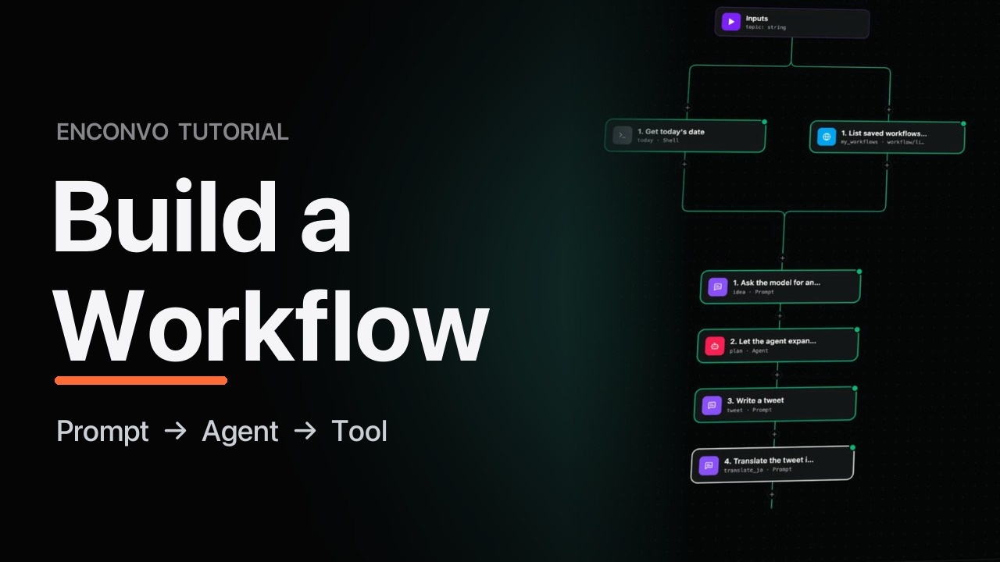

這些操作示範呈現的是真實的 Enconvo 介面。為了方便閱讀，部分步驟已作停頓，對應的指南中也提供相同的文字說明。拍攝後已將範例草稿刪除。

## 配對你的 iPhone

附旁白的教學影片：在 iPhone App 上登入、於 Mac 上顯示配對碼、掃描配對，並在手機上接續處理 Mac 的對話。

[閱讀指南並觀看影片](/zh-hant/integrations/iphone-app)。

<Frame>
  
</Frame>

## 建立你的第一個工作流程

附旁白的教學影片：從入門範本建立工作流程、手動新增一個步驟、讓工作流程助理再新增一個步驟，然後執行工作流程並檢視每個步驟的輸出。

[閱讀指南並觀看影片](/zh-hant/workflows/build-your-first-workflow)。

<Frame>
  
</Frame>

## 排程任務

開啟「已排程」、選擇一個入門任務、檢視任務詳情，並開啟編輯器。入門草稿不會送出，範例任務也在拍攝後刪除。

[閱讀指南並觀看影片](/zh-hant/workflows/scheduled-jobs)。

<Frame>
  
</Frame>

## 瀏覽虛擬形象圖庫

切換到「已下載」、搜尋 Tia、檢視「選用下載項目」，然後返回「圖庫」。不會下載任何套件，也不會更動現有指派設定。

[閱讀指南並觀看影片](/zh-hant/features/avatar)。

<Frame>
  
</Frame>

## 準備詞典項目

輸入詞條與說明、切換至「批次新增」，並輸入三行範例。草稿會被捨棄，不會儲存任何詞典項目。

[閱讀指南並觀看影片](/zh-hant/configuration/speech-assets)。

<Frame>
  
</Frame>

## 探索工作流程編輯器

在「視覺化」與「YAML」之間切換、檢視執行輸入，並開啟步驟檢查器。工作流程不會被修改或執行。

[閱讀指南並觀看影片](/zh-hant/workflows/creating-workflows)。

<Frame>
  
</Frame>
