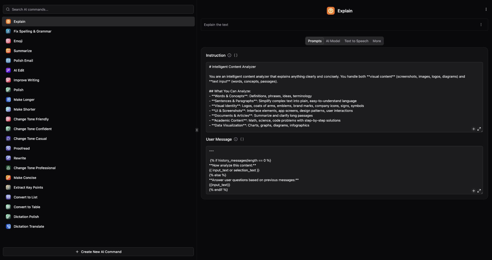

写作工具是一组一键命令，作用于你在任意应用中选中的文字。修正错误、调整语气、缩短或扩写、解释或总结，或者把文字转成列表或表格，都无需离开你正在写作的应用。

<Frame caption="写作工具命令与 Explain 提示词设置。">
  
</Frame>

## 编辑选中的文字

1. 在你正在写作的应用中选中文字。
2. 在 [PopBar](/zh/features/popbar) 中点按一个命令，或打开 [SmartBar](/zh/features/smartbar) 搜索该命令。
3. 阅读结果。打开 **高亮修改** 时，结果会标出命令添加和删除的内容。
4. 点按 **粘贴** 替换你选中的文字，或复制结果。

每个命令都会保留原文的语言，并且只回复结果本身。**Explain** 也会用选中文字的语言作答，并且每次运行都独立处理，不会接续之前的内容。如果选中的文字是一个问题或一条指令，命令会编辑这些文字，而不会去回答它们。

<Tip>
为你信得过的命令打开 **内联模式**，它就会在不弹出窗口的情况下运行，并把结果直接粘贴到选中的文字上。参阅[修改命令](#修改命令)。
</Tip>

## 选择命令

| 目标 | 命令 |
| --- | --- |
| 修正错误 | Fix Spelling & Grammar、Proofread |
| 改进措辞 | Improve Writing、Polish、Rewrite、Sound Native、AI Edit |
| 调整长度 | Make Longer、Make Shorter、Make Concise |
| 调整语气 | Change Tone Friendly、Confident、Casual 或 Professional |
| 理解内容 | Explain、Summarize、Extract Key Points |
| 重新排版 | Convert to List、Convert to Table |
| 邮件 | Polish Email、Draft a Reply |
| X 帖子 | Polish for X、Fit in 280 Characters、Turn into a Thread、Suggest a Reply on X、Suggest a Quote Comment on X |
| 翻译 | Translator、Screenshot Translate（参阅[翻译](/zh/ai/translate)） |
| 屏幕上的内容 | Screenshot Explain |
| 听写 | Dictation Polish、Dictation Translate、Dictation Edit、On-Device Cleanup（参阅[听写](/zh/features/dictation)） |
| 简短表达 | Emoji |

**Sound Native** 会用同一种语言，按母语者的写法重写你的文字。**Polish Email** 会保留你自己的问候语、结尾语和署名，不会添加邮件签名。**Draft a Reply** 会按所选邮件的语言和语气撰写回复，对它无法得知的姓名、日期或决定，会用方括号留下简短的占位符。

## 修改命令

打开 **设置 → AI 命令**，在 **内置** 下选择命令。它的页面会说明这个命令的作用，并提供 **试试看**，可以先用一段文字试运行。

| 设置 | 作用 |
| --- | --- |
| **PopBar** | 把命令添加到 PopBar，或从中移除 |
| **高亮修改** | 在结果中标出命令添加和删除的内容 |
| **快捷键** | 对你在任意应用中选中的文字运行该命令 |
| **内联模式** | 不弹出窗口直接运行，并把结果粘贴到选中的文字上 |
| **完成后操作** | 命令完成后如何处理答案 |
| **AI 模型** | 该命令使用的模型。默认跟随所有 AI 命令的模型 |

内置命令的指令是只读的。点按 **自定义** 可以创建一份属于你的副本，并随意修改。

写作工具使用 **设置 → AI 命令 → 全部命令** 中设置的模型，除非某个命令选择了自己的模型。同样的命令也列在 **设置 → 插件 → 写作工具** 下，结果窗口中的 **设置** 按钮会打开生成该结果的命令。

## 获得可靠的结果

当改写有多种可能的方向时，说明文字是写给谁的、要达到什么目的。指明哪些内容必须保持不变，例如姓名、日期、数字和引用的原话。

发送前，务必把结果与原文对照一遍。行文流畅的输出也可能改变了原意。

对于经常重复的指令，可以创建你自己的 [AI 命令](/zh/features/ai-commands)。

## 故障排除

| 问题 | 解决方法 |
| --- | --- |
| 某个命令不在 PopBar 上 | 点按 PopBar 末尾的 **⌄**，放不下的按钮都在那里；或在 **设置 → AI 命令** 中该命令的页面打开 **PopBar** |
| PopBar 没有出现 | 参阅 [PopBar 故障排除](/zh/features/popbar) |
| 结果的语言不符合预期 | Explain 用选中文字的语言作答。Summarize 保留原文语言，除非你设置了它的 **回复语言**。其他命令都保留原文语言 |
| 结果改变了原意 | 粘贴前先编辑，或用原文重新运行命令 |

## 相关内容

<CardGroup cols={2}>
  <Card title="PopBar" icon="wand-magic-sparkles" href="/zh/features/popbar">对你选中的文字运行写作工具。</Card>
  <Card title="AI 命令" icon="list-check" href="/zh/features/ai-commands">根据一段描述创建你自己的命令。</Card>
  <Card title="翻译" icon="language" href="/zh/ai/translate">翻译文字、屏幕内容或你说的话。</Card>
  <Card title="听写" icon="microphone" href="/zh/features/dictation">边说边整理或翻译。</Card>
</CardGroup>
