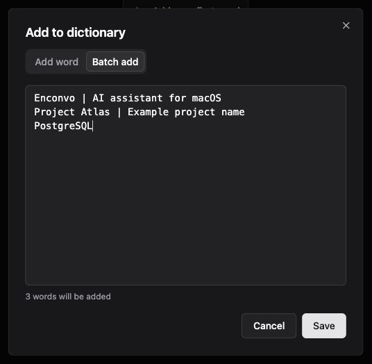

这些演示展示的是 Enconvo 的实际界面。为便于观看，步骤之间会有停顿，配套指南中也有相同的文字说明。示例草稿在录制完成后都已丢弃。

## 配对你的 iPhone

带讲解的教程：在 iPhone 应用中登录，在 Mac 上显示配对码，扫描配对码，然后在手机上继续 Mac 上的聊天。

[阅读指南并观看视频](/zh/integrations/iphone-app)。

<Frame>
  
</Frame>

## 构建你的第一个工作流

带讲解的教程：从入门模板创建工作流，手动添加一个步骤，让工作流助手再添加一个，然后运行它并查看每个步骤的输出。

[阅读指南并观看视频](/zh/workflows/build-your-first-workflow)。

<Frame>
  
</Frame>

## 安排定时任务

打开定时任务，选择一个入门任务，查看任务详情，并打开它的编辑器。入门草稿不会发送，示例任务在录制完成后已删除。

[阅读指南并观看视频](/zh/workflows/scheduled-jobs)。

<Frame>
  
</Frame>

## 浏览虚拟形象图库

切换到已下载，搜索 Tia，查看可选下载项，然后回到图库。整个过程不会下载任何资源包，也不会更改任何分配。

[阅读指南并观看视频](/zh/features/avatar)。

<Frame>
  
</Frame>

## 准备词典条目

输入一个词条和说明，切换到批量添加，并输入三行示例。草稿会被丢弃，不会保存任何词典条目。

[阅读指南并观看视频](/zh/configuration/speech-assets)。

<Frame>
  
</Frame>

## 探索工作流编辑器

在可视化和 YAML 之间切换，查看运行输入，并打开步骤检查器。工作流既不会被修改，也不会被执行。

[阅读指南并观看视频](/zh/workflows/creating-workflows)。

<Frame>
  
</Frame>
